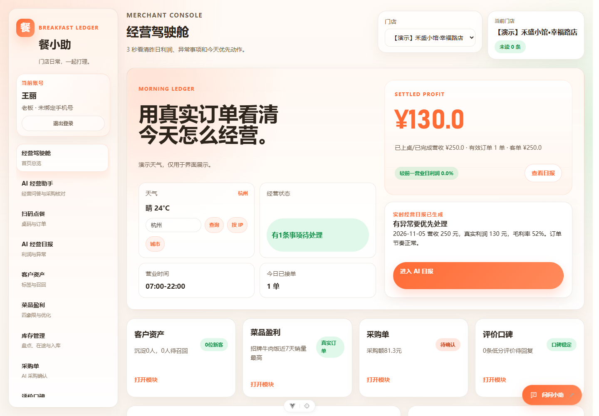
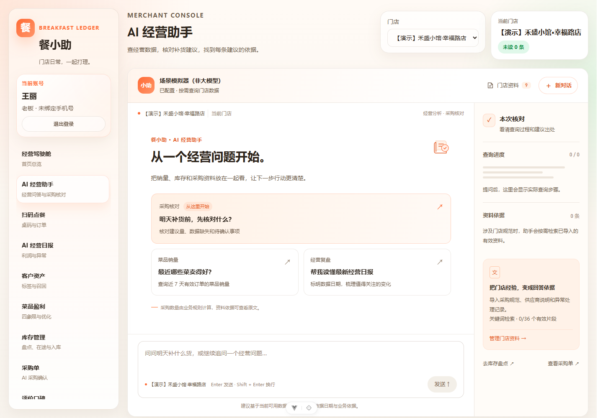
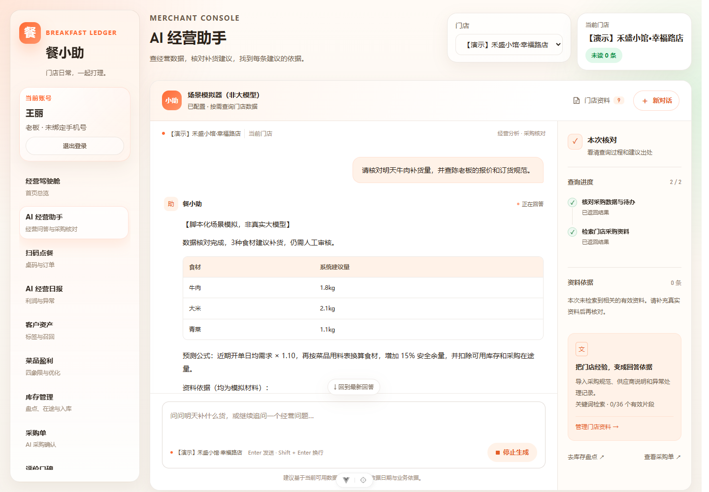
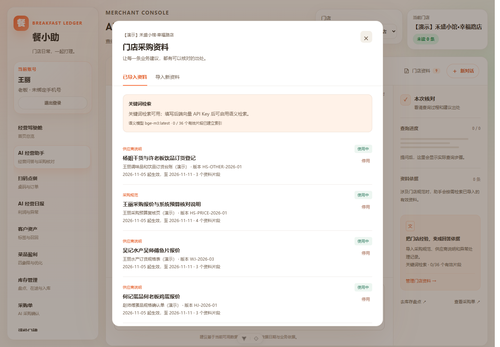
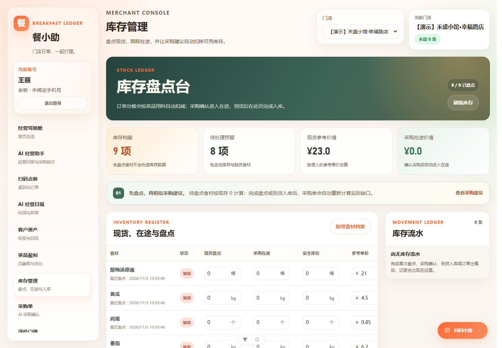
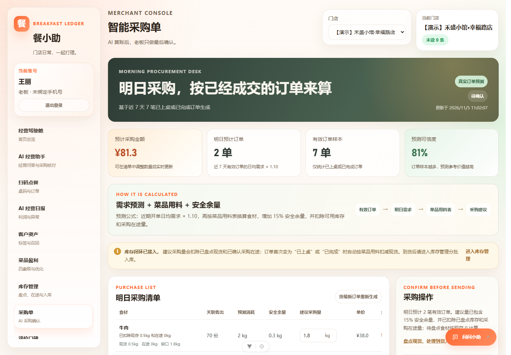
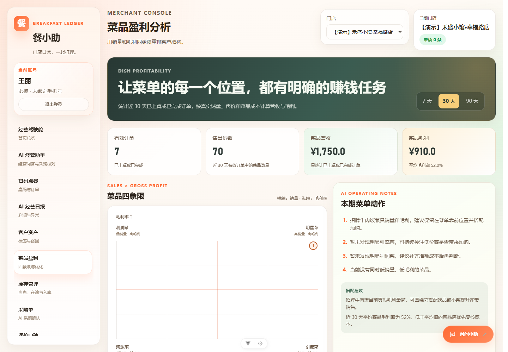
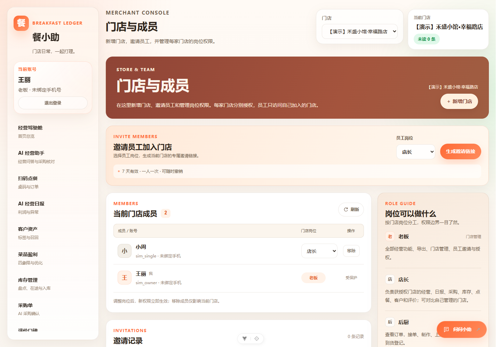
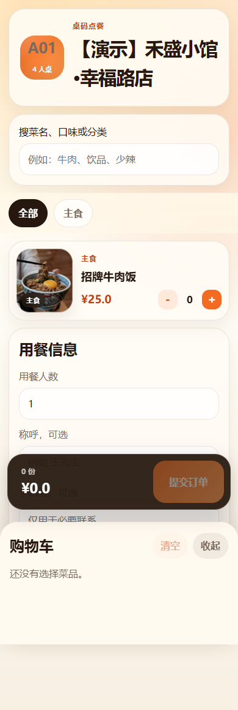
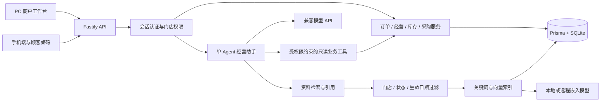

# 餐小助 · 门店经营助手

**从扫码点餐、库存采购，到有数据和资料依据的经营决策。**

Vue 3 · TypeScript · Fastify · Prisma · Single Agent · RAG

[界面预览](#界面预览) · [快速体验](#快速体验) · [图文使用指南](docs/开源使用指南.md) · [模拟场景](模拟验证/采购核对/README.md) · [MIT License](LICENSE)

餐小助面向餐饮老板、店长、后厨和收银，包含 PC 商户工作台、手机端和后端 API。系统处理日常业务；经营助手通过工具读取数据、核对采购建议，并检索门店规范和供应商材料，解释建议的依据。

截图均来自独立模拟数据库。AI 示例使用界面明确标注的脚本模拟器，展示业务与交互链路，不代表真实大模型的推理效果。

## 界面预览

### 经营驾驶舱

查看当日营收、利润、有效订单与待办，再进入日报、客户、菜品和采购模块。



### AI 经营助手

按当前门店权限查询数据。采购数量由业务规则计算，助手解释结果、提示缺失项，并展示查询过程和资料依据。



<details>
<summary><strong>查看采购核对回答与资料管理</strong></summary>

下面是脚本模拟器的实际工具调用结果，界面已标明“非大模型”。



资料库用于保存采购规范、供应商订货说明和异常记录；支持多文件导入、启用/停用、版本和生效日期。



</details>

### 库存与采购

核对现货、在途与单位，用有效销量和菜品用料生成建议，再由有权限的人员确认采购。

| 库存管理 | 采购核对 |
| --- | --- |
|  |  |

<details>
<summary><strong>查看菜品盈利、成员管理和手机点餐</strong></summary>

菜品四象限帮助比较销量与毛利。



老板管理门店和员工邀请，按门店分配岗位。



顾客通过桌码链接查看菜单、选购并下单。



</details>

## 核心功能

| 模块 | 功能 |
| --- | --- |
| 扫码点餐 | 桌码、菜单、下单、接单、制作、上桌与结单 |
| 经营与日报 | 营收、利润、有效订单、趋势、异常提示与多店对比 |
| 客户与评价 | 客户标签、跟进、召回提醒与评价管理 |
| 菜品盈利 | 销量、成本、毛利和四象限 |
| 库存与采购 | 盘点、现货与在途、采购试算、确认与到货登记 |
| 单 Agent | 工具调用、SSE 输出、经营问答、采购核对与查询过程 |
| RAG | 门店隔离、资料切片、关键词与向量混合检索、原文引用、资料启停和批量导入 |
| 门店与权限 | 注册开店、员工邀请、分店岗位、后端权限校验与操作记录 |

## 技术与结构

| 层次 | 技术 |
| --- | --- |
| 前端 | Vue 3、TypeScript、Vite、Pinia、Vue Router |
| 后端 | Node.js、Fastify、Prisma、SQLite、Swagger / OpenAPI |
| AI | DeepSeek 等兼容模型 API、单 Agent 工具循环、SSE |
| 检索 | 关键词检索、向量嵌入、混合召回、门店与时效过滤 |
| 本地嵌入 | Ollama + `bge-m3:latest`，或兼容的远程嵌入接口 |
| 部署 | Docker Compose、Nginx、环境变量配置 |



Agent 复用业务服务的统计和试算结果。确认采购、修改库存等操作仍需到业务页面按岗位权限执行。未配置嵌入服务时可使用关键词检索。

## 快速体验

需要 **Node.js 24.12+、npm**：

```bash
git clone https://github.com/lionOvO/canxiaozhu-open-source.git
cd canxiaozhu-open-source
npm --prefix backend ci
npm --prefix front-pc ci
npm --prefix front-phone ci
npm --prefix backend run prisma:generate
npm --prefix backend run demo:agent
```

打开 **http://127.0.0.1:5188/__simulation**。脚本会新建独立模拟数据库，启动后端与 PC 工作台，使用本机脚本化对话模拟器；默认未配置嵌入 Key 时使用关键词检索。可在不填写模型 Key 的情况下体验业务链路。

| 演示账号 | 密码 | 权限 |
| --- | --- | --- |
| `sim_owner` | `Simulation2026!` | 多个模拟门店的老板 |
| `sim_single` | `Simulation2026!` | 正常补货门店的店长 |

这些账号仅由独立模拟脚本创建。共 10 个场景：正常补货、未盘点、用料缺失、无成交销量、未成交订单、在途防重、库存充足、短样本与旧盘点、单位错误、资料失效与隔离。详见 [场景与预期](模拟验证/采购核对/README.md)。

## 本地开发

首次创建开发数据库时，进入 `backend` 复制模板并初始化：

```bash
cd backend
# macOS / Linux：cp .env.example .env
# PowerShell：Copy-Item .env.example .env
npm run db:push
npm run db:seed
npm run dev
```

已有数据库先备份；种子命令用于新的本地环境。另开终端分别运行：

```bash
npm --prefix front-pc run dev
npm --prefix front-phone run dev
```

| 服务 | 默认地址 |
| --- | --- |
| 后端 | http://127.0.0.1:3000 |
| API 文档 | http://127.0.0.1:3000/docs |
| PC 工作台 | http://localhost:5173 |
| 手机端 | http://localhost:5174 |

Windows 也可使用根目录的一键启动脚本。手机端顾客点餐需要有效桌码链接，可由商户点餐管理页生成。

### 真实模型与 RAG

在本机 `backend/.env` 中填写聊天模型 Key。聊天与嵌入模型分别配置；本地嵌入示例：

```env
EMBEDDING_PROVIDER=local
EMBEDDING_API_KEY=
EMBEDDING_BASE_URL=http://127.0.0.1:11434/v1
EMBEDDING_MODEL=bge-m3:latest
EMBEDDING_DIMENSIONS=1024
```

先安装 Ollama 并拉取 `bge-m3`。向量检索处理“说法不同、意思相近”的资料查询，不替代销量、库存和成本计算。详见 [图文指南](docs/开源使用指南.md)、[本地向量检索](docs/本地向量检索.md)、[RAG 资料准备](docs/RAG资料准备与经营助手使用说明.md)。

## 验证与部署

```bash
npm --prefix backend run build
npm --prefix front-pc run build
npm --prefix front-phone run build
npm --prefix backend run verify:permissions
npm --prefix backend run verify:agent:scenarios
```

最后两项使用独立验证数据。真实模型验收使用 `verify:agent:real`，需有效 Key 与额度；本地脚本模拟通过不等于真实模型验收通过。

生产运行需要后端、持久化数据库和反向代理。GitHub 负责代码托管。参考 [Docker 部署](deploy/docker/README-canteen-docker-test.md)，将示例地址、域名与配置换为自己的环境。

## 文档导航

- [图文使用指南](docs/开源使用指南.md)
- [门店成员与角色权限](docs/门店成员与权限说明.md)
- [单 Agent 实施说明](docs/单Agent实施说明.md)
- [业务场景 Agent 设计与验证](docs/业务场景Agent设计与验证.md)
- [RAG 资料准备](docs/RAG资料准备与经营助手使用说明.md)
- [模拟场景与材料](模拟验证/采购核对/README.md)
- [各模块业务流程与时序图](功能业务分析/README.md)

## 参与与许可

欢迎通过 Issue 报告问题，或通过 Pull Request 改进功能与文档，见 [贡献说明](CONTRIBUTING.md)。

原创代码采用 [MIT License](LICENSE)。第三方依赖、模型和素材保留各自许可，见 [第三方说明](THIRD_PARTY_NOTICES.md)。公开版本不包含个人简历、答辩模板、真实密钥、业务数据库或私有仓库历史。
