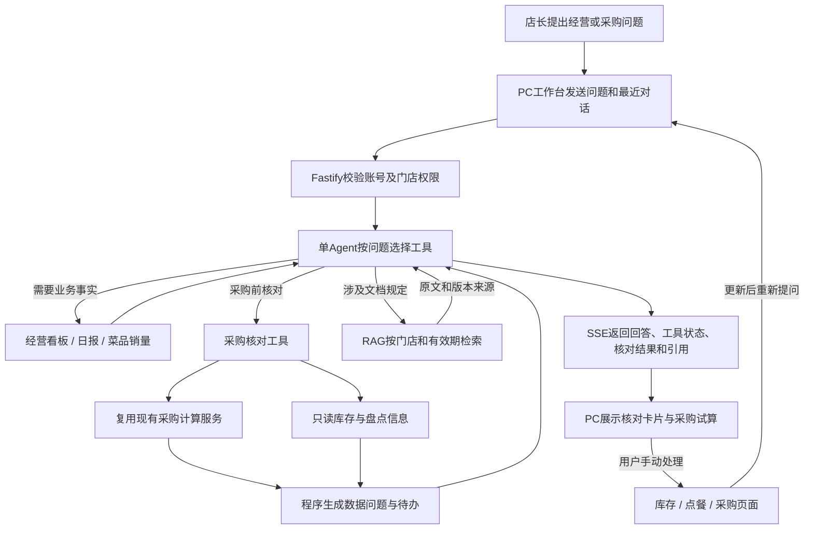
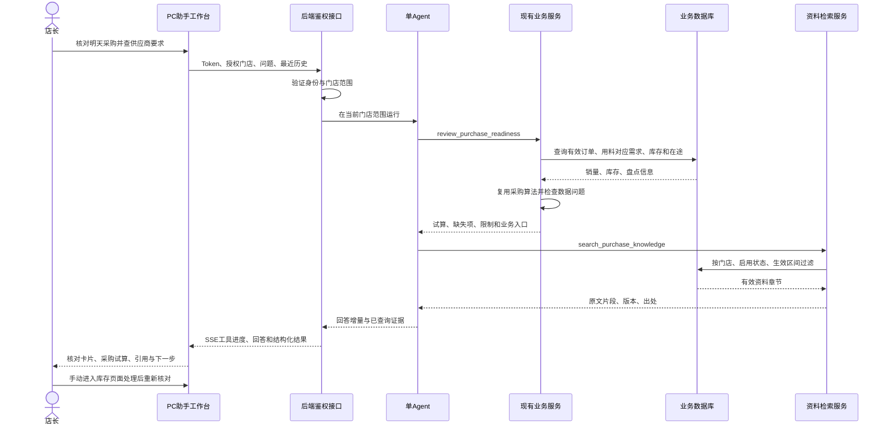

# 餐小助业务场景 Agent 设计与验证

更新：2026-10-27。实施范围是采购前的数据核对、解释和业务操作引导，保留现有经营查询能力。

## 业务目标与功能边界

店长在采购前需要判断：明天缺哪些食材、为什么建议这些数量、数据是否完整、在途是否会重复采购、还有哪些事项需要确认。

经营分析继续统计营收、利润与菜品销量；采购模块继续执行唯一的需求预测与数量计算。Agent按问题调用这些已有服务，组织核对和追问；RAG只查门店资料。助手不另建采购预测公式，不根据文本条款自行调整建议数量。

本轮新增的`review_purchase_readiness`工具复用`calculatePurchasePlan`，并读取相关库存，返回采购试算和结构化核对结果。全部工具由服务端绑定授权门店，不开放门店ID参数。

| 场景 | 工具与行为 | 结果要求 |
|---|---|---|
| 明天补什么、为什么补 | 采购核对 | 展示原始建议量、预测与安全余量、现存及在途扣减 |
| 是否可以直接下单 | 采购核对 | 先说明阻塞项和限制，不能把未盘点说成实际零库存 |
| 新品未覆盖 | 采购核对 | 列出未匹配用料的菜品及销量，要求负责人补配置 |
| 有订单但没有建议 | 采购核对 | 区分未成交状态、没有销量、缺用料与库存充足 |
| 在途是否要重复买 | 采购核对 | 展示已扣减数量，提示系统没有预计到货时间 |
| 最近经营和菜品表现 | 经营看板、日报、销量 | 标明时间与统计口径；不凭相关性断言因果 |
| 供应商截单、起订、异常流程 | 资料检索 | 仅使用当前门店有效原文，提供引用和版本 |
| 要求确认采购或修改库存 | 说明边界并引导业务页面 | 不执行写入，不声称已经下单 |

## 交互链路

## 程序检查与数据修正

- 采购计划增加历史窗口、未匹配用料菜品、排除订单状态的结构化诊断。
- 未盘点的现存暂按0参与试算，仍保留“实际库存未知”的阻塞提示；在途数量单独处理。
- 库存单位与用料单位不一致时，不扣减该库存及在途，要求先核实单位；目录初始化不再擅自改写既有库存单位。
- 在途已扣减但没有到货时间时提醒人工核实。没有批次与保质期数据时，不推断食材仍然可用。
- 历史不足7天、盘点超过7天是系统复核提醒，不是从文档推断的门店制度，也不是食品保质期判断。
- 订单时间兼容旧接口的ISO文本和数据库客户端的数值时间，统一用于经营、日报、销量与采购范围查询；不改写历史订单。

## 模拟与真实模型验收

模拟数据和材料统一保存在[模拟验证说明](../模拟验证/采购核对/README.md)。2026-10-27更新为禾盛小馆10个门店场景、7位具名供货人、13份Markdown业务材料、独立报价与资料清单、20个建议问题和15个检索评估问题。

`npm run verify:agent:scenarios`创建独立SQLite数据库，使用真实业务服务、真实账号鉴权、实际RAG检索和LangChain工具循环；模型端使用明确标识的本地脚本模拟器。它检查规则与链路，不评价真实模型理解能力。

`npm run verify:agent:real`使用同样的虚构业务数据，调用`backend/.env`当前选定的真实模型。模型质量验收要另检查：是否选择必要工具、结论数字是否与程序一致、引用是否支持结论、数据不足时是否承认、能否正确理解后续追问。

本轮本地10场景及公共约束验证通过，前后端构建通过。当前环境选中通义，真实联调返回`Arrearage`，真实模型场景验收尚未完成；未切换模型或修改密钥。DeepSeek适配保留，可在配置有效密钥后使用。

原有`verify:agent`和`verify:knowledge`继续检查工具参数、调用上限、取消、身份与门店权限、资料版本、日期、停用和引用。

## 后续迭代

先完成真实模型与店长问题验收，再将真实合同条款整理为经确认的资料。起订量、包装倍数、到货时效若要参与数量决策，应新增结构化业务配置和程序校验。采购草稿保存、审批、确认写入需要独立设计幂等、事务、权限复核和审计；当前不开放写入工具。
