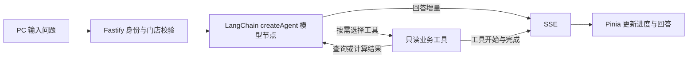

# 经营分析与采购建议单 Agent（第一阶段）

> 2026-10-27：新增采购前结构化核对、订单时间兼容修复与独立场景模拟。最新实现及验收边界见[业务场景Agent设计与验证](./业务场景Agent设计与验证.md)。下述第一阶段内容包含历史记录。

> 2026-10-26 更新：PC 已升级为独立 `/assistant` 工作台，新增 DeepSeek 配置和采购资料 RAG。当前能力、导入要求和使用步骤见 [RAG资料准备与经营助手使用说明](./RAG资料准备与经营助手使用说明.md)。下文保留第一阶段实现与历史联调记录。

依据“餐小助技术咨询”中的建议，先实现只读经营查询与采购试算，再扩展人工确认后的写入。

PC 经营助手现使用 `POST /api/v2/agent/qa/stream`（SSE）；非流式兼容入口为 `/api/v2/agent/qa`。需携带商户 Bearer Token，后端检查账号的 `assignedShopIds`。手机端尚无登录流程，暂保留原 `/voice/qa` 固定流程，未切换 Agent。



`createAgent` 底层使用 LangGraph，执行真实的模型—工具—模型循环。未单独实现自定义 StateGraph、checkpointer 或跨请求图状态恢复；多轮对话仍使用最近八条历史消息。

工具包括经营看板、指定日期日报、近 1～30 天菜品销量、库存与在途快照、明日采购试算。门店 ID 由校验后的请求绑定在工具闭包中，模型参数不包含门店 ID；额外参数、非法日期和超范围天数被拒绝。

采购试算复用原有采购算法：历史日均销量乘 1.10、按用料表换算、增加 15% 安全余量，扣除库存及在途，再按单位取整。只读分支不会初始化库存或保存采购单；缺少用料配置时标注漏算菜品，未盘点库存沿用原有“按零计算并明确提示”的保守规则，需要先盘点再确认建议。问答完成后仅保存问答日志，不改变库存或采购业务数据。

SSE 提供 `start`、`tool_start`、`tool_end`、`delta`、`done`、`error`。前端展示业务工具状态，不展示模型内部推理或原始工具数据。每次运行最多八次工具调用、图递归上限十二步、总超时九十秒；停止生成或断开连接会取消模型调用。

模型继续使用现有 `AI_PROVIDER`、Qwen/OpenAI 密钥和模型配置，必须支持 OpenAI 兼容工具调用。不支持时明确报错，不伪装成工具调用成功。

## 验证

在 `backend` 执行：

```powershell
npm run check
npm run build
npx tsx scripts/verify-business-agent.ts
# 可选：使用现有真实模型，发送门店 3001 的只读采购数据进行兼容性验证
npx tsx scripts/smoke-business-agent.ts
```

自动验证用本地模拟模型检查三次模型请求、两次工具调用、SSE 进度与文本、非法参数、门店隔离、调用上限和取消；并读取现有数据库，核对试算前后库存与采购记录一致，验证未登录返回 401、越权门店返回 403。不会重置或播种数据库。

下一阶段才接入采购确认：需要持久化具体方案、人工确认、重新校验数据与权限、幂等执行和事务，不能把现有确认方法直接开放给模型。

## 当前真实模型联调结果

2026-10-23：使用项目当前配置的模型进行采购试算问答，服务端返回 HTTP 400，错误码 `Arrearage`（账户欠费或状态异常）。本地模拟工具闭环验证与构建已通过，但真实模型成功调用尚未验证。需处理模型服务账户后，重新执行真实模型验证脚本。未修改密钥、模型账户或执行充值。
