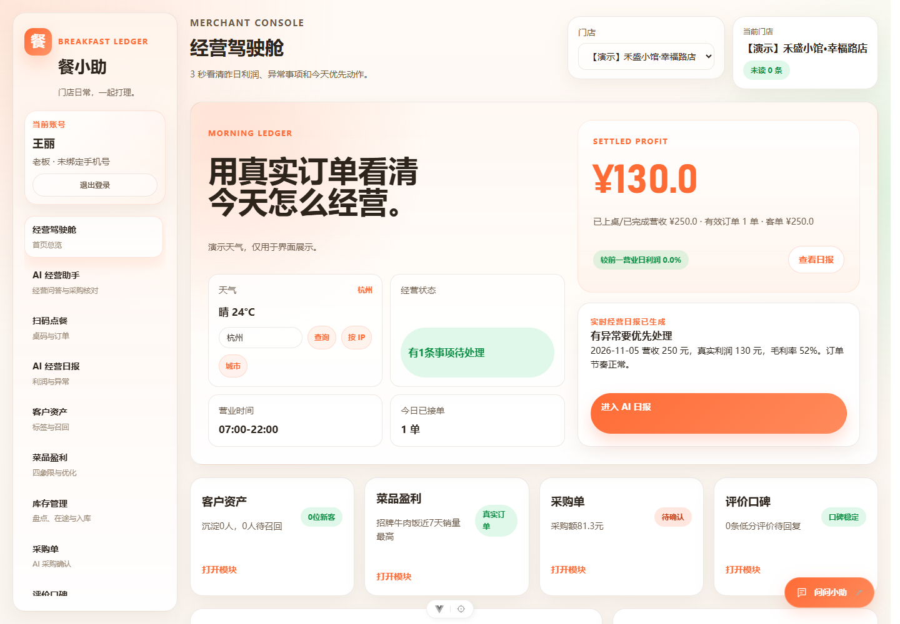
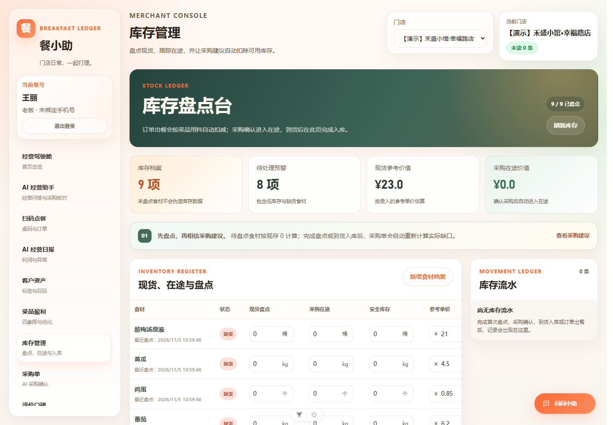
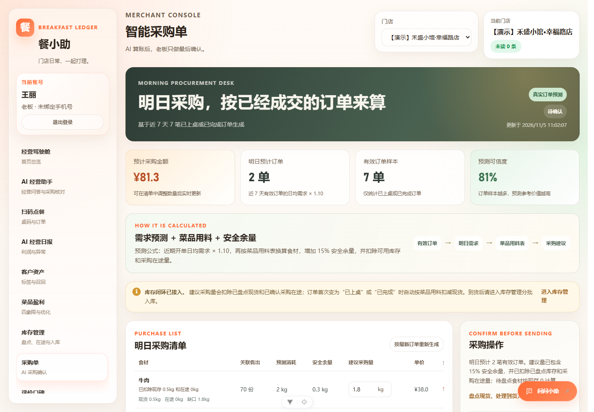
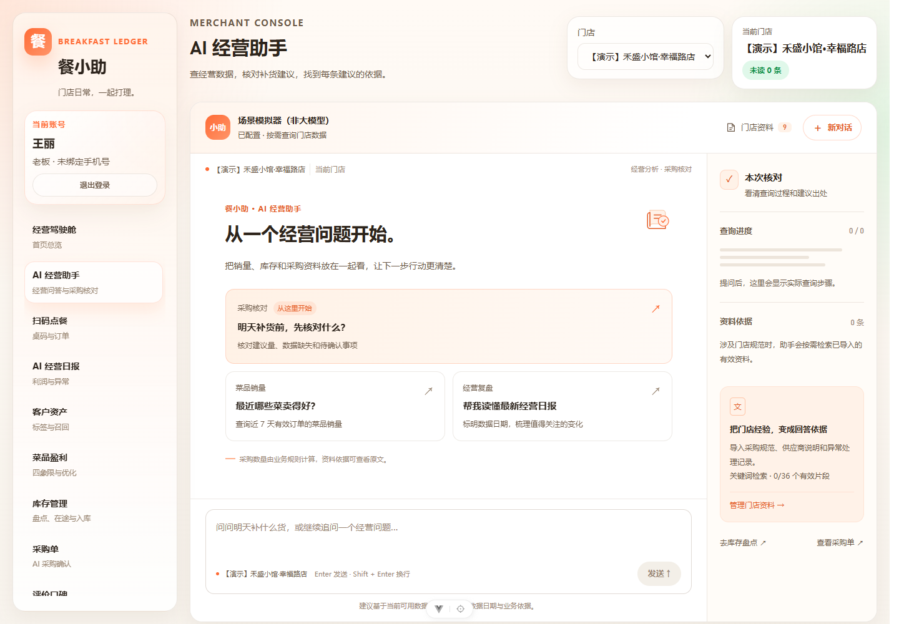
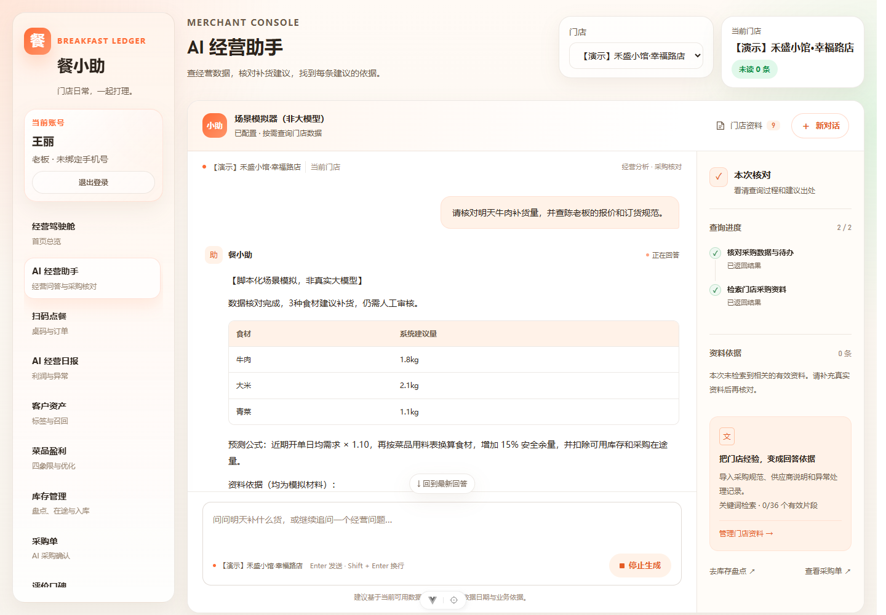
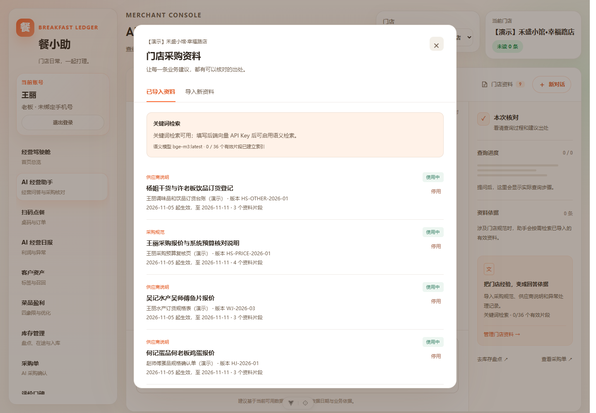
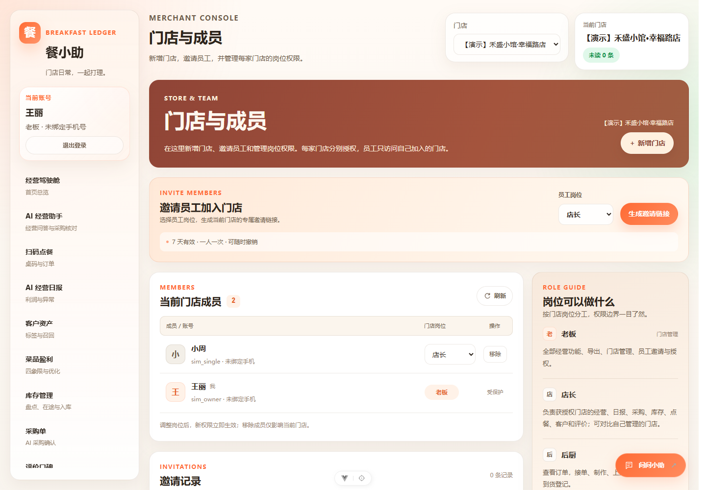
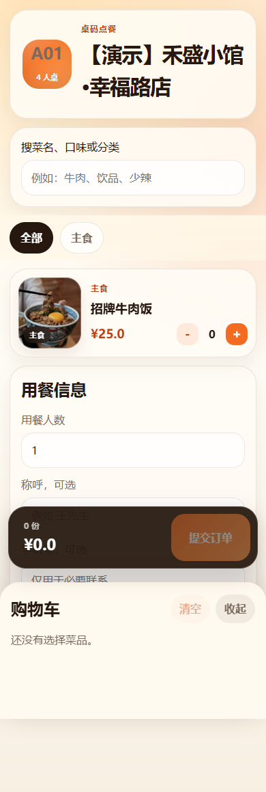

# 餐小助图文使用指南

截图来自独立模拟数据库；AI 回答使用脚本模拟器。先按根目录 README 安装依赖，执行 `npm --prefix backend run demo:agent`，打开 http://127.0.0.1:5188/__simulation。

## 1. 查看经营

进入“经营驾驶舱”查看营收、利润、订单和重点事项，再进入经营日报。订单数与菜品份数不同，核对销量时还要检查统计区间、订单状态和门店。

## 2. 盘点库存与核对采购

在库存管理中核对实际现货、单位与在途。未盘点、盘点过旧、单位不一致等情况会进入待核对项。

采购单显示业务规则生成的建议，人工核实后再确认。正常场景的牛肉饭 7 天售出 70 份，系统建议牛肉补货 1.8 kg；陈老板起订 2 kg 属于供应商条款，两者应分别展示，不能把起订量当作系统计算量。

## 3. 使用经营助手

选择快捷问题，或输入：

> 请核对明天牛肉补货量，并查陈老板的报价和订货规范。

右侧显示工具查询过程与资料依据。模拟回答明确标注“非真实大模型”，用于验证工具和业务链路。真实模型接入后，仍需核对数量、日期、工具选择、引用和缺失说明。

## 4. 导入采购资料

点击“门店资料”，在“导入新资料”中选择文件，并核对分类、版本和生效日期。

适合放入：门店采购与验收规范；供应商材料规格、单位、报价日期、起订量、截单时间与配送费；已确认的少送、缺货替换与退换处理记录。

销量、库存、在途与采购试算从业务系统查询，不需要重复复制进知识库。资料按当前门店、启用状态与日期过滤，支持批量导入及启用/停用。

嵌入模型和聊天模型独立配置。本地 `bge-m3` 帮助把“送少了怎么办”匹配到“到货短缺处理”；未配置时可使用关键词检索，界面显示当前模式。

## 5. 分配岗位

老板在“门店与成员”选中门店、生成员工邀请。邀请 7 天有效，一人一次，可以撤销。普通商户注册后成为自己门店的老板；员工通过邀请加入。

| 岗位 | 典型工作 |
| --- | --- |
| 老板 | 门店管理、经营、采购、配置、员工授权 |
| 店长 | 获授权门店的经营、采购、库存、订单、客户与评价 |
| 后厨 | 接单、制作、上桌、盘点与到货 |
| 收银 | 查看订单、收银结单、客户跟进 |

完整权限范围见 [门店成员与权限](门店成员与权限说明.md)。

## 6. 顾客扫码点餐

从商户点餐管理页生成桌码链接，顾客通过手机打开 `/order/:token` 查看菜单、选购与下单。不要使用无效 Token。

手机访问局域网服务时，将 `localhost` 换为电脑的局域网地址，并按实际环境配置代理和跨域。

## 7. 复现模拟场景

切换带“【演示】”的门店，体验正常补货、未盘点、用料缺失、无成交、未成交订单、在途防重、库存充足、旧盘点、单位错误与资料隔离。

完整问题和预期见 [采购核对场景](../模拟验证/采购核对/README.md)。模拟数据库和自动报告留在本地，不提交。
