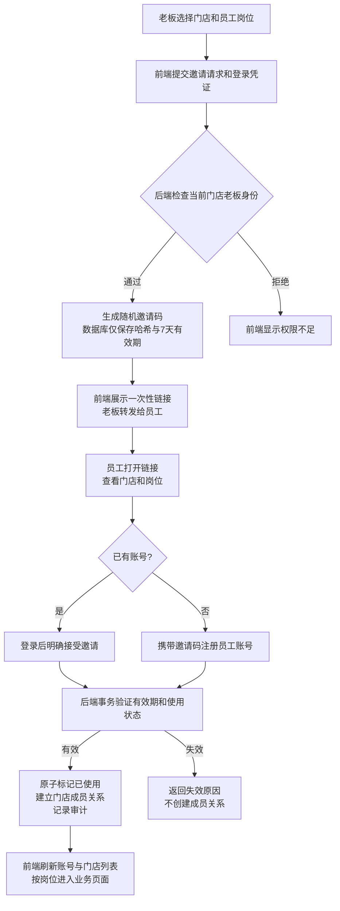
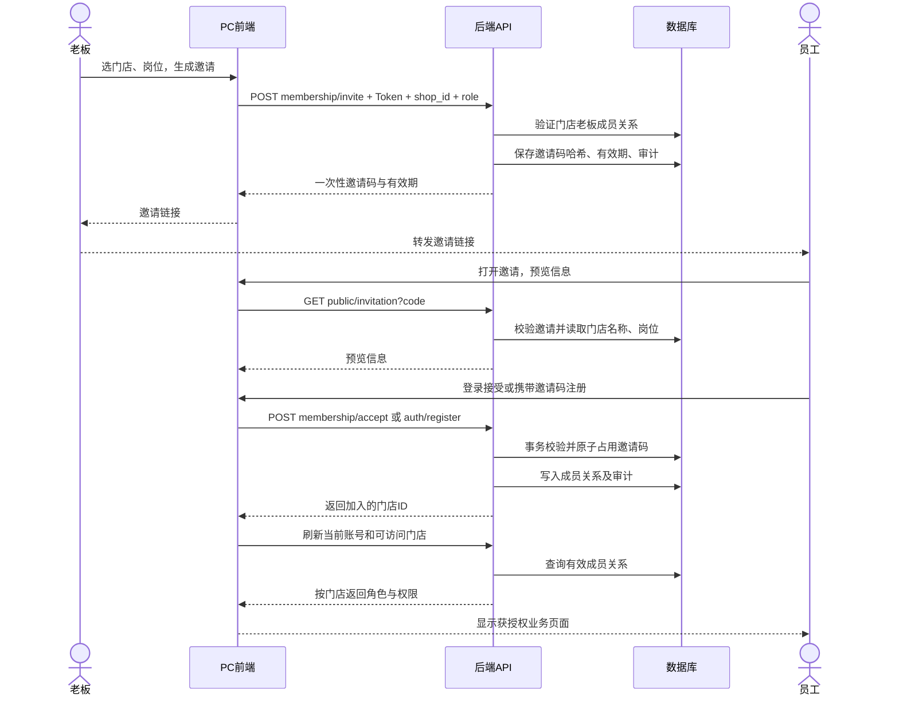

# 门店成员与权限

## 使用方式

老板登录 PC 后进入 **门店与成员**：

1. 点击“新增门店”，填写名称、城市和营业时间，创建自己的新门店。新门店没有演示菜品、订单或客户记录。
2. 先选中要授权的门店，再选择店长、后厨或收银，生成邀请链接。链接也可以展开为邀请码。
3. 员工打开链接查看门店和岗位。已有账号登录后点击加入；新员工通过“注册加入”注册，直接成为受邀门店的员工，不会另外创建门店。
4. 在成员列表调整岗位，或移除离职员工。在邀请记录中撤销尚未接受的邀请。

普通商户独立注册时，默认成为自己第一家门店的**老板**。老板与店长是不同岗位，老板也不是平台管理员。员工通过邀请加入门店，岗位不能由员工在注册时自行选择。

邀请码 7 天有效，一人使用一次，服务器只保存哈希值。完整链接仅在生成后显示，关闭后需要重新生成。建议为每位员工单独生成，不要发布到公开群组。

## 固定岗位范围

| 功能 | 老板 | 店长 | 后厨 | 收银 |
| --- | --- | --- | --- | --- |
| 点餐订单查看 | 可以 | 可以 | 可以 | 可以 |
| 接单、制作、上桌 | 可以 | 可以 | 可以 | 不可以 |
| 收银完成结单 | 可以 | 可以 | 不可以 | 可以 |
| 取消订单 | 可以 | 可以 | 不可以 | 不可以 |
| 经营总览、日报、菜品盈利 | 可以 | 可以 | 不可以 | 不可以 |
| 库存盘点、到货登记 | 可以 | 可以 | 可以 | 不可以 |
| 采购建议、确认采购 | 可以 | 可以 | 不可以 | 不可以 |
| 客户跟进 | 可以 | 可以 | 不可以 | 可以 |
| 评价管理 | 可以 | 可以 | 不可以 | 不可以 |
| 多店看板 | 自己管理的店 | 获授权担任店长的店 | 不可以 | 不可以 |
| 导出采购单、系统配置、采购资料维护 | 可以 | 不可以 | 不可以 | 不可以 |
| 新增门店、邀请、调权、移除员工 | 可以 | 不可以 | 不可以 | 不可以 |

同一个账号可以在 A 店担任店长，在 B 店担任后厨。切换门店后，页面显示的岗位、菜单及操作权限随之切换。一个人在其他门店拥有老板权限，不会因此取得当前门店的老板权限。

AI 经营助手也按门店岗位提供工具。老板和店长可以查询经营与采购数据；后厨可查询订单和库存；收银可查询订单。工具不接受模型传入的门店 ID，每次执行前重新检查账号和门店权限。旧语音经营问答只对有经营总览权限的岗位开放。

## 生效与限制

- 后端每次请求重新读取门店成员关系，旧登录不会继续保留被撤销的权限。
- 页面跳转会刷新账号权限；操作返回无权限时，页面同步更新岗位和导航。失去全部门店权限后可以继续使用原账号接受新邀请。
- 不支持通过员工邀请授予老板身份，也不能在成员管理中移除或降级老板。老板最后一家自有门店不能删除。
- 手机端商户页面需要登录；顾客的桌码点餐页面保持免登录。完整成员管理入口在 PC 端。
- 供应商和资料配置里的岗位说明不决定权限，权限以真实门店成员关系为准。

## 数据与兼容

启动时采用追加方式创建 `ShopMember`、`ShopInvitation`、`MembershipMigration`、`PermissionAudit` 四张表及索引。旧账号原来的 `assignedShopIds` 和角色仅迁移一次，后续以 `ShopMember` 为准。迁移标记防止服务重启后重新授予已经撤销的权限。

不需要新增 API Key。本功能不更换现有模型配置或业务数据库。

上线时需要同时更新后端、PC 和手机端，并提前备份 SQLite 数据库。不要通过数据库重置或重新执行演示种子来升级。此说明不代表已经发布到服务器。

## 验证

在 `backend` 目录运行：

```powershell
npm run verify:permissions
npm run check
```

权限验证只重建专用的 `backend/prisma/membership-verification.db`，不会重置业务数据库。脚本覆盖旧账号迁移、独立注册、受邀注册、跨店数据隔离、不同店不同角色、过期及撤销邀请、并发兑换、业务 ID 越权、出餐与收银、AI 工具鉴权、旧会话失权及重启后撤权保持等场景。

前端分别在 `front-pc` 和 `front-phone` 运行 `npm run build`。浏览器验收还覆盖邀请预览、员工注册入口、新建门店、门店切换、商户手机登录、顾客免登录点餐和窄屏布局。

2026-11-04 本地验收结果：17 组接口及权限验证、9 组浏览器场景通过；后端、PC 和手机端构建通过；导航异步加载及 Agent 只读工具回归通过。本地业务库升级前已备份，原有账号、门店、订单、订单明细和库存记录数量保持不变，数据库完整性及外键检查通过。

## 邀请流程




