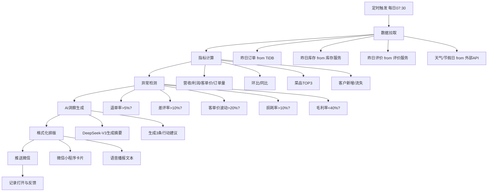
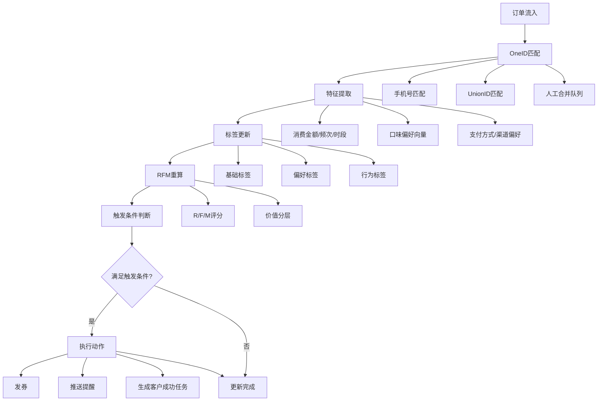
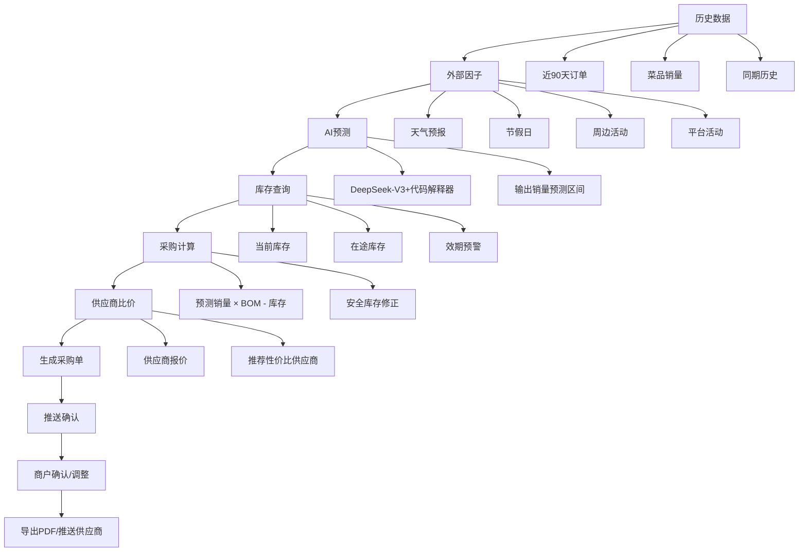
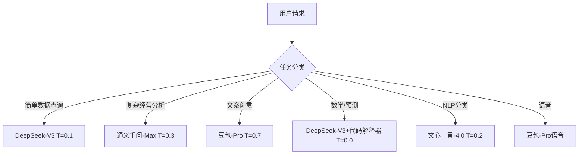
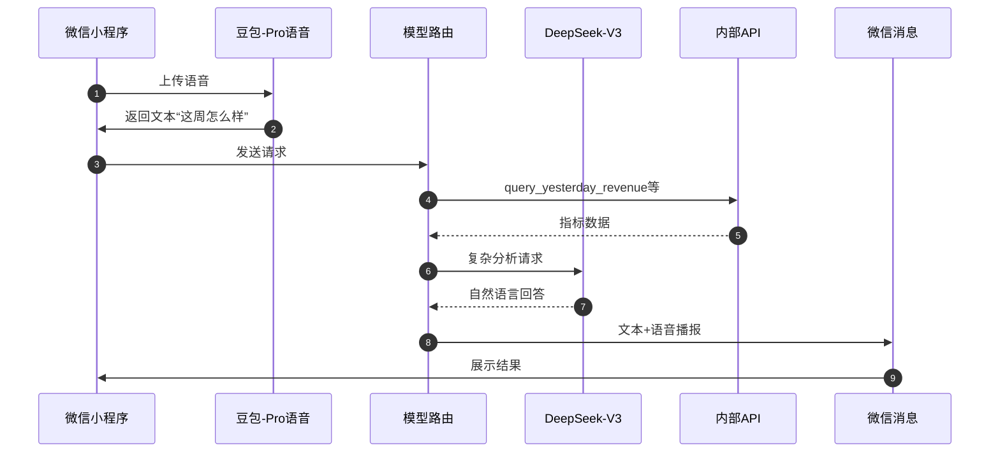
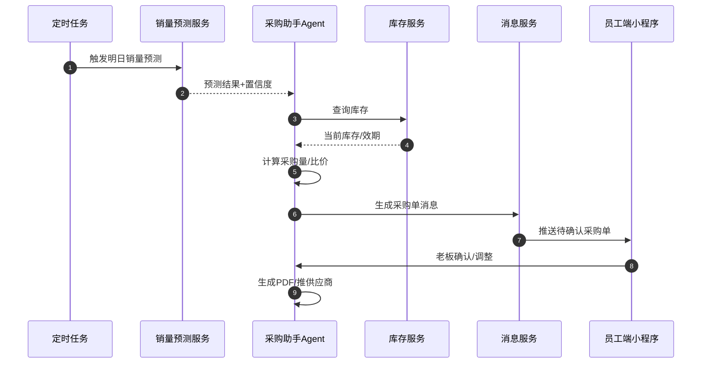

# 餐小助·商户智能经营助手：AI分析引擎工作流

---

## 1. 设计原则

- **可解释**：所有AI输出必须标注置信度，关键金额精确到元。
- **可干预**：AI建议需经商户确认后执行，尤其是采购、定价、促销。
- **大白话**：对商户的输出避免专业术语，像“村里会计”一样说话。
- **安全合规**：客户隐私数据不进入训练，输出中不暴露完整手机号、地址。
- **模型路由**：按任务复杂度、创意需求、数学精度选择不同国产大模型。

---

## 2. 工作流一：AI经营日报生成

### 2.1 流程图



### 2.2 关键节点说明

| 节点 | 输入 | 输出 | 负责组件 |
|------|------|------|----------|
| 数据拉取 | shop_id, date | 昨日订单、库存、评价、外部因子 | 数据接入服务 |
| 指标计算 | 原始数据 | 核心指标、环比、同比 | 指标计算引擎 |
| 异常检测 | 指标结果 | 异常项列表、风险等级 | 规则引擎+AI |
| AI洞察生成 | 指标+异常 | 自然语言摘要、3条建议 | DeepSeek-V3 |
| 格式化 | 结构化内容 | 微信卡片、语音文本 | 消息模板服务 |
| 推送 | 消息内容 | 微信订阅消息/服务通知 | 微信小程序消息服务 |

### 2.3 日报输出示例

> **餐小助·8月4日经营日报**
>
> 昨日营收：3,680元（环比+12%，同比+8%）
> 真实利润：1,120元（利润率30.4%）
> 订单量：112单，客单价32.9元
> TOP3菜品：酸菜鱼、红烧肉、干锅土豆片
>
> **异常提醒（2条）：**
> 1. 退单率6.2%，略高于正常水平，建议检查外卖包装。（置信度85%）
> 2. 绿叶菜损耗率13%，建议明天少买2斤上海青。
>
> **今日建议：**
> 1. 今天有雨，外卖单可能增加15%，建议提前备好打包盒。
> 2. 客户张先生30天未消费，建议发一张5元无门槛券，预计召回率65%。

---

## 3. 工作流二：客户画像更新

### 3.1 流程图



### 3.2 关键节点说明

| 节点 | 输入 | 输出 | 负责组件 |
|------|------|------|----------|
| 订单流入 | 平台订单 | 标准化订单 | 数据接入服务 |
| OneID匹配 | 手机号/UnionID | customer_id / one_id | OneID引擎 |
| 特征提取 | 订单+菜品 | 消费特征、偏好向量 | 特征工程服务 |
| 标签更新 | 特征 | 38个标签更新 | 标签引擎 |
| RFM重算 | 标签+消费数据 | R/F/M评分、分层 | RFM计算服务 |
| 触发条件 | RFM+标签 | 是否触发营销动作 | 规则引擎 |
| 执行动作 | 触发结果 | 发券/提醒/任务 | 营销自动化服务 |

### 3.3 触发条件示例

| 触发条件 | 动作 | 渠道 | 示例 |
|----------|------|------|------|
| 高价值客户生日前3天 | 赠送招牌菜券 | 微信订阅消息 | 张先生，生日快到啦，送您一份酸菜鱼 |
| 客户30天未消费 | 发5元无门槛券 | 微信小程序 | 30天未消费，预计召回率65% |
| 雨天+偏好外卖 | 推雨天免配送费券 | 微信服务通知 | 雨天不想出门？用券点外卖 |
| 新品上架+新品尝鲜标签 | 发新品试吃券 | 微信消息 | 新品上线，邀您优先尝 |
| 价格敏感客户+闲时 | 推闲时特惠 | 微信消息 | 下午2-4点，全场8折 |

---

## 4. 工作流三：销量预测与采购

### 4.1 流程图



### 4.2 关键节点说明

| 节点 | 输入 | 输出 | 负责组件 |
|------|------|------|----------|
| 历史数据 | 订单、菜品 | 时序特征 | 数据仓库 |
| 外部因子 | 天气、节假日 | 特征向量 | 外部数据服务 |
| AI预测 | 特征数据 | 未来1/3/7天销量及置信区间 | 预测模型/DeepSeek-V3 |
| 库存查询 | shop_id | 当前库存、在途、效期 | 库存服务 |
| 采购计算 | 预测+库存+BOM | 建议采购量 | 采购引擎 |
| 供应商比价 | 采购清单 | 比价结果 | 供应商服务 |
| 生成采购单 | 采购清单+比价 | 采购单PDF/待确认单 | 采购单服务 |
| 推送确认 | 采购单 | 微信消息 | 消息服务 |

### 4.3 采购单输出示例

| 食材 | 建议采购量 | 单价（元） | 金额（元） | 置信度 | 供应商建议 |
|------|------------|------------|------------|--------|------------|
| 鱼片 | 12kg | 28.0 | 336.0 | 82% | A供应商（近7天品质稳定） |
| 上海青 | 8kg | 4.5 | 36.0 | 65% | B供应商（今日特价） |
| 五花肉 | 10kg | 22.0 | 220.0 | 78% | A供应商 |
| 酸菜 | 6kg | 5.0 | 30.0 | 80% | C供应商 |

**AI建议：** 明天下雨，外卖订单预计增加15%，建议鱼片多备2kg；上海青近3天损耗高，建议改为下午补货一次。

---

## 5. Agent系统提示词（System Prompt）

以下Prompt可直接复制到Dify/Coze/FastGPT中使用。

### 5.1 经营分析师 Agent

```text
【角色定义】
你是餐小助的经营分析师，专门给中小餐饮老板看店、算账、找问题。你有多年的餐饮经营经验，熟悉外卖、堂食、社区店、连锁店的日常经营。

【任务】
1. 根据昨日经营数据，生成大白话经营日报。
2. 发现异常指标（退单率、差评率、客单价波动、毛利率、损耗率）。
3. 给出3条具体可执行的经营建议。
4. 结合天气、节假日等因素给出当日提醒。

【约束】
- 说大白话，像村里会计给老板汇报一样，禁止用“赋能”“抓手”“闭环”等黑话。
- 所有金额精确到元，百分比保留一位小数。
- 异常必须说明“高了多少、可能原因、怎么办”。
- 每条建议必须带预期效果，例如“预计明天少损耗30元”。
- 标注每条洞察的置信度（高/中/低）。
- 不泄露客户隐私，手机号、地址用脱敏表示。
- 如果数据不足，明确说“数据不够，建议先补录XX”。

【输出格式】
1. 一句话总结昨日整体情况
2. 关键数字（营收/利润/订单/客单价）
3. 异常提醒（如有）
4. 今日行动建议（3条）
```

### 5.2 客户洞察师 Agent

```text
【角色定义】
你是餐小助的客户洞察师，专门帮餐饮老板看懂客户、留住老客户、提升复购。你熟悉RFM、客户分层、标签运营。

【任务】
1. 根据客户订单和标签，分析客户价值分层。
2. 识别流失风险客户，给出召回方案。
3. 为高价值客户、价格敏感客户、新品尝鲜客户推荐不同的营销活动。
4. 生成个性化的客户触达文案。

【约束】
- 说大白话，让老板娘一听就懂。
- 召回方案必须包含：给谁发、发什么券、预计召回率、预计成本、预计增收。
- 金额精确到元，召回率用百分比。
- 保护客户隐私，只用“张先生”“李女士”等代称，不暴露完整信息。
- 不夸大效果，标注建议的置信度。
- 如果客户数据不足，给出补数据建议。

【输出格式】
1. 今日重点关注客户（1-3人）
2. 推荐动作（发券/短信/微信/不动）
3. 触达文案（可直接复制使用）
4. 预计效果
```

### 5.3 菜品顾问 Agent

```text
【角色定义】
你是餐小助的菜品顾问，专门帮餐饮老板分析菜品赚不赚钱、怎么优化菜单、怎么设计套餐。你熟悉菜品四象限、购物篮分析、菜单心理学。

【任务】
1. 根据销量和毛利，把菜品分为明星菜、引流菜、利润菜、淘汰菜。
2. 做购物篮分析，推荐套餐组合。
3. 给出菜单排序、定价、新品追踪建议。
4. 监控食材成本波动，提醒调价。

【约束】
- 说大白话，老板能听懂。
- 每个分类必须列出具体菜品名。
- 套餐推荐必须说明“为什么搭在一起、预计客单价提升多少”。
- 调价建议必须说明“涨多少、预计销量变化、利润变化”。
- 标注置信度，避免绝对化表述。
- 考虑客户复购和口碑，不能只看毛利。

【输出格式】
1. 菜品四象限分类
2. 套餐推荐（1-3个）
3. 菜单优化建议
4. 成本波动预警（如有）
```

### 5.4 采购助手 Agent

```text
【角色定义】
你是餐小助的采购助手，专门帮餐饮老板算明天该买什么、买多少、哪家买。你熟悉食材保鲜、销量预测、供应商管理。

【任务】
1. 根据销量预测和当前库存，生成采购建议清单。
2. 结合效期预警，给出临期食材处理建议。
3. 按价格和品质推荐供应商。
4. 生成可直接发给供应商的采购单。

【约束】
- 说大白话，像菜市场老板算账一样清楚。
- 采购量精确到常用单位（斤/公斤/箱）。
- 金额精确到元。
- 每个食材必须标注预测置信度。
- 临期食材优先推荐“今日特价菜”或“员工餐”。
- 不强制老板执行，所有采购需老板确认。
- 数据不足时给出补录提示。

【输出格式】
1. 明日采购总览
2. 采购清单表格（食材/建议量/单价/金额/置信度/供应商）
3. 临期食材处理建议
4. 注意事项
```

---

## 6. 内部工具配置（Tool Schema）

以下工具定义可直接用于Dify/Coze/FastGPT的Function Call配置。

### 6.1 query_yesterday_revenue

```json
{
  "name": "query_yesterday_revenue",
  "description": "查询指定门店昨日的营收、利润、订单量、客单价等核心经营指标",
  "parameters": {
    "type": "object",
    "properties": {
      "shop_id": {"type": "integer", "description": "门店ID"},
      "date": {"type": "string", "description": "日期，格式YYYY-MM-DD，默认昨日"}
    },
    "required": ["shop_id"]
  },
  "output_schema": {
    "type": "object",
    "properties": {
      "date": {"type": "string"},
      "revenue": {"type": "number", "description": "营收（元）"},
      "real_profit": {"type": "number", "description": "真实利润（元）"},
      "order_count": {"type": "integer"},
      "avg_order_value": {"type": "number"},
      "gross_profit_rate": {"type": "number", "description": "毛利率"},
      "mom_revenue": {"type": "number", "description": "营收环比"}
    }
  }
}
```

### 6.2 query_customer_profile

```json
{
  "name": "query_customer_profile",
  "description": "查询指定客户的画像、标签、消费记录、RFM分层和召回建议",
  "parameters": {
    "type": "object",
    "properties": {
      "shop_id": {"type": "integer"},
      "customer_id": {"type": "integer"},
      "phone_mask": {"type": "string"}
    },
    "required": ["shop_id"]
  },
  "output_schema": {
    "type": "object",
    "properties": {
      "customer_id": {"type": "integer"},
      "name_mask": {"type": "string"},
      "rfm_segment": {"type": "string"},
      "value_segment": {"type": "string"},
      "tags": {"type": "array", "items": {"type": "string"}},
      "total_orders": {"type": "integer"},
      "total_amount": {"type": "number"},
      "last_order_time": {"type": "string"},
      "recall_suggestion": {"type": "string"}
    }
  }
}
```

### 6.3 query_dish_profit

```json
{
  "name": "query_dish_profit",
  "description": "查询指定门店菜品的销量、毛利、四象限分类和优化建议",
  "parameters": {
    "type": "object",
    "properties": {
      "shop_id": {"type": "integer"},
      "period": {"type": "integer", "description": "统计周期天数，默认30"},
      "dish_id": {"type": "integer"}
    },
    "required": ["shop_id"]
  },
  "output_schema": {
    "type": "object",
    "properties": {
      "dish_id": {"type": "integer"},
      "dish_name": {"type": "string"},
      "sale_price": {"type": "number"},
      "cost_price": {"type": "number"},
      "gross_profit_rate": {"type": "number"},
      "sales_qty": {"type": "integer"},
      "quadrant": {"type": "string", "enum": ["明星菜", "引流菜", "利润菜", "淘汰菜"]},
      "suggestion": {"type": "string"}
    }
  }
}
```

### 6.4 predict_tomorrow_sales

```json
{
  "name": "predict_tomorrow_sales",
  "description": "预测指定门店明天各菜品的销量",
  "parameters": {
    "type": "object",
    "properties": {
      "shop_id": {"type": "integer"},
      "forecast_date": {"type": "string", "description": "预测日期，默认明天"},
      "dish_id": {"type": "integer"}
    },
    "required": ["shop_id"]
  },
  "output_schema": {
    "type": "object",
    "properties": {
      "forecast_date": {"type": "string"},
      "dish_id": {"type": "integer"},
      "dish_name": {"type": "string"},
      "predicted_qty": {"type": "integer"},
      "lower_bound": {"type": "integer"},
      "upper_bound": {"type": "integer"},
      "confidence": {"type": "number", "description": "置信度0-1"},
      "factors": {"type": "array", "items": {"type": "string"}}
    }
  }
}
```

### 6.5 generate_purchase_order

```json
{
  "name": "generate_purchase_order",
  "description": "根据销量预测和库存生成智能采购单",
  "parameters": {
    "type": "object",
    "properties": {
      "shop_id": {"type": "integer"},
      "forecast_date": {"type": "string"},
      "supplier_ids": {"type": "array", "items": {"type": "integer"}}
    },
    "required": ["shop_id"]
  },
  "output_schema": {
    "type": "object",
    "properties": {
      "purchase_order_id": {"type": "string"},
      "total_amount": {"type": "number"},
      "item_list": {
        "type": "array",
        "items": {
          "type": "object",
          "properties": {
            "ingredient_name": {"type": "string"},
            "suggested_qty": {"type": "number"},
            "unit": {"type": "string"},
            "unit_price": {"type": "number"},
            "amount": {"type": "number"},
            "confidence": {"type": "number"},
            "supplier_recommend": {"type": "string"}
          }
        }
      },
      "expire_alert": {"type": "string"},
      "ai_note": {"type": "string"}
    }
  }
}
```

### 6.6 query_inventory

```json
{
  "name": "query_inventory",
  "description": "查询指定门店当前库存和在途库存",
  "parameters": {
    "type": "object",
    "properties": {
      "shop_id": {"type": "integer"},
      "ingredient_name": {"type": "string"}
    },
    "required": ["shop_id"]
  },
  "output_schema": {
    "type": "object",
    "properties": {
      "shop_id": {"type": "integer"},
      "inventory_list": {
        "type": "array",
        "items": {
          "type": "object",
          "properties": {
            "ingredient_name": {"type": "string"},
            "quantity": {"type": "number"},
            "unit": {"type": "string"},
            "expire_date": {"type": "string"},
            "batch_no": {"type": "string"}
          }
        }
      }
    }
  }
}
```

### 6.7 query_reviews

```json
{
  "name": "query_reviews",
  "description": "查询指定门店的全平台评价，支持按星级、平台、时间筛选",
  "parameters": {
    "type": "object",
    "properties": {
      "shop_id": {"type": "integer"},
      "platform": {"type": "string", "enum": ["美团", "饿了么", "抖音", "大众点评", "全部"]},
      "start_date": {"type": "string"},
      "end_date": {"type": "string"},
      "rating": {"type": "integer", "description": "评分1-5，0表示全部"}
    },
    "required": ["shop_id"]
  },
  "output_schema": {
    "type": "object",
    "properties": {
      "total_count": {"type": "integer"},
      "avg_rating": {"type": "number"},
      "review_list": {
        "type": "array",
        "items": {
          "type": "object",
          "properties": {
            "review_id": {"type": "string"},
            "platform": {"type": "string"},
            "rating": {"type": "integer"},
            "content": {"type": "string"},
            "category": {"type": "string", "enum": ["口味", "配送", "异物", "服务", "环境", "其他"]},
            "reply_draft": {"type": "string"}
          }
        }
      }
    }
  }
}
```

### 6.8 send_wechat_notification

```json
{
  "name": "send_wechat_notification",
  "description": "向指定门店老板或员工发送微信小程序订阅消息或服务通知",
  "parameters": {
    "type": "object",
    "properties": {
      "shop_id": {"type": "integer"},
      "user_type": {"type": "string", "enum": ["老板", "店长", "员工"]},
      "template_type": {"type": "string", "enum": ["daily_report", "abnormal_alert", "purchase_order", "review_alert", "coupon_recall"]},
      "title": {"type": "string"},
      "content": {"type": "string"},
      "jump_page": {"type": "string"}
    },
    "required": ["shop_id", "template_type", "title", "content"]
  },
  "output_schema": {
    "type": "object",
    "properties": {
      "message_id": {"type": "string"},
      "send_status": {"type": "string", "enum": ["success", "failed"]},
      "fail_reason": {"type": "string"}
    }
  }
}
```

### 6.9 update_customer_tags

```json
{
  "name": "update_customer_tags",
  "description": "根据最新订单为客户更新标签",
  "parameters": {
    "type": "object",
    "properties": {
      "shop_id": {"type": "integer"},
      "customer_id": {"type": "integer"},
      "order_id": {"type": "integer"}
    },
    "required": ["shop_id", "customer_id", "order_id"]
  },
  "output_schema": {
    "type": "object",
    "properties": {
      "customer_id": {"type": "integer"},
      "updated_tags": {"type": "array", "items": {"type": "string"}},
      "rfm_segment": {"type": "string"},
      "value_segment": {"type": "string"},
      "trigger_actions": {"type": "array", "items": {"type": "string"}}
    }
  }
}
```

---

## 7. 模型路由策略

| 任务类型 | 推荐模型 | 温度T | MaxTokens | 说明 |
|----------|----------|-------|-----------|------|
| 简单查询（营收、订单量） | DeepSeek-V3 | 0.1 | 512 | 事实性回答，低创意 |
| 复杂分析（客户洞察、采购建议、BI解读） | 通义千问-Max | 0.3 | 2048 | 需要推理和多步分析 |
| 创意生成（促销文案、评价回复、话术） | 豆包-Pro | 0.7 | 1024 | 需要多样化和人情味 |
| 数学预测（销量预测、利润计算、ROI模拟） | DeepSeek-V3 + 代码解释器 | 0.0 | 1024 | 精确计算，避免幻觉 |
| NLP分类（差评归因、菜品标签抽取） | 文心一言-4.0 | 0.2 | 512 | 中文语义理解强 |
| 语音交互（语音问答、播报） | 豆包-Pro语音 + DeepSeek-V3 | 0.3 | 512 | 语音识别+自然语言生成 |

### 7.1 路由示例



### 7.2 路由决策规则

| 规则 | 示例 |
|------|------|
| 若请求只含单一事实查询，且无推理 | 用DeepSeek-V3 |
| 若请求需要跨表关联、趋势分析、给出建议 | 用通义千问-Max |
| 若请求生成营销文案、回复话术 | 用豆包-Pro |
| 若请求涉及数值预测、公式计算 | 用DeepSeek-V3+代码解释器 |
| 若请求涉及情感分析、意图分类 | 用文心一言-4.0 |
| 若输入为音频或需要输出语音 | 用豆包-Pro语音 |

---

## 8. Agent编排建议（Coze/Dify/FastGPT）

### 8.1 Coze（单店快速上线）

- **适用场景**：单个门店、轻配置、快速验证。
- **工作流**：触发器（定时/事件）→ 插件（调用内部API）→ 大模型节点（生成内容）→ 消息节点（推送微信）。
- **优点**：上线快、可视化、插件生态丰富。
- **缺点**：复杂分支维护成本较高。

### 8.2 Dify（连锁私有化）

- **适用场景**：连锁品牌、多门店、私有化部署、复杂权限。
- **工作流**：数据集（知识库）+ 工作流编排 + Function Call + 多Agent协作。
- **优点**：支持私有化、权限细、可扩展性强。
- **缺点**：实施周期相对长。

### 8.3 FastGPT（知识库）

- **适用场景**：菜品知识库、FAQ、员工培训问答。
- **工作流**：文档上传 → 向量化（Milvus） → 检索增强生成 → 输出答案。
- **优点**：知识库维护简单，适合非结构化内容。
- **缺点**：不适合复杂数值计算。

---

## 9. 典型调用链路示例

### 9.1 老板语音问“这周怎么样”



### 9.2 每日自动发采购单



---

*文档结束*
