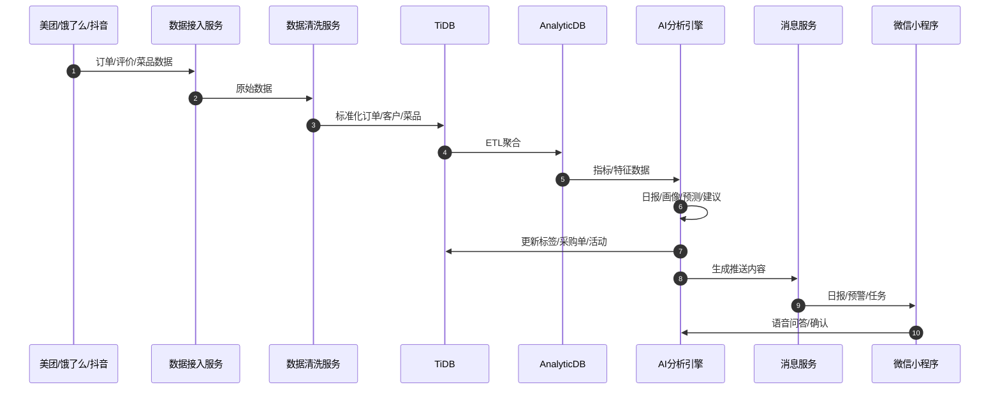
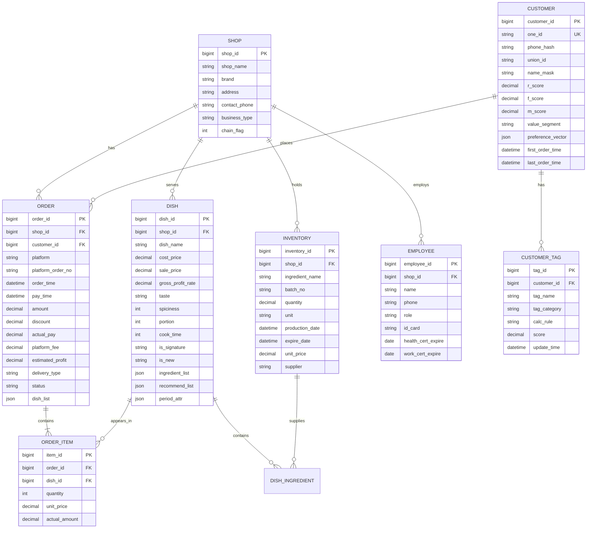

# 餐小助·商户智能经营助手 产品需求文档（PRD）V2.0

---

## 1. 文档信息

| 项目 | 内容 |
|------|------|
| 产品名称 | 餐小助·商户智能经营助手 |
| 文档版本 | V2.0 |
| 编写日期 | 2026-08-05 |
| 目标读者 | 产品经理、技术负责人、实施顾问、销售负责人、客户成功 |
| 文档状态 | 待评审 |
| 配套文件 | 《餐小助_客户数据模型与标签体系.md》《餐小助_AI分析引擎工作流.md》《餐小助_界面原型描述.md》《餐小助_销售话术与获客.md》《餐小助_实施SOP.md》 |

### 1.1 版本变更记录

| 版本 | 日期 | 修改人 | 变更内容 |
|------|------|--------|----------|
| V1.0 | 2026-07-20 | 产品部 | 初稿，覆盖8大模块框架 |
| V2.0 | 2026-08-05 | 产品部 | 细化量化价值、补充API定义、ER图、销售与实施配套材料 |

### 1.2 术语表

| 序号 | 术语 | 说明 |
|------|------|------|
| 1 | 餐小助 | 产品品牌名，面向中小餐饮商户的AI经营合伙人 |
| 2 | 数字店长 | 产品定位比喻，指AI替代传统店长完成数据汇总、决策建议、执行触达 |
| 3 | OneID | 跨平台客户统一标识，基于手机号+微信UnionID+平台ID合并生成 |
| 4 | RFM | Recency（最近消费）、Frequency（消费频次）、Monetary（消费金额）分层模型 |
| 5 | 毛利 | 菜品售价减去食材成本，未扣除平台扣点、人工、房租 |
| 6 | 真实利润 | 毛利扣除平台扣点、优惠、退款、包装耗材后的门店到手利润 |
| 7 | 损耗率 | 一定周期内废弃食材成本 / 总采购成本 × 100% |
| 8 | 复购率 | 统计周期内消费≥2次的客户数 / 总消费客户数 × 100% |
| 9 | 客单价 | 订单实付金额 / 有效订单数 |
| 10 | AI经营日报 | 每日8点自动生成的经营摘要，含关键指标、异常、建议 |
| 11 | 菜品四象限 | 以销量和毛利为轴，将菜品分为明星菜、引流菜、利润菜、淘汰菜 |
| 12 | 购物篮分析 | 分析同一订单中菜品的关联购买关系，用于套餐设计 |
| 13 | 销量预测 | 基于历史销量、天气、节假日、活动等因素预测未来销量 |
| 14 | 智能采购单 | AI根据预测销量、库存、效期自动生成的采购建议清单 |
| 15 | 效期预警 | 对临近保质期的食材批次进行预警，提示优先使用或促销 |
| 16 | 动态定价 | 根据时段、天气、库存、竞争强度等因素实时调整售价或套餐价 |
| 17 | 人效 | 单位时间内员工产出的订单数或营收额 |
| 18 | 差评归因 | 通过NLP对差评内容进行原因分类，如口味、配送、异物、服务 |
| 19 | 多店看板 | 连锁版功能，支持总部/督导查看多门店经营对比 |
| 20 | API | Application Programming Interface，应用程序接口 |

---

## 2. 产品概述

### 2.1 产品定位

餐小助不是聊天机器人，而是中小餐饮商户的“数字店长”。它通过接入美团、饿了么、抖音来客、微信支付、银豹、客如云等多渠道数据，利用DeepSeek、通义千问、文心一言、豆包等国产大模型，帮助老板自动算账、自动管客、自动控损耗、自动做促销，实现“让AI帮你盯店，你只管做好菜”。

### 2.2 核心价值主张

| 价值维度 | 具体承诺 | 量化目标 |
|----------|----------|----------|
| 省人力 | 自动汇总多渠道订单、自动对账、自动生成采购单 | 替代1.5个杂工统计工作量 |
| 省时间 | 每日经营数据自动推送，老板无需手动拉表 | 每天经营分析时间从2小时降至10分钟 |
| 省损耗 | 销量预测+效期预警+采购建议 | 损耗率从12%降至5% |
| 多赚钱 | 客户分层运营+菜品优化+智能定价 | 复购率提升20%，单店月均增收5000元 |
| 降风险 | 证件到期、差评未回、临期食材自动提醒 | 合规事故率下降80% |

### 2.3 总体目标

单店月均降本3000元以上，增收5000元以上，综合经营效率提升30%以上。

### 2.4 部署形态

- **微信小程序（老板端）**：看数据、查日报、语音问答、接收预警。
- **PC Web后台（管理端）**：复杂配置、多店看板、数据导出、知识库维护。
- **员工端小程序**：接收排班、录入库存、确认采购单、查看任务。
- **钉钉/飞书机器人**：向督导/店长推送日报与异常。

---

## 3. 用户画像

### 3.1 社区快餐店老板·老王

- **背景**：40岁，经营一家30平米的社区快餐店，主营盖浇饭、小炒。
- **日常痛点**：美团、饿了么、堂食现金订单混在一起，月底算不清真实利润；进货靠经验，绿叶菜经常剩一半倒掉；老客户来了叫不上名字，也没有任何会员系统。
- **核心诉求**：每天睁开眼睛就知道昨天赚了多少钱；告诉我今天该买什么、买多少；帮我留住回头客。
- **使用场景**：早上8点看AI经营日报；10点确认AI采购单；晚上看客户流失提醒。
- **量化价值**：每月节省采购损耗约1500元，节省对账时间约40小时。

### 3.2 连锁品牌督导·李经理

- **背景**：负责某茶饮品牌8家门店，每周巡店2次，主要关注业绩达成和异常门店。
- **日常痛点**：每家店数据格式不同，Excel汇总慢；异常门店发现晚；门店活动效果无法横向对比。
- **核心诉求**：一个看板看全部门店；自动标红异常门店；快速下发统一营销活动。
- **使用场景**：PC后台查看多店看板；根据系统建议给低业绩门店下发优惠券模板；查看各店人效对比。
- **量化价值**：巡店效率提升50%，活动统一执行时间从3天缩短到2小时。

### 3.3 夫妻店老板娘·阿芬

- **背景**：和丈夫经营一家早餐+快餐店，自己收银、进货、带娃，时间碎片化。
- **日常痛点**：不会用电脑，只会用微信；看不懂复杂报表；记不住哪些客人爱吃什么。
- **核心诉求**：像微信消息一样简单；语音问问题就能出答案；自动提醒我哪些老客户该维护了。
- **使用场景**：微信小程序语音问“这周怎么样”；一键确认AI采购单；给客户发微信优惠券。
- **量化价值**：每天节省决策时间1.5小时，老客户复购率提升25%。

### 3.4 轻食创业者·小陈

- **背景**：90后，刚创业一年，主打健康轻食外卖，对数据敏感。
- **日常痛点**：新品成功率低，不知道哪些菜品该下架；平台扣点高，真实利润薄；想建私域但没时间运营。
- **核心诉求**：菜品盈利分析、新品追踪、自动化会员运营、私域触达。
- **使用场景**：查看菜品四象限；根据购物篮分析设置套餐；给流失客户发召回券。
- **量化价值**：新品失败成本降低40%，私域复购贡献营收提升30%。

---

## 4. 市场与竞品分析

### 4.1 市场机会

中国餐饮AI市场规模已突破800亿元，但80%以上产品集中在C端客服、智能点餐等场景，真正帮助商户“管店赚钱”的B端经营智能工具稀缺。中小餐饮平均寿命仅18个月，主要死因不是口味，而是“不会算账、不会管客、不会控损耗”。

### 4.2 竞品对比

| 竞品 | 定位 | 经营分析能力 | 客户运营能力 | 库存预测能力 | 定价促销能力 | 与餐小助差异 |
|------|------|--------------|--------------|--------------|--------------|--------------|
| 美团收银 | 收银+门店管理 | 中等，侧重交易流水 | 弱，依赖美团平台会员 | 弱 | 弱 | 餐小助跨平台、AI决策更深 |
| 客如云 | 收银+供应链 | 中等，报表较全 | 中等 | 中等 | 弱 | 餐小助智能定价、AI日报更贴合中小商户 |
| 二维火 | 收银+会员 | 中等 | 中等 | 弱 | 弱 | 餐小助AI预测、多渠道对账更强 |
| 有赞餐饮 | 私域+会员 | 中等，侧重私域转化 | 强 | 弱 | 中等 | 餐小助在库存、采购、排班、口碑管理上补足 |
| **餐小助** | **AI经营合伙人** | **强，AI洞察+异常归因** | **强，OneID+分层自动化** | **强，销量预测+效期预警** | **强，动态定价+ROI预测** | **全栈AI、全渠道、量化省赚** |

### 4.3 竞争策略

1. **避开收银红海**：不与美团、客如云在收银硬件上正面竞争，专注“经营分析+智能决策”。
2. **跨平台数据整合**：商户使用多个平台接单，数据孤岛严重，餐小助的OneID和多渠道对账是核心壁垒。
3. **量化价值先行**：销售与产品设计中始终强调“每月省多少、赚多少”。
4. **轻实施、快上线**：7天上线，首月免费，降低决策门槛。

---

## 5. 功能需求清单

以下按8大模块展开，每个功能点均标注用户故事、验收标准、量化价值。

### 5.1 模块A：AI经营驾驶舱

| 功能点 | 优先级 | 用户故事 | 验收标准 | 节省价值 |
|--------|--------|----------|----------|----------|
| AI经营日报 | P0 | 作为老板，我希望每天8点收到微信经营日报，快速了解昨日营收利润和异常，以便及时调整经营策略。 | 每日8:00自动推送；内容包含营收、利润、订单量、客单价、TOP3菜品、3条异常、1条天气建议；生成时间<30秒。 | 每日节省对账与报表时间约1.5小时 |
| 多渠道自动对账 | P0 | 作为老板，我希望系统自动汇总美团、饿了么、抖音、现金等渠道订单，算出真实利润。 | 支持至少4个渠道；T+1自动对账；真实利润误差<2%；支持手动补录现金订单。 | 每月节省1.5个杂工统计工作量，约2000元 |
| 异常预警 | P0 | 作为老板，我希望系统在我退单率、差评率、客单价波动异常时及时提醒。 | 支持6类异常规则；微信消息5分钟内触达；异常归因准确率>85%。 | 避免因异常未及时处理导致的营收损失约500-2000元/月 |
| AI语音数据问答 | P1 | 作为老板娘，我希望语音问“这周怎么样”，系统直接告诉我答案。 | 支持普通话、方言识别；响应时间<3秒；答案包含关键数字和建议。 | 每日节省查询数据时间约30分钟 |
| 核心指标看板 | P0 | 作为老板，我希望小程序首页看到毛利率、客单价、复购率、损耗率。 | 4个核心指标实时更新；支持7/30/90天趋势图；指标可下钻。 | 决策响应速度提升50% |

### 5.2 模块B：AI客户资产管家

| 功能点 | 优先级 | 用户故事 | 验收标准 | 节省价值 |
|--------|--------|----------|----------|----------|
| 客户OneID打通 | P0 | 作为老板，我希望同一个客户在不同平台下单能被识别为同一个人。 | 手机号匹配率>95%；合并后客户档案统一；支持微信UnionID补充。 | 客户资产可视化，避免重复营销浪费 |
| AI自动标签体系 | P0 | 作为老板，我希望系统自动给客户打标签，不用我手动维护。 | 支持≥30个标签；标签每日自动更新；支持标签组合筛选。 | 每月节省标签维护时间约20小时 |
| 客户流失预警与召回 | P0 | 作为老板，我希望系统告诉我哪些老客户快流失了，并推荐召回方案。 | 30/60/90天未消费自动预警；召回方案含券面额、预计召回率、成本；支持一键发券。 | 复购率提升20%，月增收约2000-5000元 |
| 自动化分层运营 | P1 | 作为老板，我希望高价值客户生日自动送菜，价格敏感客户推闲时特惠。 | 支持4层客户分层；支持生日/雨天/闲时等触发条件；自动化执行率>90%。 | 营销转化率从2%提升至6%，ROI提升3倍 |

### 5.3 模块C：AI菜品盈利分析

| 功能点 | 优先级 | 用户故事 | 验收标准 | 节省价值 |
|--------|--------|----------|----------|----------|
| 菜品四象限 | P0 | 作为老板，我希望看到哪些菜是明星菜、引流菜、利润菜、淘汰菜。 | 自动按销量×毛利分类；每周更新；支持下钻查看明细。 | 菜单优化后整体毛利提升3-5个百分点 |
| 购物篮分析 | P1 | 作为老板，我希望知道哪些菜品经常被一起点，便于设计套餐。 | 关联规则支持度>5%才展示；推荐套餐并预测销量；支持一键上架。 | 套餐客单价提升15-25% |
| AI菜单优化 | P1 | 作为老板，我希望系统告诉我菜单怎么调，比如把某道菜移到第几位。 | 基于销量和毛利给出排序建议；预测调整后的销量变化；支持模拟。 | 重点菜品销量提升10-20% |
| 菜品时段分析 | P2 | 作为老板，我希望知道每道菜在早餐/午餐/晚餐的表现。 | 分时段销量、毛利、复购率展示；支持时段推荐。 | 时段菜单优化减少备货浪费 |
| 新品追踪 | P2 | 作为创业者，我希望追踪新品的销量、评价、毛利变化。 | 新品上架后自动追踪30天；生成新品健康度报告。 | 新品失败成本降低40% |
| 成本波动监控 | P1 | 作为老板，我希望食材涨价时系统提醒我调整售价。 | 食材成本变动>5%时预警；给出调价建议。 | 避免利润被食材涨价侵蚀 |

### 5.4 模块D：AI智能采购与库存

| 功能点 | 优先级 | 用户故事 | 验收标准 | 节省价值 |
|--------|--------|----------|----------|----------|
| 销量预测 | P0 | 作为老板，我希望系统预测明天每道菜能卖多少份。 | 支持未来1/3/7天预测；预测准确率>75%；考虑天气、节假日、活动。 | 减少备货不足与过量 |
| 智能采购单 | P0 | 作为老板，我希望每天收到AI推荐的采购清单。 | 根据预测销量×BOM-库存生成；支持多供应商比价；支持一键导出PDF。 | 每日节省采购决策时间1小时，损耗率从12%降至5% |
| 效期预警 | P0 | 作为老板，我希望临期食材被提醒，避免报废。 | 提前24/48/72小时分级预警；推荐处理方式（促销/调拨/报废）。 | 每月减少食材报废损失约1000-3000元 |
| 损耗归因 | P1 | 作为老板，我希望知道损耗主要来自哪些食材和原因。 | 按食材、原因、时段统计；给出改进建议。 | 针对性改进后损耗再降2-3个百分点 |

### 5.5 模块E：AI智能定价与促销

| 功能点 | 优先级 | 用户故事 | 验收标准 | 节省价值 |
|--------|--------|----------|----------|----------|
| 动态定价 | P1 | 作为老板，我希望雨天外卖自动小幅提价或调整套餐。 | 基于天气、时段、库存自动建议；每次调整需老板确认；记录调价日志。 | 雨天/高峰期毛利提升5-10% |
| AI促销方案 | P1 | 作为老板，我输入“本月想多卖5000元”，系统给我活动方案。 | 输出活动形式、门槛、预计ROI、风险；支持一键创建券。 | 活动ROI从1.5提升至3.0 |
| 优惠券分层发放 | P1 | 作为老板，我希望系统自动给不同客户发不同的券。 | 支持价格敏感/高价值/新品爱好者等分层；支持微信消息触达。 | 券核销率从10%提升至25% |
| 满减门槛智能设定 | P2 | 作为老板，我希望系统帮我算满减门槛，既吸引客户又不亏。 | 基于历史客单价分布推荐门槛；模拟不同门槛对利润的影响。 | 满减活动利润提升10% |

### 5.6 模块F：AI员工与排班

| 功能点 | 优先级 | 用户故事 | 验收标准 | 节省价值 |
|--------|--------|----------|----------|----------|
| 客流预测与排班建议 | P1 | 作为老板，我希望系统根据预测客流告诉我下周怎么排班。 | 支持未来7天排班建议；分前厅/后厨；支持员工可用时间约束。 | 人力成本降低5-10% |
| 人效分析 | P2 | 作为老板，我希望知道每个员工出餐速度和贡献。 | 统计人均订单数、出餐时长、营收贡献；支持排名。 | 优化岗位安排后高峰产能提升15% |
| 证件到期预警 | P1 | 作为老板，我希望健康证、营业执照到期前收到提醒。 | 提前30/15/7天提醒；支持上传证件照片OCR识别到期日。 | 避免因证件过期被处罚 |
| AI招聘需求预警 | P2 | 作为老板，我希望系统根据客流增长提醒我是否需要招人。 | 连续2周客流增长>20%且人效下降时提醒。 | 提前规划招聘，避免服务质量下降 |

### 5.7 模块G：AI评价与口碑

| 功能点 | 优先级 | 用户故事 | 验收标准 | 节省价值 |
|--------|--------|----------|----------|----------|
| 全平台评价聚合 | P0 | 作为老板，我希望在一个页面看到美团、饿了么、抖音、大众点评的评价。 | 支持4个平台；T+1同步；支持按星级/时间/平台筛选。 | 每日节省切换平台查看时间约30分钟 |
| 差评实时预警+归因 | P0 | 作为老板，我希望收到差评时系统立刻告诉我原因。 | 差评5分钟内预警；NLP归因准确率>85%；区分口味/配送/异物/服务。 | 差评响应时间从24小时缩短至1小时 |
| AI个性化回复 | P1 | 作为老板，我希望系统帮我写差评回复，不像是复制粘贴。 | 每条回复不同；体现歉意和整改；引导客户加微信/到店。 | 差评挽回率提升20% |
| 好评关键词提取 | P2 | 作为老板，我希望知道客户最喜欢夸我什么。 | 自动提取TOP10好评关键词；支持词云展示。 | 指导营销卖点提炼 |

### 5.8 模块H：系统管理与数据接入

| 功能点 | 优先级 | 用户故事 | 验收标准 | 节省价值 |
|--------|--------|----------|----------|----------|
| 多平台数据接入配置 | P0 | 作为实施顾问，我希望在后台配置商户的美团、饿了么等账号接入。 | 支持OAuth授权和RPA两种模式；支持接入状态监控。 | 7天内完成上线 |
| 商户后台 | P0 | 作为老板，我希望在PC后台管理门店、员工、菜品、供应商。 | 支持门店CRUD、角色权限、菜品维护、供应商管理。 | 管理效率提升 |
| 员工权限 | P0 | 作为老板，我希望给员工分配不同权限。 | 支持老板/店长/后厨/收银4种角色；权限到菜单级。 | 数据安全可控 |
| 知识库配置 | P1 | 作为老板，我希望维护菜品知识库和常见问答。 | 支持上传菜单、成本、过敏原；支持FAQ维护。 | 提升AI回答准确率 |
| 数据导出 | P1 | 作为老板，我希望导出经营报表。 | 支持Excel/PDF导出；支持按日期、门店筛选。 | 满足财务对账需求 |
| 多店切换 | P1 | 作为连锁督导，我希望在小程序和PC后台切换门店。 | 支持门店列表；支持收藏常用门店。 | 多店管理效率提升 |

---

## 6. 非功能需求

### 6.1 性能需求

| 指标 | 目标值 | 说明 |
|------|--------|------|
| 小程序首页加载 | <2秒 | 首屏4个核心指标+日报入口 |
| AI经营日报生成 | <30秒 | T+1凌晨批量生成 |
| 语音问答响应 | <3秒 | 含语音识别、指标查询、AI生成 |
| 数据同步延迟 | <15分钟 | 美团/饿了么/抖音订单同步 |
| 报表导出 | <60秒 | 单门店90天数据Excel导出 |
| 并发支持 | 1000 QPS | 高峰期同时查询 |

### 6.2 可用性需求

| 指标 | 目标值 | 说明 |
|------|--------|------|
| 系统可用性 | 99.5% | 月度累计可用时间 |
| 故障恢复时间 | <30分钟 | P0级故障 |
| 数据备份 | 每日异地备份 | 保留30天 |
| 降级方案 | 核心看板可离线缓存 | 网络异常时展示昨日数据 |

### 6.3 安全需求

| 要求 | 说明 |
|------|------|
| 数据加密 | 传输使用HTTPS/TLS1.3，敏感字段AES-256加密存储 |
| 隐私合规 | 符合《个人信息保护法》《数据安全法》；手机号脱敏展示；客户数据仅商户可见 |
| 权限控制 | RBAC模型，最小权限原则；敏感操作留痕 |
| 接口安全 | API鉴权、防重放、限流、防SQL注入 |
| 审计日志 | 记录登录、数据导出、配置变更、AI决策确认 |

### 6.4 合规需求

| 要求 | 说明 |
|------|------|
| 微信支付合规 | 遵循微信支付商户平台规则，不触碰资金流水篡改 |
| 平台接口合规 | 美团、饿了么、抖音开放协议，不违规爬取 |
| 食品安全 | 协助证件到期提醒、临期食材预警，但不替代商户主体责任 |
| AI生成内容 | 促销文案、评价回复需商户确认后发送，避免虚假宣传 |

---

## 7. 系统架构

### 7.1 总体架构图

### 7.2 核心数据流图

### 7.3 10个核心API定义

#### API-01 获取AI经营日报

| 项目 | 内容 |
|------|------|
| 接口路径 | `POST /api/v2/daily-report/get` |
| 请求参数 | `shop_id`（门店ID）、`date`（日期，默认昨日） |
| 响应字段 | `date`、`revenue`、`profit`、`order_count`、`avg_order_value`、`top_dishes`、`abnormal_items`、`weather_tip`、`ai_summary` |
| 模型路由 | DeepSeek-V3生成摘要，T=0.3 |

#### API-02 多渠道对账

| 项目 | 内容 |
|------|------|
| 接口路径 | `POST /api/v2/reconciliation/calculate` |
| 请求参数 | `shop_id`、`start_date`、`end_date` |
| 响应字段 | `channel_list`、`total_revenue`、`total_fee`、`real_profit`、`diff_amount`、`diff_reason` |
| 模型路由 | DeepSeek-V3+代码解释器 |

#### API-03 客户画像查询

| 项目 | 内容 |
|------|------|
| 接口路径 | `POST /api/v2/customer/profile` |
| 请求参数 | `customer_id`或`phone_hash` |
| 响应字段 | `one_id`、`rfm`、`tags`、`preference_vector`、`order_history`、`recall_suggestion` |
| 模型路由 | 通义千问-Max |

#### API-04 客户标签更新

| 项目 | 内容 |
|------|------|
| 接口路径 | `POST /api/v2/customer/tags/update` |
| 请求参数 | `shop_id`、`customer_id`、`order_event` |
| 响应字段 | `updated_tags`、`changed_fields`、`trigger_actions` |
| 模型路由 | DeepSeek-V3 |

#### API-05 菜品四象限分析

| 项目 | 内容 |
|------|------|
| 接口路径 | `POST /api/v2/dish/quadrant` |
| 请求参数 | `shop_id`、`period`（7/30/90天） |
| 响应字段 | `star_list`、`traffic_list`、`profit_list`、`eliminate_list`、`suggestions` |
| 模型路由 | DeepSeek-V3 |

#### API-06 销量预测

| 项目 | 内容 |
|------|------|
| 接口路径 | `POST /api/v2/forecast/sales` |
| 请求参数 | `shop_id`、`dish_id`、`forecast_days`、`weather`、`holiday_flag` |
| 响应字段 | `date`、`predicted_qty`、`confidence`、`lower_bound`、`upper_bound`、`factors` |
| 模型路由 | DeepSeek-V3+代码解释器，T=0.0 |

#### API-07 智能采购单生成

| 项目 | 内容 |
|------|------|
| 接口路径 | `POST /api/v2/purchase/order/generate` |
| 请求参数 | `shop_id`、`forecast_date`、`supplier_ids` |
| 响应字段 | `item_list`（食材/建议量/单价/金额/置信度）、`total_amount`、`expire_alert`、`supplier_comparison` |
| 模型路由 | 通义千问-Max |

#### API-08 评价聚合与归因

| 项目 | 内容 |
|------|------|
| 接口路径 | `POST /api/v2/review/aggregate` |
| 请求参数 | `shop_id`、`platform`、`start_date`、`rating` |
| 响应字段 | `review_list`、`sentiment`、`category_distribution`、`keywords`、`reply_drafts` |
| 模型路由 | 文心一言-4.0 |

#### API-09 AI促销方案生成

| 项目 | 内容 |
|------|------|
| 接口路径 | `POST /api/v2/promotion/generate` |
| 请求参数 | `shop_id`、`goal`、`budget`、`target_customers`、`period` |
| 响应字段 | `plan_name`、`strategy`、`coupon_rules`、`expected_roi`、`risk_tips`、`execution_steps` |
| 模型路由 | 豆包-Pro，T=0.7 |

#### API-10 语音数据问答

| 项目 | 内容 |
|------|------|
| 接口路径 | `POST /api/v2/voice/qa` |
| 请求参数 | `shop_id`、`audio_base64`、`question_text` |
| 响应字段 | `answer_text`、`answer_audio_url`、`referenced_metrics`、`confidence` |
| 模型路由 | 豆包-Pro语音+DeepSeek-V3 |

### 7.4 核心ER图

---

## 8. 风险评估

| 序号 | 风险类型 | 风险描述 | 发生概率 | 影响程度 | 应对方案 |
|------|----------|----------|----------|----------|----------|
| 1 | 数据接入风险 | 美团/饿了么/抖音开放平台政策变化，导致API受限或RPA失效 | 中 | 高 | 多渠道备份接入；与平台保持商务沟通；关键数据支持手动补录 |
| 2 | 数据安全风险 | 商户经营数据、客户手机号泄露，引发合规与信任危机 | 低 | 极高 | AES-256加密、脱敏展示、RBAC权限、定期安全审计、等保二级 |
| 3 | AI预测不准 | 新店数据少、突发事件（疫情/修路）导致销量预测偏差大 | 中 | 中 | 新店冷启动采用行业基准；预测结果带置信区间和人工确认；持续反馈优化 |
| 4 | 商户使用率低 | 老板习惯凭经验经营，不愿查看系统建议 | 中 | 高 | 极简小程序交互、语音问答、首月免费、客户成功每周回访 |
| 5 | 竞品低价竞争 | 美团、客如云等用免费功能挤压空间 | 高 | 中 | 差异化定位AI决策层；量化价值报告；锁定私域运营能力 |
| 6 | 实施交付周期长 | 多平台接入复杂，导致7天上线承诺无法兑现 | 中 | 中 | 标准化接入SOP、RPA兜底、远程实施+视频培训、分阶段上线 |

---

## 9. 路线图

| 阶段 | 时间 | 目标 |
|------|------|------|
| MVP | 1-2个月 | 经营日报、多渠道对账、核心指标看板、客户OneID、基础标签 |
| V1.0 | 3-4个月 | 菜品四象限、销量预测、智能采购单、效期预警、差评聚合 |
| V2.0 | 5-6个月 | 动态定价、AI促销、分层运营、AI排班、语音问答、多店看板 |
| V3.0 | 7-12个月 | 连锁私有化、供应链比价、AI外呼召回、行业垂直解决方案 |

---

## 10. 成功指标

| 指标 | 目标 |
|------|------|
| 单店月均降本 | ≥3000元 |
| 单店月均增收 | ≥5000元 |
| 商户7日活跃率 | ≥70% |
| AI日报打开率 | ≥60% |
| 采购单确认率 | ≥50% |
| 差评响应时间 | ≤1小时 |
| 客户复购率提升 | ≥20% |
| 损耗率下降 | ≥5个百分点 |

---

*文档结束*
