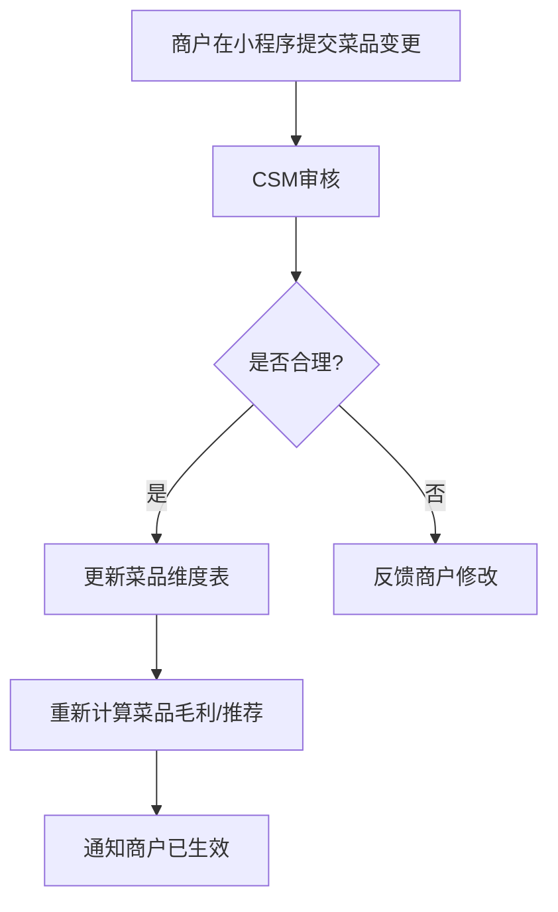

# 餐小助·商户智能经营助手：实施SOP

---

## 1. 实施总则

### 1.1 目标

- 标准化交付流程，确保每家门店**7天内上线**。
- 降低实施复杂度，让商户感受到“省心、省力、见效快”。
- 建立客户成功机制，提升7日活跃率和续约率。

### 1.2 实施团队角色

| 角色 | 职责 |
|------|------|
| 客户成功经理（CSM） | 整体统筹、客户沟通、培训、回访 |
| 实施工程师 | 数据接入、系统配置、RPA部署 |
| AI训练师 | 知识库录入、标签调优、模型冷启动 |
| 销售 | 签约转交、续费跟进 |

### 1.3 实施前置条件

- 已签署合同并收款（或首月免费已开通）。
- 商户已提供平台账号授权（美团/饿了么/抖音等）。
- 已建立专属服务群（含商户老板/店长、CSM、实施工程师）。
- 已发放《上线准备清单》。

---

## 2. 7天上线流程

### Day 1：签约+授权

| 时间 | 事项 | 负责人 | 交付物 |
|------|------|--------|--------|
| 上午 | 合同签署、收款/开通免费试用 | 销售 | 合同、发票（如需） |
| 下午 | 建立专属服务群，发送《上线准备清单》 | CSM | 服务群、准备清单 |
| 下午 | 收集商户基础信息：门店名称、地址、营业时间、菜品清单、成本价 | CSM | 《商户信息采集表》 |
| 傍晚 | 获取美团/饿了么/抖音等平台授权 | 实施工程师 | 授权状态截图 |

**关键动作**：
- 明确告知商户7天上线计划。
- 强调需要提供真实菜品成本价，否则无法计算毛利。

**常见问题**：
- 商户忘记平台密码 → 协助找回或引导重置。
- 授权失败 → 检查账号权限是否为管理员。

---

### Day 2：数据接入

| 时间 | 事项 | 负责人 | 交付物 |
|------|------|--------|--------|
| 上午 | 配置API接入或RPA采集任务 | 实施工程师 | 接入配置文档 |
| 下午 | 验证订单、菜品、评价数据是否正常拉取 | 实施工程师 | 数据校验报告 |
| 下午 | 处理异常数据：重复订单、缺失平台、金额异常 | 实施工程师 | 异常数据清单 |
| 傍晚 | 向商户确认数据完整性 | CSM | 群内反馈 |

**关键动作**：
- 至少接入最近30天历史订单，用于模型冷启动。
- 现金订单支持手动导入Excel模板。

**验收标准**：
- 订单数据完整率>95%。
- 菜品匹配率>90%。
- 无重大金额异常。

---

### Day 3：知识库

| 时间 | 事项 | 负责人 | 交付物 |
|------|------|--------|--------|
| 上午 | 录入菜品档案：名称、成本、售价、口味、食材清单、过敏原 | AI训练师 | 菜品维度表 |
| 下午 | 录入供应商信息、采购单位、常规价格 | CSM/商户 | 供应商档案 |
| 下午 | 录入门店FAQ：营业时间、配送范围、招牌菜介绍 | AI训练师 | 知识库文档 |
| 傍晚 | 配置客户标签规则、RFM评分阈值 | AI训练师 | 标签配置表 |

**关键动作**：
- 与商户逐项核对菜品成本价，确保真实。
- 确认过敏原信息，避免AI推荐出错。

**验收标准**：
- 菜品档案完整率100%。
- 成本价缺失率<5%。
- 知识库可回答Top20常见问题。

---

### Day 4：模型冷启动

| 时间 | 事项 | 负责人 | 交付物 |
|------|------|--------|--------|
| 上午 | 运行OneID匹配，合并跨平台客户 | 实施工程师 | 客户合并报告 |
| 上午 | 计算客户标签、RFM分层 | AI训练师 | 标签更新报告 |
| 下午 | 运行销量预测模型，验证预测合理性 | AI训练师 | 预测准确率报告 |
| 下午 | 生成首份测试版经营日报 | AI训练师 | 测试日报 |
| 傍晚 | 与商户核对日报内容，修正明显错误 | CSM | 日报校验记录 |

**关键动作**：
- 对新店或数据量不足的门店，启用行业基准冷启动策略。
- 标注置信度，低置信度项提醒商户重点核对。

**验收标准**：
- OneID匹配率>90%。
- 日报关键指标与商户认知误差<10%。
- 销量预测无明显离谱结果。

---

### Day 5：培训

| 时间 | 事项 | 负责人 | 交付物 |
|------|------|--------|--------|
| 上午 | 老板端小程序培训：首页、日报、客户、采购、评价 | CSM | 培训视频/图文手册 |
| 下午 | 员工端小程序培训：库存录入、采购确认、任务处理 | CSM | 员工操作手册 |
| 下午 | PC后台培训：菜品维护、供应商管理、数据导出 | CSM | 后台操作手册 |
| 傍晚 | 答疑与操作考核（至少完成3次核心操作） | CSM | 培训签到表 |

**培训要点**：
- 演示语音问答功能，降低老板娘使用门槛。
- 强调“AI是建议，最终确认由您决定”。
- 讲解如何查看置信度，避免盲目信任。

---

### Day 6：试运行

| 时间 | 事项 | 负责人 | 交付物 |
|------|------|--------|--------|
| 全天 | 系统试运行，自动推送日报、采购单、异常提醒 | 实施团队 | 试运行日志 |
| 上午 | 观察日报生成与推送是否正常 | 实施工程师 | 推送成功截图 |
| 下午 | 观察采购单生成与商户确认流程 | CSM | 确认记录 |
| 傍晚 | 收集商户反馈，修复明显问题 | 实施工程师 | 问题修复清单 |

**关键动作**：
- 主动联系商户至少3次，询问使用感受。
- 对试运行中出现的问题当日闭环。

---

### Day 7：上线

| 时间 | 事项 | 负责人 | 交付物 |
|------|------|--------|--------|
| 上午 | 正式切换为生产环境，关闭测试数据 | 实施工程师 | 上线确认单 |
| 上午 | 发送首日经营日报，确认商户收到 | CSM | 日报接收确认 |
| 下午 | 举行简短上线仪式（群内恭喜、发送操作指南） | CSM | 上线通知 |
| 下午 | 制定后续回访计划 | CSM | 回访计划表 |

**上线标准**：
- 商户能独立查看日报。
- 商户能独立确认/调整采购单。
- 商户能独立查看客户详情并理解标签含义。
- 系统无P0/P1级故障。

---

## 3. 客户成功机制

### 3.1 客户成功目标

| 指标 | 目标值 |
|------|--------|
| 7日活跃率 | ≥70% |
| 30日活跃率 | ≥60% |
| 日报打开率 | ≥60% |
| 采购单确认率 | ≥50% |
| 续约率 | ≥80% |
| NPS | ≥40 |

### 3.2 回访机制

| 时间 | 回访方式 | 内容 | 责任人 |
|------|----------|------|--------|
| 上线第3天 | 微信/电话 | 是否收到日报？是否看懂？有无问题？ | CSM |
| 上线第7天 | 微信 | 发送首周经营改善报告 | CSM |
| 每周一 | 微信群 | 推送上周经营简报，提醒查看日报 | CSM |
| 每月5日 | 电话/视频会议 | 月度复盘，输出《月度省赚报告》 | CSM |
| 每季度 | 线上分享会 | 优秀商户案例分享、新功能培训 | 客户成功部 |

### 3.3 未登录商户唤醒

| 未登录天数 | 动作 |
|------------|------|
| 3天 | 微信消息提醒，发送昨日经营摘要 |
| 7天 | 电话回访，了解是否遇到困难 |
| 15天 | 安排实施工程师远程协助 |
| 30天 | 客户成功经理上门或视频诊断 |
| 45天 | 触发流失预警，销售介入续费沟通 |

### 3.4 经营改善报告模板

**报告名称**：《餐小助·XX门店月度经营改善报告》

**内容结构**：
1. 本月核心数据（营收、利润、订单、客单价、复购率、损耗率）
2. 与上月对比（环比变化）
3. AI发现的关键问题（最多3条）
4. AI给出的优化建议（最多3条）
5. 已执行动作与效果（如已发放的券、已确认的采购单）
6. 下月目标与行动计划

---

## 4. 知识库维护

### 4.1 维护原则

- 知识库是AI回答准确率和经营建议质量的基础，必须持续维护。
- 谁提供、谁负责、谁更新。
- 每周进行一次完整性检测。

### 4.2 维护内容

| 内容类型 | 维护方式 | 频率 | 责任人 |
|----------|----------|------|--------|
| 菜品信息 | 商户小程序提交变更；CSM审核后更新 | 实时 | 商户/CSM |
| 成本价 | 商户手动更新；系统根据采购价自动修正 | 每周 | 商户/系统 |
| 供应商信息 | 商户后台维护 | 变动时 | 商户 |
| 营业时间/配送范围 | 商户后台维护 | 变动时 | 商户 |
| FAQ | CSM根据常见咨询补充 | 每周 | CSM |
| 营销话术 | 市场部定期更新 | 每月 | 市场部 |
| 差评回复模板 | AI训练师根据平台规则优化 | 每月 | AI训练师 |

### 4.3 菜品变更提交流程

### 4.4 成本价更新流程

1. 商户在后台手动录入最新成本价。
2. 系统根据最近一次采购单价自动校验，偏差>10%时提醒商户确认。
3. 成本价更新后，自动重算菜品毛利率、利润、采购建议。
4. 历史订单毛利不追溯，仅影响新订单和后续建议。

### 4.5 每周完整性检测清单

| 检查项 | 检查方式 | 正常标准 |
|--------|----------|----------|
| 菜品档案完整率 | 统计缺失成本价/食材清单的菜品 | ≥95% |
| 客户标签覆盖率 | 统计有标签客户占比 | ≥90% |
| 知识库FAQ命中率 | 抽样AI回答，判断是否引用知识库 | ≥80% |
| 供应商信息有效性 | 检查供应商是否可联系 | 100% |
| 预测准确率 | 对比预测销量与实际销量 | ≥75% |
| 异常数据量 | 统计未处理的异常订单 | 0条P0/P1 |

---

## 5. 常见问题处理SOP

### 5.1 数据接入问题

| 问题 | 原因 | 处理方案 |
|------|------|----------|
| 美团订单拉取失败 | 授权过期/账号权限不足 | 重新授权；确认账号为管理员 |
| 菜品无法匹配 | 平台菜品名与系统档案不一致 | 建立别名映射表 |
| 现金订单缺失 | 未手动录入 | 提供Excel导入模板 |
| 金额异常 | 平台优惠分摊规则差异 | 人工核对并修正分摊逻辑 |

### 5.2 AI建议问题

| 问题 | 原因 | 处理方案 |
|------|------|----------|
| 销量预测偏差大 | 新店数据少/突发事件 | 启用行业基准；人工修正；持续学习 |
| 采购单置信度低 | 历史数据波动大 | 提醒商户重点核对；增加安全库存 |
| 客户标签不准 | OneID未合并 | 人工合并客户档案 |
| 差评归因错误 | 评价语义复杂 | 人工标注，反哺模型 |

### 5.3 商户使用问题

| 问题 | 原因 | 处理方案 |
|------|------|----------|
| 老板不看日报 | 推送时间不合适/内容太多 | 调整推送时间；优化摘要 |
| 员工不确认采购单 | 操作流程不熟 | 重新培训；简化确认步骤 |
| 不会发券 | 不清楚券模板 | 提供一键发券模板 |
| 担心AI决策 | 对AI不信任 | 强调人工确认机制；展示成功案例 |

---

## 6. 实施工具包

### 6.1 必备文档

| 文档名称 | 用途 |
|----------|------|
| 《上线准备清单》 | 签约首日发给商户 |
| 《商户信息采集表》 | 收集门店、菜品、供应商信息 |
| 《平台授权指引》 | 指导商户完成美团/饿了么/抖音授权 |
| 《老板端操作手册》 | 培训老板使用小程序 |
| 《员工端操作手册》 | 培训后厨/店长 |
| 《PC后台操作手册》 | 培训管理员 |
| 《月度经营改善报告模板》 | 客户成功每月输出 |

### 6.2 必备工具

| 工具 | 用途 |
|------|------|
| 远程协助工具（向日葵/ToDesk） | 远程指导商户操作 |
| 屏幕录制工具 | 制作培训视频 |
| 数据校验脚本 | 自动检查数据完整性 |
| RPA监控面板 | 监控数据采集状态 |
| 客户成功CRM | 记录回访与问题 |

---

## 7. 实施成功标准

商户上线7天后，需同时满足以下条件才算实施成功：

1. 老板能独立查看并理解AI经营日报。
2. 至少完成过一次采购单确认或调整。
3. 至少查看过一次客户详情页或客户列表。
4. 系统无P0/P1级故障。
5. 商户对实施服务满意度≥4分（5分制）。

---

*文档结束*
