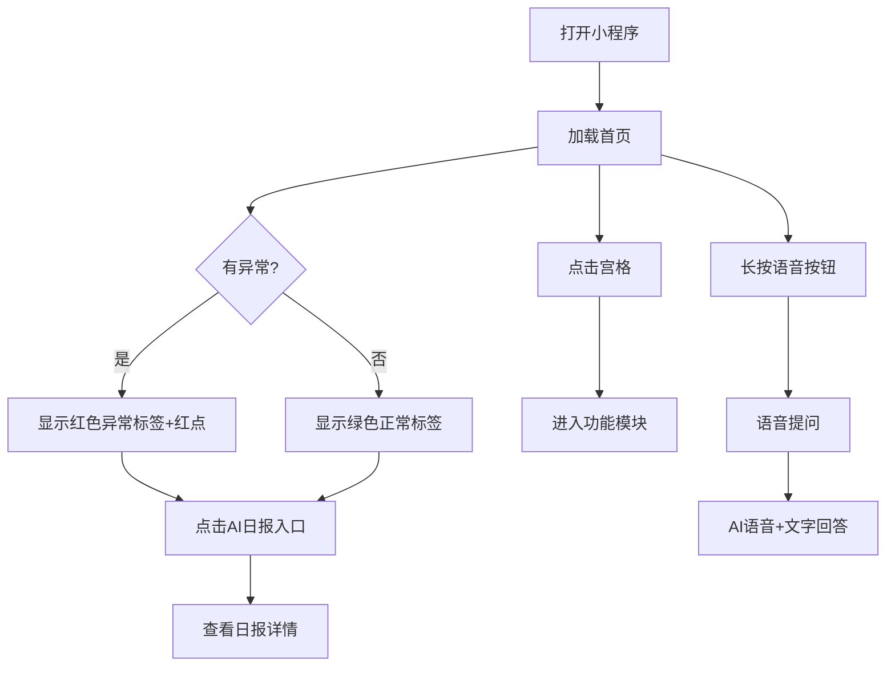
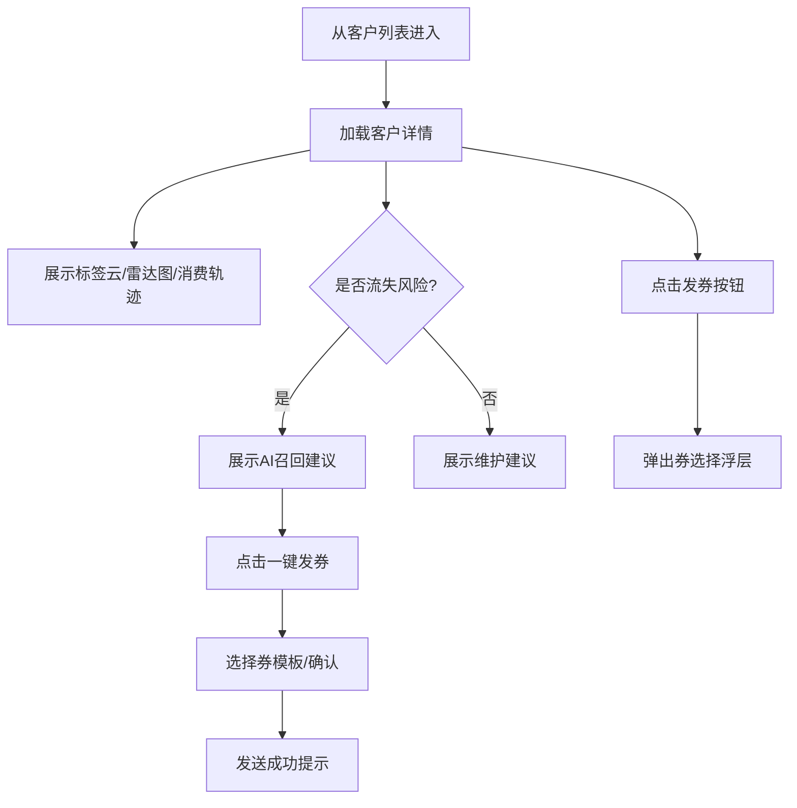
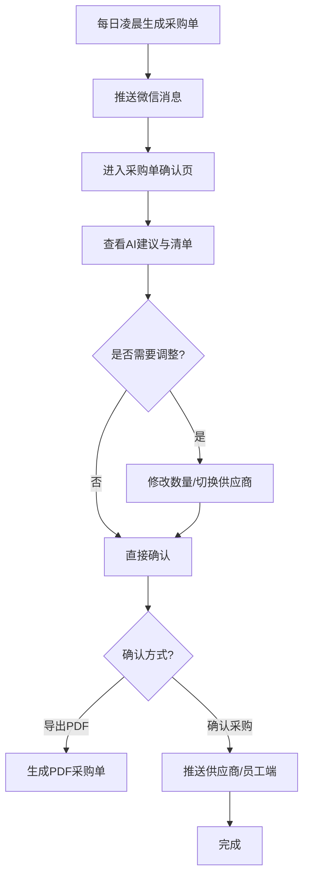

# 餐小助·商户智能经营助手：商户端界面原型描述

---

## 1. 设计总则

### 1.1 设计目标

- **一眼看懂**：老板打开小程序3秒内知道昨天赚了多少钱、有没有异常。
- **一键操作**：最常用的动作（确认采购单、发券、看日报）不超过2次点击。
- **语音优先**：老板娘不会打字也能用，核心页面保留语音入口。
- **亲和可信**：采用暖色调（橙+米白）、圆角卡片、清晰图标，降低B端工具冰冷感；可加入“餐小助”卡通IP小助手头像，增强品牌记忆。

### 1.2 色彩与字体

| 元素 | 规格 |
|------|------|
| 主色 | 活力橙 #FF6B35（用于营收数字、主要按钮） |
| 辅色 | 清新绿 #00C853（利润、正常、已完成） |
| 警示色 | 警示红 #FF3D00（异常、待处理、临期） |
| 背景色 | 暖灰白 #F7F8FA |
| 卡片色 | 纯白 #FFFFFF |
| 主文字 | 深灰 #1A1A1A，16-18px，PingFang SC / 思源黑体 |
| 数字 | DIN Alternate / Roboto，加粗，突出 |
| 标签文字 | 12-13px，中灰 #666666 |

### 1.3 通用交互

- 所有卡片可点击下钻；数字模块支持“长按复制”。
- 异常项带红色角标，点击后弹出详情与处理建议。
- 页面下拉刷新，上拉加载更多（列表类页面）。
- 关键操作（如发券、确认采购）需二次确认弹窗。

---

## 2. 页面一：小程序首页

### 2.1 页面定位

首页是老板每天打开次数最高的页面，承担“经营状态总览+快捷入口+异常提醒”的核心职责。目标是让老板一眼看清“昨天赚了多少钱、今天有没有事、该点哪里”。

### 2.2 页面结构（自上而下）

#### 2.2.1 顶部状态栏（固定高度 120rpx）

- **左侧**：门店名称，如“老王快餐（幸福路店）”，右侧小箭头可切换门店（连锁版）。
- **右侧**：消息中心图标，带红点数字，显示未读异常/任务数。
- **背景**：浅橙色渐变，营造清晨看店的氛围。

#### 2.2.2 天气与经营状态区（高度 180rpx）

- **左侧天气卡片**：显示今日天气图标（晴/雨/阴）、温度、简短提示，如“今天有雨，外卖预计多15%”。
- **右侧经营状态标签**：
  - 正常：绿色标签“今日经营正常”。
  - 异常：红色标签“有2条异常待处理”，点击跳转日报详情。
- **底部小字**：营业时间、今日已接单量（实时）。

#### 2.2.3 昨日营收大数字区（高度 240rpx，视觉焦点）

- **主数字**：昨日真实利润，用最大号字体（48px，橙色），如“¥1,120”。
- **副数字**：昨日营收、订单量、客单价，横向排列：
  - 营收 ¥3,680（环比+12%）
  - 订单 112单
  - 客单 ¥32.9
- **环比趋势**：利润右侧小箭头与百分比，绿色表示增长，红色表示下降。
- **交互**：点击该区域进入“经营日报详情页”。

#### 2.2.4 AI日报入口（高度 140rpx）

- **卡片样式**：左侧“餐小助”头像，中间文字“AI经营日报已生成”，右侧红色圆点提示有异常。
- **内容摘要**：一行核心结论，如“昨天利润正常，但绿叶菜损耗偏高”。
- **红点逻辑**：有异常时显示红点；无异常时显示蓝色小点“今日已推送”。
- **交互**：点击进入日报详情页，支持语音播报。

#### 2.2.5 快捷功能4宫格（高度 320rpx）

四宫格布局，每个格子96×96rpx图标+两行文字：

| 宫格 | 图标 | 标题 | 副标题/状态 |
|------|------|------|-------------|
| 左上 | 客户 | 客户资产 | 本月新增23人，3人待召回 |
| 右上 | 菜品 | 菜品盈利 | 1道淘汰菜建议下架 |
| 左下 | 采购 | 采购单 | 今日待确认 |
| 右下 | 评价 | 评价口碑 | 1条差评待回复 |

- **状态提示**：宫格右上角可带小红点或状态标签，如“待确认”“1条新”。
- **交互**：点击进入对应功能模块首页。

#### 2.2.6 核心指标趋势卡（高度 280rpx）

- 标题“近7天核心指标”。
- 顶部Tab切换：毛利率 / 客单价 / 复购率 / 损耗率。
- 下方折线图展示7天趋势，异常点用红点标注。
- 底部一行AI解读：“毛利率连续3天稳定在55%，建议保持当前套餐结构。”

#### 2.2.7 今日待办列表（高度自适应）

- 标题“今日待办”。
- 列表项示例：
  1. 【采购】今日采购单待确认（置信度82%）
  2. 【客户】张先生30天未消费，建议发5元券
  3. 【库存】上海青2kg将在24小时后过期，建议做今日特价
  4. 【评价】美团1条差评待回复，已生成回复草稿
- 每个待办右侧有“去处理”按钮。

#### 2.2.8 AI语音悬浮按钮

- **位置**：页面右下角，距底边120rpx，距右边40rpx。
- **样式**：圆形橙色按钮，带麦克风图标，外围有轻微呼吸动画。
- **交互**：
  - 单击：进入语音输入状态，底部弹出语音条。
  - 长按：直接录音，松开后AI回答。
- **示例问答**：老板问“这周怎么样”，系统语音+文字回答。

### 2.3 页面交互流程

### 2.4 量化价值

- 老板每天打开1次首页，可在10秒内掌握昨日利润，节省传统对账时间约1小时/天。
- 异常红点提醒使问题响应时间从平均1天缩短至2小时内。

---

## 3. 页面二：客户详情页

### 3.1 页面定位

客户详情页帮助老板/老板娘认识每一位重要客户，从“茫茫人海”变成“张先生的故事”。支持客户分层、标签管理、消费轨迹、AI召回建议，让商户把平台客人变成自己的老客。

### 3.2 页面结构

#### 3.2.1 顶部客户信息卡（高度 260rpx）

- **左侧头像**：默认用姓氏头像（如“张”），若绑定微信则显示微信头像。
- **客户等级**：头像下方显示会员等级徽章，如“银卡会员”“高价值客户”。
- **右侧信息**：
  - 客户名称：张先生（138****5678）
  - RFM分层：重要价值客
  - 状态标签：活跃 / 30天未消费 / 流失风险
- **快捷操作**：右上角“发券”按钮，点击弹出券模板选择。

#### 3.2.2 消费数据概览（高度 180rpx）

横向4个数据块：

| 数据块 | 数值 | 说明 |
|--------|------|------|
| 累计消费 | ¥3,260 | 到店总消费 |
| 累计订单 | 48单 | 有效订单数 |
| 平均客单 | ¥67.9 | 高于门店均值 |
| 最近消费 | 32天前 | 提醒流失风险 |

#### 3.2.3 偏好标签云（高度 200rpx）

- 标题“客户偏好”。
- 标签以胶囊形式展示，颜色按类别区分：
  - 基础标签（蓝色）：男性客户、会员客户
  - 偏好标签（橙色）：晚餐常客、爱吃辣、外卖党
  - 行为标签（绿色）：雨天点外卖、新品尝鲜
  - 价值标签（紫色）：高价值客户、流失风险客户
- 标签可点击，点击后显示该标签的定义和计算依据。

#### 3.2.4 口味偏好雷达图（高度 240rpx）

- 用雷达图展示“辣/甜/清淡/咸鲜/酸”五个维度偏好。
- 下方文字总结：“张先生偏好中辣、偏咸鲜，不爱甜口。”
- 若存在过敏原，用红色文字提示：“忌口：花生、海鲜”。

#### 3.2.5 消费轨迹时间轴（高度自适应）

- 标题“消费轨迹”。
- 时间轴展示最近10笔订单：
  - 时间：2026-08-04 18:45
  - 平台：美团
  - 菜品：酸菜鱼+干锅土豆片
  - 金额：¥68.0
  - 评价：⭐⭐⭐⭐⭐
- 点击单笔订单可下钻到订单详情。

#### 3.2.6 AI召回建议区（高度 220rpx）

- 背景：浅橙色卡片，突出显示。
- 内容示例：
  > **AI召回建议**
  >
  > 张先生已30天未消费，历史客单价68元，偏好酸菜鱼和辣味。
  > 建议发放一张“满50减5元”无门槛券，预计召回率65%，预计成本5元，预计增收44元。
- **操作按钮**：
  - 左侧灰色按钮“再看看”（关闭建议）
  - 右侧橙色按钮“一键发券”（确认后发送）
- **置信度**：卡片右下角小字“置信度：中”。

#### 3.2.7 客户备注与手动标签（高度 160rpx）

- 支持老板娘手动添加备注，如“每次来都带孩子”“不吃香菜”。
- 支持手动打标签，标签从预设标签库选择。

### 3.3 页面交互流程

### 3.4 量化价值

- 通过客户详情页，老板娘可在30秒内了解一个老客户，制定个性化维护策略。
- AI召回建议使复购率从平均15%提升至25%以上，单客户年增收约200-500元。

---

## 4. 页面三：采购单确认页

### 4.1 页面定位

采购单确认页是AI智能采购与库存模块的核心落地页。系统每天生成采购建议，老板/后厨在此确认、调整、导出，实现“AI算账、老板拍板”。

### 4.2 页面结构

#### 4.2.1 顶部采购单信息（高度 160rpx）

- **标题**：明日采购单（2026-08-06）
- **副标题**：基于过去90天销量+天气预报生成
- **总金额**：¥1,250.0（橙色大字）
- **状态标签**：待确认 / 已确认 / 已导出

#### 4.2.2 AI采购建议摘要（高度 140rpx）

- 卡片背景：浅绿色。
- 内容示例：
  > 明日预计订单128单，较今日增加14%。雨天外卖增加，建议鱼片多备2kg；绿叶菜损耗高，建议分两次采购。
- 右侧显示“置信度 82%”。

#### 4.2.3 临期预警区（如有，高度 120rpx）

- 背景：浅红色。
- 内容示例：
  > 上海青2kg将在24小时后过期，建议今日做特价菜或员工餐。
- 操作按钮：“设为特价菜”。

#### 4.2.4 AI采购清单表格（主体区域）

表格列：

| 食材 | 建议量 | 单位 | 单价 | 金额 | 置信度 | 供应商建议 | 操作 |
|------|--------|------|------|------|--------|------------|------|
| 鱼片 | 14 | kg | ¥28.0 | ¥392.0 | 82% | A供应商 | 调整 |
| 上海青 | 8 | kg | ¥4.5 | ¥36.0 | 65% | B供应商 | 调整 |
| 五花肉 | 10 | kg | ¥22.0 | ¥220.0 | 78% | A供应商 | 调整 |
| 酸菜 | 6 | kg | ¥5.0 | ¥30.0 | 80% | C供应商 | 调整 |
| 大米 | 25 | kg | ¥3.5 | ¥87.5 | 90% | A供应商 | 调整 |

- **行交互**：
  - 左滑：删除该行。
  - 点击“调整”：弹出数字输入框，可修改建议量，系统实时重算金额。
- **置信度颜色**：
  - ≥80%：绿色
  - 60%-79%：橙色
  - <60%：红色（建议人工重点核对）

#### 4.2.5 供应商比价提示（高度 160rpx）

- 标题“供应商比价”。
- 展示系统推荐供应商及理由：
  - A供应商：鱼片、五花肉品质稳定，近7天退货率0%
  - B供应商：上海青今日特价，单价低0.5元/kg
- 支持切换供应商，切换后金额联动更新。

#### 4.2.6 底部操作栏（固定底部，高度 120rpx）

- **左侧**：
  - “重置为AI建议”按钮（灰色线框），点击后恢复系统推荐。
- **右侧**：
  - “一键导出PDF”按钮（白色底、橙色字），生成PDF采购单。
  - “确认采购单”按钮（橙色底、白色字），确认后推送至供应商或员工端。

#### 4.2.7 确认后状态

- 显示“已确认”，按钮变为“查看PDF”“再次调整”。
- 推送消息至员工端小程序和钉钉/飞书群（如配置）。

### 4.3 页面交互流程

### 4.4 量化价值

- 采购单确认页将传统采购决策时间从每天1-2小时缩短至5-10分钟。
- 通过销量预测和效期预警，预计损耗率从12%降至5%，单店每月节省食材成本约1500-3000元。

---

## 5. 其他关键页面简述

### 5.1 AI经营日报详情页

- 顶部日期切换器。
- 四大核心指标卡片。
- 营收/利润趋势图。
- 异常项列表（带原因分析与建议）。
- TOP3菜品与客户新增/流失。
- 底部“语音播报”按钮。

### 5.2 菜品四象限页

- 2×2矩阵图，横轴销量、纵轴毛利。
- 每个象限列出菜品，支持点击下钻。
- 底部AI优化建议：套餐推荐、淘汰菜提醒、菜单排序建议。

### 5.3 评价管理页

- 顶部平台筛选（美团/饿了么/抖音/大众点评/全部）。
- 评价列表：星级、内容、平台、时间、AI归因标签。
- 差评高亮显示，右侧“AI回复”按钮生成回复草稿。
- 支持一键复制回复或跳转平台回复。

### 5.4 多店看板页（连锁版）

- 顶部门店筛选与对比开关。
- 横向门店业绩排名。
- 异常门店红色标红。
- 支持下发统一活动、统一采购模板。

---

## 6. 原型交付建议

1. **低保真阶段**：使用Axure/Figma绘制线框图，确认信息架构与交互流程。
2. **高保真阶段**：输出视觉稿，重点打磨首页营收大数字、客户详情召回建议卡、采购单表格。
3. **走查清单**：
   - 首页3秒内能否看出昨日利润？
   - 客户详情页能否直接发券？
   - 采购单调整是否方便？
   - 语音按钮是否始终可触达？
4. **开发标注**：提供切图、间距、字号、颜色Token，确保前端还原。

---

*文档结束*
