# 餐小助项目技术文档：从扫码点餐到 AI 经营分析的完整实现

## 1. 项目概述

### 1.1 项目定位

餐小助是一套面向中小餐饮商户的智能经营辅助系统。它不是单纯的聊天机器人，也不是只展示静态数据的后台页面，而是围绕餐饮门店每天真实发生的订单、客户、菜品、库存、采购、评价和天气等数据，帮助老板快速看清经营状态，并给出可执行的经营建议。

项目核心目标可以概括为一句话：

> 让顾客点餐产生的数据真正回流到商户端，再通过数据分析和 AI 助手辅助老板做经营决策。

### 1.2 目标用户

项目主要服务三类用户：

| 用户角色 | 使用场景 | 关注重点 |
| --- | --- | --- |
| 餐饮老板 / 店长 | PC 后台、手机商户端 | 营收、利润、订单、客户、采购、评价、门店状态 |
| 店员 / 后厨 | 商户端订单队列 | 接单、出餐、订单状态切换 |
| 到店顾客 | 扫桌码点餐页 | 浏览菜单、加入购物车、提交订单、查看订单状态 |

### 1.3 已实现功能范围

当前项目已经实现了以下主要功能：

| 模块 | 已实现能力 |
| --- | --- |
| 登录注册 | 账号密码登录、短信验证码注册、中文用户名、可选邮箱、会话恢复、退出登录 |
| PC 商户后台 | 经营驾驶舱、扫码点餐订单队列、AI 经营日报、客户资产、菜品盈利、库存、采购单、评价口碑、多店看板、系统管理 |
| 手机商户端 | 移动端总览、日报、客户、采购、库存、点餐订单、菜品、评价、多店、设置等页面 |
| 顾客扫码点餐 | 桌码识别、菜品浏览、搜索筛选、购物车、备注、加菜合并、订单提交、订单状态展示 |
| 订单闭环 | 顾客下单后进入商户订单队列，商户可切换 pending、accepted、cooking、served、completed、cancelled 等状态 |
| 客户资产沉淀 | 根据点餐时填写的称呼和手机号生成客户档案，记录订单历史、消费金额、RFM 分层、流失风险、备注 |
| 菜品盈利分析 | 基于有效订单统计菜品销量、收入、毛利，按销量和毛利进行四象限分析 |
| 智能采购单 | 基于近 30 天有效订单、BOM 用料表、库存与安全余量生成采购建议，支持确认、导出和库存联动 |
| 评价口碑 | 聚合评价、差评归因、AI 回复草稿、处理状态标记 |
| 天气系统 | 接入和风天气；支持城市选择、城市搜索、IP 定位；天气结果影响经营提示 |
| AI 语音问答 | 接入 OpenAI 兼容协议的大模型，支持 Qwen，提供 SSE 流式输出、停止生成、错误明确提示 |
| 部署运维 | Docker Compose 测试版部署、Nginx 反向代理、健康检查、腾讯云公网访问、更新脚本 |

### 1.4 系统整体链路

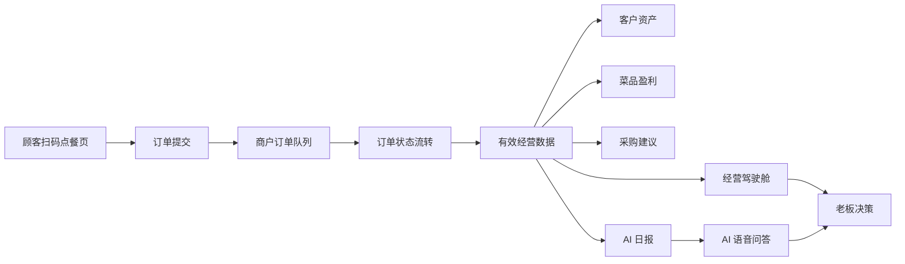

这条链路是项目区别于普通后台 Demo 的关键：页面不是为了“展示好看”，而是尽量让真实业务数据从顾客端进入系统，再被商户端分析和使用。

## 2. 技术栈详解

### 2.1 前端技术栈

项目分为 PC 商户后台和手机端两个前端工程。

#### PC 商户后台：front-pc

| 技术 | 版本 | 用途 |
| --- | --- | --- |
| Vue | 3.5.41 | 页面组件开发、响应式状态渲染 |
| Vite | 8.2.0 | 前端构建和本地开发服务器 |
| Pinia | 4.0.2 | 全局状态管理，如登录状态、门店数据 |
| Vue Router | 5.2.0 | 页面路由、登录守卫、模块跳转 |
| TypeScript | 6.0.3 | 类型约束，降低接口字段误用风险 |
| vue-tsc | 3.3.9 | Vue + TypeScript 类型检查 |
| @vitejs/plugin-vue | 6.0.8 | Vite Vue 单文件组件支持 |
| npm-run-all2 | 9.0.3 | 并行执行类型检查和构建任务 |
| vite-plugin-vue-devtools | 8.2.1 | Vue 开发调试辅助 |

PC 端主要页面包括：

| 页面 | 文件 |
| --- | --- |
| 登录 | `front-pc/src/views/LoginView.vue` |
| 注册 | `front-pc/src/views/RegisterView.vue` |
| 经营驾驶舱 | `front-pc/src/views/DashboardView.vue` |
| 扫码点餐订单管理 | `front-pc/src/views/DiningOrdersView.vue` |
| AI 经营日报 | `front-pc/src/views/DailyReportView.vue` |
| 客户资产 | `front-pc/src/views/CustomersView.vue` |
| 菜品盈利 | `front-pc/src/views/DishesView.vue` |
| 库存管理 | `front-pc/src/views/InventoryView.vue` |
| 智能采购单 | `front-pc/src/views/PurchaseView.vue` |
| 评价口碑 | `front-pc/src/views/ReviewsView.vue` |
| 多店看板 | `front-pc/src/views/ChainBoardView.vue` |
| 系统管理 | `front-pc/src/views/SettingsView.vue` |

#### 手机端：front-phone

| 技术 | 版本 | 用途 |
| --- | --- | --- |
| Vue | 3.5.41 | 移动端组件开发 |
| Vite | 8.2.0 | 构建手机端资源 |
| Pinia | 4.0.2 | 移动端状态管理 |
| Vue Router | 5.2.0 | 手机商户端与顾客点餐路由 |
| ECharts | 6.1.0 | 趋势图、指标图等数据可视化 |
| vue-echarts | 8.0.1 | 在 Vue 中封装 ECharts |
| qrcode | 1.5.4 | 生成桌码、顾客点餐二维码 |
| TypeScript | 6.0.3 | 类型安全 |
| vue-tsc | 3.3.9 | 类型检查 |

手机端包含两类页面：

| 类型 | 代表路由 | 说明 |
| --- | --- | --- |
| 手机商户端 | `/dashboard`、`/report`、`/customers`、`/purchase`、`/dining` | 给老板和店员在手机上看数据、处理订单 |
| 顾客点餐端 | `/order/:token` | 顾客扫描桌码后进入的点餐页面 |

### 2.2 后端技术栈

后端位于 `backend` 目录，采用 TypeScript + Fastify + Prisma。

| 技术 | 版本 | 用途 |
| --- | --- | --- |
| Node.js | 生产镜像 Node 22；本地运行时可用 Node v24.19.0 | 后端运行环境 |
| Fastify | 5.11.2 | 高性能 HTTP API 框架 |
| @fastify/cors | 11.3.0 | 跨域配置 |
| @fastify/helmet | 13.1.0 | 安全响应头 |
| @fastify/rate-limit | 10.3.0 | 接口限流 |
| @fastify/swagger | 9.8.1 | OpenAPI 文档生成 |
| @fastify/swagger-ui | 5.2.6 | Swagger UI |
| @fastify/type-provider-typebox | 6.1.0 | Fastify 与 TypeBox 类型结合 |
| TypeBox | 1.3.10 | 请求参数 Schema 校验 |
| Prisma | 6.19.3 | ORM、数据库建模、查询 |
| @prisma/client | 6.19.3 | Prisma Client |
| OpenAI SDK | 5.23.2 | OpenAI 兼容协议大模型调用 |
| TypeScript | 5.9.3 | 后端类型系统 |
| tsx | 4.23.7 | TypeScript 开发运行 |
| pino-pretty | 13.1.3 | 日志美化输出 |

后端核心文件：

| 文件 | 作用 |
| --- | --- |
| `backend/src/server.ts` | 服务启动入口 |
| `backend/src/app.ts` | Fastify 应用注册 |
| `backend/src/routes/v2.ts` | V2 API 路由定义 |
| `backend/src/services/auth-service.ts` | 登录、注册、会话、微信登录 |
| `backend/src/services/sms-service.ts` | 阿里云短信/号码认证验证码 |
| `backend/src/services/dining-service.ts` | 桌码、菜单、顾客下单、订单状态、客户沉淀 |
| `backend/src/services/merchant-service.ts` | 驾驶舱、日报、客户、菜品、采购、评价、多店、系统管理 |
| `backend/src/services/ai-provider.ts` | AI 模型适配、Qwen/OpenAI 兼容调用、流式输出 |
| `backend/src/services/weather-service.ts` | 和风天气、高德/备用地理编码、天气缓存 |
| `backend/src/services/location-service.ts` | IP 定位 |
| `backend/src/services/inventory-service.ts` | 库存、入库、订单扣减、采购在途 |
| `backend/src/services/password.ts` | 密码哈希与校验 |

### 2.3 数据库与数据模型

当前项目使用 Prisma + SQLite：

| 技术 | 配置 |
| --- | --- |
| 数据库 | SQLite |
| ORM | Prisma 6.19.3 |
| 连接配置 | `DATABASE_URL=file:./dev.db`，Docker 中为 `file:/app/data/dev.db` |
| 持久化方式 | Docker volume：`canteen-test-db:/app/data` |

主要数据表：

| 模型 | 说明 |
| --- | --- |
| `Shop` | 门店基础信息 |
| `MerchantUser` | 商户账号 |
| `AuthSession` | 登录会话 |
| `LoginAuditLog` | 登录审计 |
| `DiningTable` | 餐桌与二维码 token |
| `MenuItem` | 菜品信息、价格、成本、图片 |
| `DiningOrder` | 顾客订单 |
| `DiningOrderItem` | 订单菜品明细 |
| `CustomerProfileSnapshot` | 客户资产快照 |
| `DishQuadrantSnapshot` | 菜品盈利四象限快照 |
| `PurchaseOrder` | 智能采购单 |
| `InventoryItem` | 库存物料 |
| `InventoryTransaction` | 库存流水 |
| `Review` | 评价记录 |
| `SystemConfigSnapshot` | 系统配置 |
| `VoiceQuestionLog` | AI 语音问答日志 |

### 2.4 外部服务与第三方能力

| 服务 | 用途 | 当前接入方式 |
| --- | --- | --- |
| 阿里云号码认证 / 短信 | 注册验证码 | `ALIYUN_SMS_PROVIDER=pnvs` 或 `dysms` |
| 通义千问 Qwen | AI 语音问答 | OpenAI 兼容协议，`QWEN_BASE_URL=https://dashscope.aliyuncs.com/compatible-mode/v1` |
| 和风天气 QWeather | 实时天气 | API Key + 专属 Host |
| 高德 Web Service | 城市转经纬度备用方案 | `AMAP_WEB_SERVICE_KEY` |
| 微信开放平台 | PC 微信扫码登录预留 | `WECHAT_LOGIN_APP_ID`、`WECHAT_LOGIN_APP_SECRET` |
| 腾讯云 CVM | 公网部署 | Ubuntu 服务器 + Docker Compose + Nginx |

### 2.5 部署与运维技术栈

| 技术 | 版本 / 配置 | 用途 |
| --- | --- | --- |
| Docker Compose | Compose v2 方案 | 编排前端 Web 与后端 API |
| Node 镜像 | `node:22-bookworm-slim` | 构建和运行后端 |
| Nginx 镜像 | `nginx:1.27-alpine` | 静态资源服务与反向代理 |
| Nginx | 容器内监听 8080 | `/api/` 反代后端，`/phone/` 承载手机端 |
| dumb-init | 后端容器入口 | 正确处理进程信号 |
| Docker volume | `canteen-test-db` | 持久化 SQLite 数据库 |
| 健康检查 | `/api/v2/health`、`/healthz` | 判断后端和前端容器是否可用 |

部署结构如下：

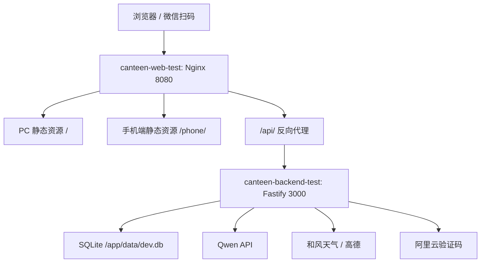

## 3. 项目实现过程

### 阶段一：需求分析与产品建模

项目早期首先明确了两个问题：

1. 餐小助不是一个纯展示系统，而是要服务真实餐饮经营流程。
2. 顾客端点餐数据必须能够沉淀到商户端，否则客户资产、菜品盈利、采购建议都会失去数据来源。

因此产品被拆成三端：

| 端 | 目标 |
| --- | --- |
| PC 商户后台 | 适合大屏查看、配置管理、复杂数据分析 |
| 手机商户端 | 适合老板随时看核心数据、处理订单 |
| 顾客扫码点餐页 | 负责产生真实订单数据 |

业务数据围绕以下链路设计：

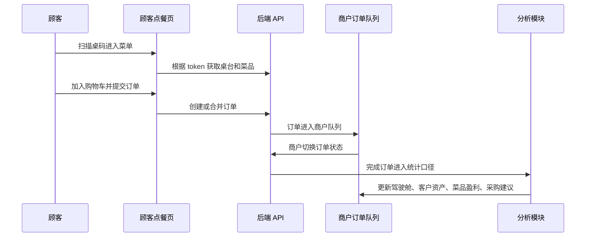

### 阶段二：前端页面搭建

PC 端采用 `AppShell + Vue Router + Pinia` 的结构。登录页、注册页独立于业务框架之外，进入系统后由统一侧边栏和内容区承载各功能模块。

手机端采用更适合移动设备的页面分类方式，避免所有内容堆在一个长页面里。重要模块被拆成总览、日报、客户、采购、库存、点餐、更多等页面，减少用户滑动负担。

顾客点餐页单独放在 `/order/:token`，这样二维码可以直接指向具体餐桌，不需要顾客手动输入桌号。

前端实现中的重点交互包括：

| 功能 | 实现思路 |
| --- | --- |
| 登录守卫 | 路由 `meta.requiresAuth` 判断是否需要登录；未登录跳转登录页 |
| 门店切换 | Pinia 保存当前门店，并驱动各模块请求对应 `shop_id` |
| 语音问答弹层 | 弹层内部独立滚动，避免滚动穿透到背后页面 |
| 购物车弹层 | 弹层打开时锁定背景滚动，购物车内部独立滚动 |
| 加入购物车动效 | 菜品按钮触发上抛动画，视觉上飞入底部金额数字 |
| 手机端分类 | 将长页面拆分成多页，底部导航承担高频入口 |
| 天气选择 | 下拉城市选择 + 输入搜索 + IP 定位 |

### 阶段三：后端 API 与数据模型实现

后端统一使用 `/api/v2` 作为接口前缀，接口返回格式采用：

```json
{
  "success": true,
  "data": {}
}
```

异常时返回：

```json
{
  "success": false,
  "error": {
    "message": "明确的错误提示",
    "code": "错误类型"
  }
}
```

主要接口包括：

| 接口 | 用途 |
| --- | --- |
| `GET /api/v2/health` | 健康检查 |
| `POST /api/v2/auth/login` | 登录 |
| `POST /api/v2/auth/register` | 注册 |
| `POST /api/v2/auth/sms/send` | 发送验证码 |
| `GET /api/v2/auth/me` | 获取当前用户 |
| `POST /api/v2/dashboard/overview` | 经营驾驶舱 |
| `POST /api/v2/dining/tables` | 桌码列表 |
| `POST /api/v2/dining/orders` | 商户订单队列 |
| `POST /api/v2/dining/orders/status` | 更新订单状态 |
| `GET /api/v2/public/dining/:token/menu` | 顾客端获取菜单 |
| `POST /api/v2/public/dining/:token/orders` | 顾客下单 / 加菜 |
| `POST /api/v2/customer/assets/overview` | 客户资产总览 |
| `POST /api/v2/dish/quadrant` | 菜品盈利四象限 |
| `POST /api/v2/purchase/order/generate` | 生成采购单 |
| `POST /api/v2/review/aggregate` | 评价聚合 |
| `POST /api/v2/voice/qa/stream` | AI 流式问答 |
| `POST /api/v2/weather/live` | 实时天气 |

### 阶段四：扫码点餐闭环

扫码点餐是项目的数据入口，也是系统能否真实落地的关键。

实现步骤：

1. 后端为每张桌子生成唯一 `qrToken`。
2. 商户端展示桌台二维码。
3. 顾客扫码进入 `/phone/order/:token`。
4. 顾客端根据 token 请求公开菜单接口。
5. 顾客填写称呼、手机号、人数、备注，提交订单。
6. 后端校验菜品状态、数量、手机号格式。
7. 如果传入 `existing_order_id` 且原订单未完成/未取消，则执行加菜合并。
8. 商户端订单队列读取新订单。
9. 商户更新状态，状态到达 `served` 或 `completed` 时触发库存扣减和经营统计。

关键设计点：

| 问题 | 方案 |
| --- | --- |
| 顾客不能手动填桌号 | 使用二维码 token 自动关联桌台 |
| 加菜不能产生一堆碎片订单 | 同一未结束订单支持合并，金额累加，备注拼接 |
| 取消订单不能进入销量统计 | 统计口径统一过滤 `cancelled`，经营指标只统计有效订单 |
| 库存不能重复扣减 | 只有订单首次进入终态时才扣库存 |

### 阶段五：客户资产与菜品盈利

客户资产并不是手动录入的，而是从订单自动沉淀。

沉淀规则：

1. 顾客点餐时填写称呼或手机号。
2. 后端根据手机号、手机号掩码或姓名做 OneID 匹配。
3. 如果匹配到已有客户，则更新历史订单。
4. 如果没有匹配，则创建新的客户档案。
5. 根据订单数、总消费、最后消费时间计算 RFM 分层和流失风险。

菜品盈利模块则基于订单明细计算：

| 指标 | 口径 |
| --- | --- |
| 销量 | 有效订单中的菜品数量合计 |
| 营收 | 有效订单中菜品金额合计 |
| 成本 | 菜品成本价 × 销售数量 |
| 毛利 | 销售金额 - 成本 |
| 毛利率 | 毛利 / 销售金额 |

四象限逻辑：

| 象限 | 特征 | 建议 |
| --- | --- | --- |
| 明星菜 | 高销量、高毛利 | 主推、放到菜单显眼位置 |
| 引流菜 | 高销量、低毛利 | 控制成本，搭配套餐 |
| 利润菜 | 低销量、高毛利 | 强化曝光，提高转化 |
| 淘汰菜 | 低销量、低毛利 | 降低库存，考虑下架 |

### 阶段六：智能采购与库存闭环

采购单不是简单写死的示例数据，而是结合订单、BOM 和库存动态计算。

当前采购预测流程：

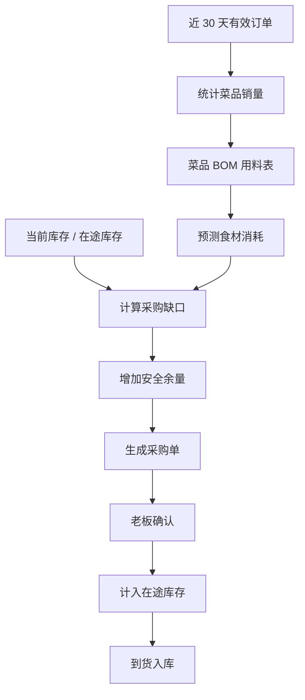

关键公式：

```text
预测订单量 = 近 30 天有效订单日均值 × 1.1
预测食材消耗 = 预测菜品销量 × BOM 单份用量
建议采购量 = 预测消耗 - 当前库存 - 在途库存 + 安全余量
```

为了避免误导用户，系统对数据来源做了区分：

| 数据状态 | 前端表现 |
| --- | --- |
| 有真实订单 | 展示预测值和置信度 |
| 数据不足 | 明确提示数据不足，不伪造分析 |
| 已确认采购 | 计入在途库存，避免重复采购 |

### 阶段七：AI 语音问答与流式输出

AI 问答最初如果采用普通 HTTP 响应，用户需要等待模型完整生成后才能看到结果。实际体验中，用户会以为系统卡死。因此项目改造成 SSE 流式输出。

后端关键设计：

| 设计 | 说明 |
| --- | --- |
| `reply.hijack()` | 接管 Fastify 原始响应 |
| `Content-Type: text/event-stream` | 使用 SSE 协议 |
| `X-Accel-Buffering: no` | 避免 Nginx 缓冲导致流式失效 |
| `AbortController` | 前端停止生成或断开连接时中断上游模型 |
| `event: delta` | 模型增量内容 |
| `event: done` | 完整回答结束 |
| `event: error` | 模型不可用或配置错误时明确提示 |

前端对应实现：

1. 发送问题后锁定输入框，防止 AI 思考过程中重复提问。
2. 使用 `fetch` + `ReadableStream` 逐段读取 SSE 数据。
3. 将 `delta` 事件拼接成打字机式输出。
4. 用户点击停止生成时中断请求。
5. 如果模型未连接，明确提示“AI 模型未连接”，不返回虚假分析。

### 阶段八：部署与服务器上线

项目部署时经历了从本地启动到云端 Docker 化的迁移。

最终测试版采用两个容器：

| 容器 | 作用 |
| --- | --- |
| `canteen-backend-test` | 运行 Fastify 后端 |
| `canteen-web-test` | Nginx 托管 PC 和 phone 静态资源，并反代 API |

访问路径：

| 路径 | 说明 |
| --- | --- |
| `/` | PC 商户后台 |
| `/phone/` | 手机商户端 |
| `/phone/order/:token` | 顾客扫码点餐页 |
| `/api/` | 后端 API |
| `/healthz` | 前端容器健康检查 |
| `/api/v2/health` | 后端服务健康检查 |

Nginx 关键配置：

```nginx
location /api/ {
  proxy_pass http://canteen-backend-test:3000/api/;
}

location /phone/ {
  alias /usr/share/nginx/phone/;
  try_files $uri $uri/ /phone/index.html;
}

location / {
  root /usr/share/nginx/html;
  try_files $uri $uri/ /index.html;
}
```

## 4. 真实运行截图与功能说明

以下截图来自餐小助本地真实运行环境，使用演示商户账号进入系统后截取。它们用于说明项目不是静态页面拼图，而是已经具备登录态、门店数据、订单入口、客户沉淀和采购计算等完整业务界面。

### 4.1 PC 端经营驾驶舱


经营驾驶舱是商户每天进入系统后的第一屏，集中展示当前门店、利润、有效订单、客单价、经营状态、天气提醒和 AI 日报入口。截图中天气模块出现了接口失败提示，这是系统真实错误反馈的一部分：当第三方天气服务不可用时，页面不会伪造天气结果，而是明确提示检查配置，避免误导经营判断。

### 4.2 扫码点餐与桌码入口


扫码点餐页面负责把顾客端和商户端连接起来。商户可以查看桌码入口、打开顾客点餐页、刷新订单队列，并跟踪今日扫码订单、待处理订单和订单金额。顾客通过桌码下单后，订单会进入这个页面，后续状态流转会继续影响驾驶舱、菜品盈利、客户资产和采购预测。

### 4.3 客户资产沉淀页面

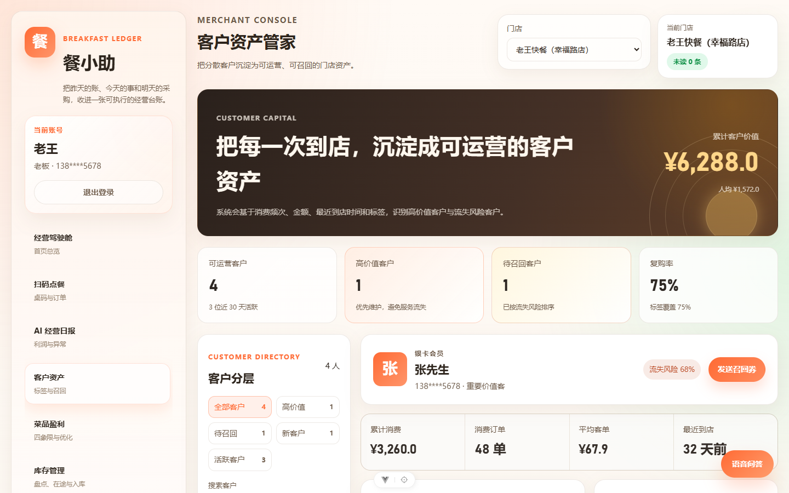

客户资产页面展示从真实点餐记录中沉淀出的客户档案，包括累计客户价值、可运营客户、高价值客户、待召回客户、复购率、消费订单、平均客单和最近到店时间。这个页面的核心逻辑是把顾客在点餐时填写的称呼与手机号转化为可跟进的客户资产，而不是依赖人工手动维护名单。

### 4.4 智能采购单页面

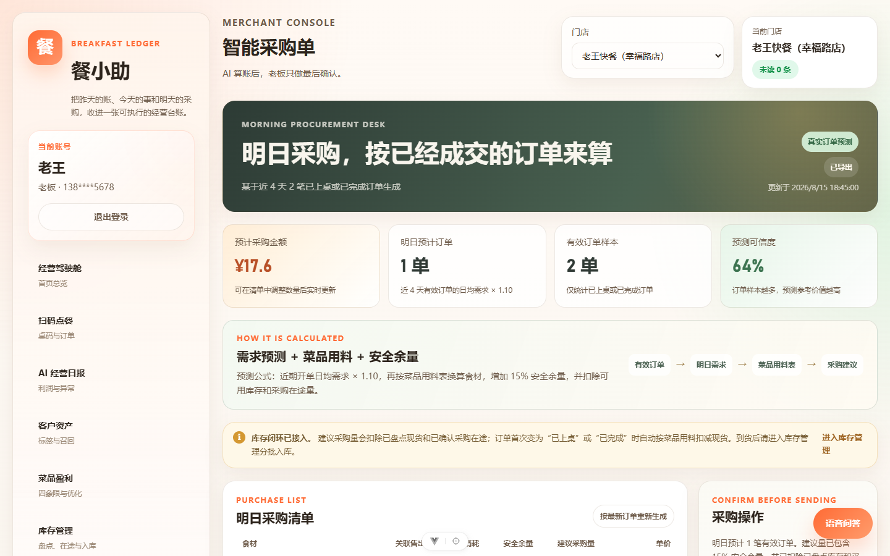

智能采购单根据有效订单、菜品用料、库存和安全余量生成采购建议。页面中展示了预测采购金额、明日预计订单、有效订单样本、预测可信度和采购计算流程，帮助老板理解“为什么要买这些食材”。采购确认后，系统还能把采购结果同步到库存和在途数量，减少重复采购。

### 4.5 AI 经营日报页面

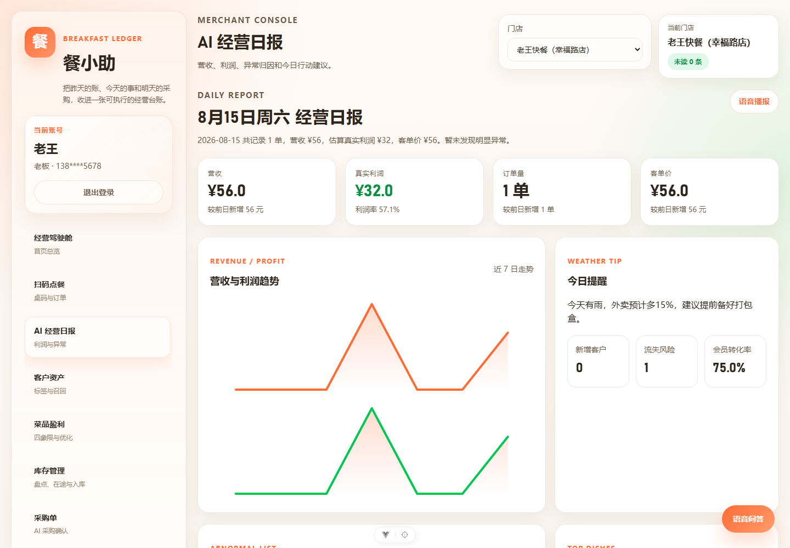

AI 经营日报把营收、真实利润、订单量、客单价、近 7 日趋势、天气提醒和客户风险放到同一份日结视图中。页面的业务价值不只是展示数字，而是先把异常和当日动作集中出来，帮助老板在早上快速判断“今天先处理什么”。右上角的语音播报入口可进一步连接 AI 流式问答。

### 4.6 菜品盈利分析页面

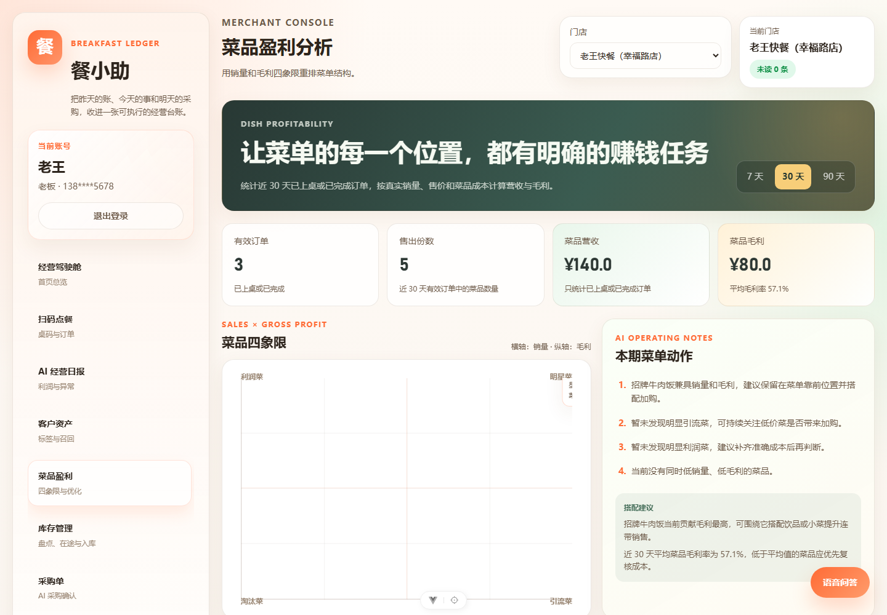

菜品盈利分析基于已上桌或已完成订单统计有效订单、售出份数、菜品营收和毛利，并将菜品放入销量与毛利组成的四象限中。右侧的本期菜品动作会给出主推、搭配、控成本或观察的建议，避免把取消订单误算为销量。

### 4.7 库存管理页面

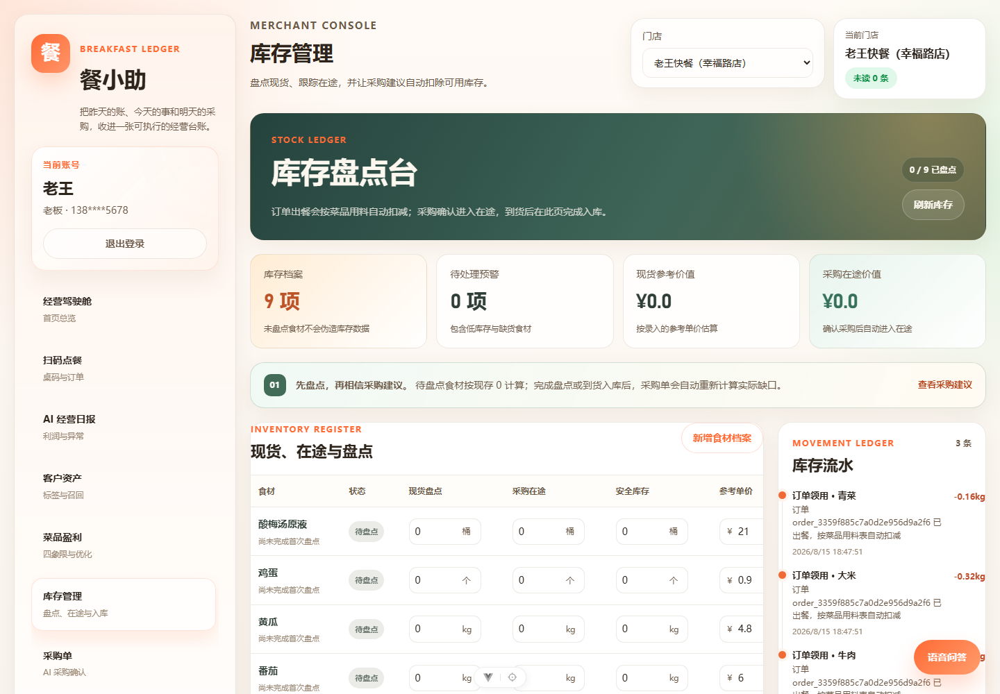

库存管理页面维护食材档案、现货盘点、采购在途、安全库存和库存流水。订单完成后，系统可按照菜品用料表扣减食材；采购确认后，数量会进入在途；到货后再转为现货。截图右侧的库存流水用于追溯某次扣减来自哪一笔订单。

### 4.8 评价口碑页面

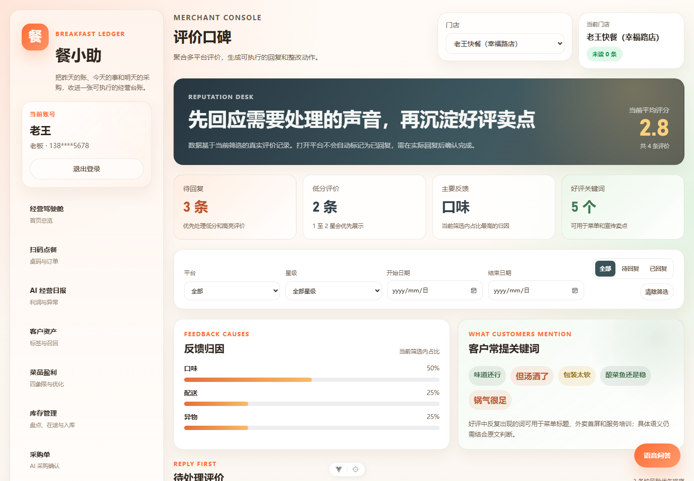

评价口碑页面聚合评分、待回复评价、低分评价、主要反馈原因和高频关键词。系统将“口味、配送、异物”等内容归因成可处理问题，并为商户提供回复和整改的优先级依据，帮助把差评处理从临时应对变成可跟踪的运营动作。

### 4.9 多店看板页面

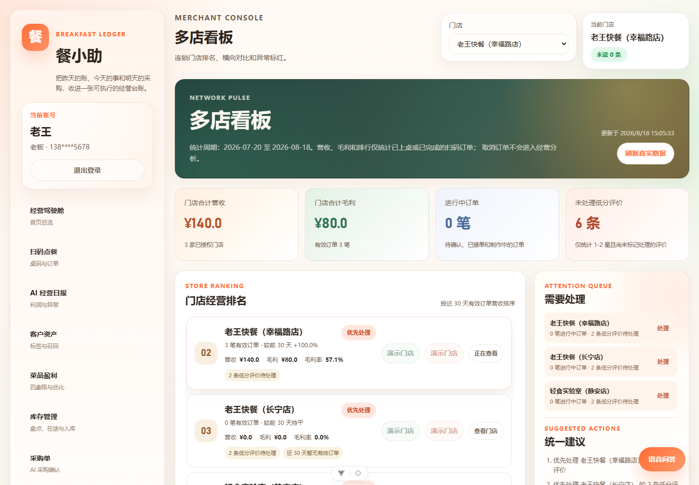

多店看板用于授权门店之间的横向对比，展示门店合计营收、合计毛利、进行中订单、未处理低分评价和经营排名。系统只按有效订单计算营收和毛利，并通过“需要处理”队列和统一建议把多店晨会的重点集中起来。

### 4.10 系统管理页面

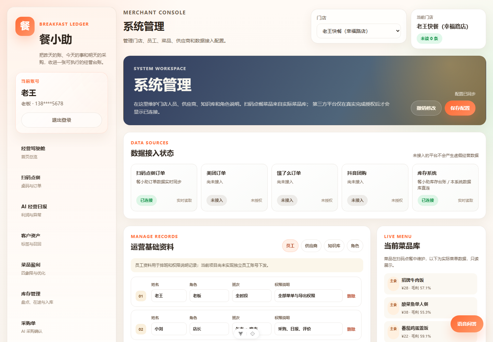

系统管理页面集中维护数据接入状态、员工角色、供应商、知识库、菜品库和权限说明。未接入的第三方平台会明确标注“未接入”，避免将演示数据伪装成真实连接；已连接的扫码点餐和库存系统则作为当前经营数据的可信来源。

### 4.11 顾客桌码点餐页面

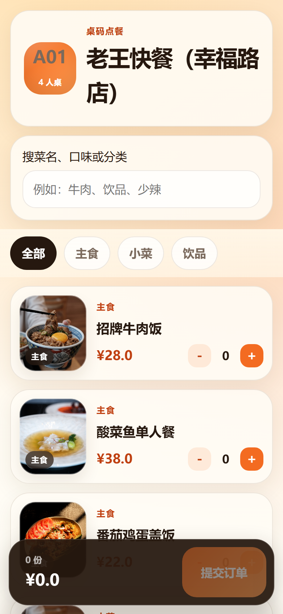

顾客扫描餐桌二维码后，会自动进入绑定桌号的移动点餐页，无需手动输入桌号。页面支持菜品搜索、分类筛选、菜品图片浏览、数量增减、购物车与提交订单；提交后的订单将回流到商户端扫码点餐队列，成为客户资产、菜品盈利和采购预测的原始数据来源。

## 5. 开发中遇到的问题及解决方案

### 5.1 AI 返回太慢，用户误以为系统卡死

问题表现：

语音问答提交后，页面长时间没有任何变化，用户无法判断 AI 是在思考还是已经出错。

根因：

普通请求需要等待模型完整生成后才返回，加上 Nginx 默认可能缓冲响应，导致首屏等待明显。

解决方案：

1. 后端改为 SSE 流式输出。
2. 前端逐字渲染模型增量。
3. 增加“正在分析”“停止生成”等状态。
4. 生成期间禁用输入框，防止重复提问。
5. 设置 `X-Accel-Buffering: no` 避免 Nginx 缓冲。

### 5.2 未连接 AI 模型时不能返回假数据

问题表现：

如果 AI 模型未配置，系统曾经可能给出看似正常的经营分析，容易误导用户。

解决方案：

1. 后端抽象 `AiProviderUnavailableError`。
2. 未配置 `QWEN_API_KEY` 或 `AI_PROVIDER` 时直接返回明确错误。
3. 前端展示“AI 模型未连接 / 调用失败”，不再伪造分析。
4. 文案强调“当前不可用”，避免用户把模拟内容当成真实建议。

### 5.3 顾客扫码二维码在公网打不开

问题表现：

本地开发时二维码地址是 `localhost:5174`，手机微信扫码后无法打开。

根因：

`localhost` 对扫码手机来说指的是手机本机，不是开发电脑或云服务器。

解决方案：

1. 二维码地址改为根据环境变量生成。
2. 本地局域网测试使用电脑局域网 IP。
3. 服务器部署使用公网 IP 或域名。
4. Nginx 配置 `/phone/` SPA fallback，保证扫码路径刷新也能打开。

### 5.4 购物车弹层滚动穿透

问题表现：

打开购物车后，用户滚动购物车，实际滚动的是背后的页面。

根因：

移动端弹层没有独立滚动容器，也没有锁定背景滚动。

解决方案：

1. 弹层打开时锁定页面背景滚动。
2. 购物车内容区域设置最大高度和 `overflow-y: auto`。
3. 避免弹层底部按钮遮挡内容。
4. 统一处理语音问答弹层、购物车弹层等类似问题。

### 5.5 取消订单被计入销量

问题表现：

菜品销量和经营驾驶舱数据会把已取消订单也统计进去，造成销量、营收和采购建议偏高。

根因：

部分统计 SQL 没有统一过滤订单状态。

解决方案：

1. 统一有效订单口径：经营指标只统计 `served` 和 `completed`，或至少排除 `cancelled`。
2. 菜品盈利、采购预测、驾驶舱、客户资产等模块同步修正。
3. 在文档和页面中明确说明数据统计口径。

### 5.6 加菜金额与商户端金额重复累计

问题表现：

顾客后续加菜时，金额显示和商户端统计出现不一致。

根因：

加菜场景同时涉及订单合并、订单项追加和总金额展示，如果前端和后端都做累计，容易重复计算。

解决方案：

1. 后端负责订单金额权威计算。
2. 前端只展示后端返回的 `totalAmount`。
3. 商户端订单队列不再自行叠加金额。
4. 加菜备注统一追加到订单备注中。

### 5.7 天气 IP 定位不准

问题表现：

IP 定位有时识别到北京、衡阳等不符合用户实际位置的城市。

根因：

服务端拿到的可能是内网 IP、云服务器出口 IP、代理 IP，不能完全代表用户真实位置。

解决方案：

1. 增加手动城市选择和城市搜索。
2. IP 定位只作为辅助能力。
3. 服务端检测到内网 IP 时直接提示无法可靠识别。
4. 天气数据本身使用和风天气，城市定位可以通过高德或备用地理编码获取坐标。

### 5.8 Docker 部署后显示旧页面

问题表现：

更新代码后，服务器仍然显示旧页面，或者接口返回 500。

根因：

可能来自 Nginx 缓存、构建产物未更新、容器未重建、路径指向旧目录等问题。

解决方案：

1. 使用 Docker Compose 明确构建前端和后端镜像。
2. 静态资源使用 hash 文件名并设置长期缓存。
3. `index.html` 设置 `no-cache`，避免 SPA 入口长期缓存。
4. 更新脚本执行构建、上传、重建、健康检查。
5. 通过 `/healthz` 和 `/api/v2/health` 判断部署结果。

### 5.9 中文乱码问题

问题表现：

部分源码和文档中的中文字符串出现乱码。

根因：

Windows 环境、PowerShell、编辑器和文件编码之间存在不一致，部分文件可能被错误编码保存。

解决方案：

1. 后续所有源码和文档统一保存为 UTF-8。
2. 避免在不同编码终端中直接复制大段中文。
3. 错误提示、业务文案集中管理，减少散落字符串。
4. 将乱码清理列为后续维护事项。

## 6. 模型选择与应用说明

### 6.1 模型选择

项目 AI 问答部分采用 OpenAI 兼容协议进行模型接入，当前主要面向通义千问 Qwen 系列，配置项如下：

```env
AI_PROVIDER=qwen
QWEN_API_KEY=你的 DashScope API Key
QWEN_MODEL=qwen3.7-plus
QWEN_BASE_URL=https://dashscope.aliyuncs.com/compatible-mode/v1
```

选择 Qwen 的原因：

| 维度 | 说明 |
| --- | --- |
| 国内可用性 | 国内网络环境下调用更稳定，接入门槛较低 |
| 中文能力 | 对中文经营问题、餐饮场景描述理解较好 |
| 成本 | 相比部分国际大模型，国内模型在日常问答场景中更有性价比 |
| 协议兼容 | 支持 OpenAI 兼容调用方式，后端代码切换成本低 |
| 适合场景 | 适合经营日报解读、问答、建议生成、异常归因等文本型任务 |

系统同时保留 OpenAI 兼容模型配置：

```env
AI_PROVIDER=openai
OPENAI_API_KEY=你的 OpenAI API Key
OPENAI_MODEL=gpt-5
```

这意味着后续如果要切换模型，不需要重写业务逻辑，只需要更换 Provider 配置。

### 6.2 模型类型

当前项目使用的是通用大语言模型 API，不是本地训练模型。模型主要承担以下任务：

| 任务 | 输入 | 输出 |
| --- | --- | --- |
| 经营问答 | 用户问题 + 当前门店驾驶舱 + 日报数据 | 结构化经营建议 |
| 日报解读 | 营收、利润、订单、客单价、异常、天气等指标 | 今日重点、异常原因、行动建议 |
| 采购解释 | 有效订单、BOM、库存、预测结果 | 采购依据与风险说明 |
| 客户召回建议 | 客户消费历史、RFM、偏好、流失风险 | 召回话术、优惠建议、置信度 |
| 差评回复 | 差评内容、平台、评分、归因类别 | 更自然的回复草稿 |

### 6.3 是否进行了模型训练

当前项目没有进行模型微调或自训练。

原因有三点：

1. 项目当前数据规模还不足以支撑高质量微调。
2. 餐饮经营问答更需要“实时业务数据注入”，而不是固定知识记忆。
3. 使用 API + Prompt + 业务上下文的方式更轻量，也更适合学生项目和中小商户 MVP 阶段。

当前采用的是“提示词工程 + 业务上下文注入”方案：

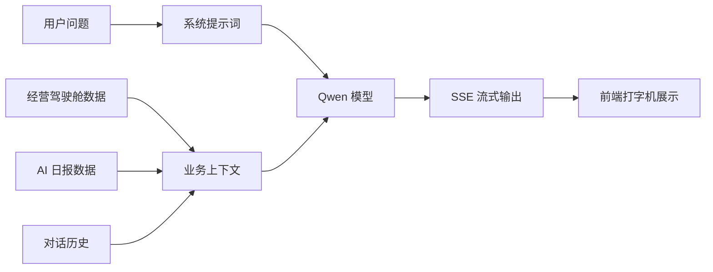

### 6.4 提示词设计

后端系统提示词的核心约束包括：

1. 你是餐小助的经营分析助手，服务对象是餐饮老板和店长。
2. 回答必须基于门店经营数据、日报、采购、客户和评价信息。
3. 不允许虚构事实。
4. 数据不足时必须明确说明“现有数据不足”。
5. 回答风格要直接、专业、可执行。
6. 先给结论，再给依据，最后给行动建议。

这些约束的目的不是让模型“更会聊天”，而是让模型更像一个可控的经营辅助工具。

### 6.5 模型调用参数

当前主要参数：

| 参数 | 当前设置 | 说明 |
| --- | --- | --- |
| `model` | `qwen3.7-plus` | 通过环境变量配置 |
| `temperature` | `0.2` | 降低随机性，保证经营建议更稳定 |
| `stream` | `true` | 流式输出 |
| `history limit` | 最近 8 轮 | 保留上下文，但避免上下文过长 |
| `confidence` | 默认 0.9 | 前端展示用的置信度标识 |

### 6.6 性能表现

在交互体验上，AI 从普通完整返回改为流式返回后，用户感知明显改善：

| 指标 | 非流式 | 流式 |
| --- | --- | --- |
| 首次反馈 | 需要等完整回答，可能 5-15 秒无变化 | 建立连接后开始逐段显示 |
| 用户感知 | 容易误以为卡死 | 能看到正在生成 |
| 中断能力 | 不好中断 | 支持停止生成 |
| 错误提示 | 容易和普通失败混在一起 | 可通过 `event:error` 明确提示 |

需要注意的是，流式输出通常不会增加模型本身的 token 费用，它只是改变了返回方式。费用主要取决于输入 token、输出 token 和模型单价。

### 6.7 模型降级策略

为了避免误导用户，系统没有在模型不可用时生成假分析。

当前策略：

| 状态 | 处理方式 |
| --- | --- |
| API Key 未配置 | 返回“AI 模型未连接” |
| 模型名错误 | 提示检查 `QWEN_MODEL` 和 `QWEN_BASE_URL` |
| 鉴权失败 | 提示检查 API Key 和模型权限 |
| 额度不足 / 限流 | 提示稍后重试或检查余额 |
| 网络失败 | 提示检查服务器网络和模型服务状态 |

这是项目中非常重要的工程原则：经营系统宁愿明确说“我不知道”，也不能用假数据误导老板。

## 7. 安全设计

### 7.1 登录与注册安全

| 设计 | 说明 |
| --- | --- |
| 密码哈希 | 使用 Node.js `crypto.scryptSync` 加盐哈希 |
| Salt | 每个用户随机 16 字节 salt |
| 安全比较 | 使用 `timingSafeEqual` 避免时序攻击 |
| Session token | 随机生成 32 字节 token，数据库只保存 SHA-256 哈希 |
| 会话有效期 | 默认 7 天 |
| 登录审计 | 成功/失败登录记录 IP、UA、原因 |
| 短信验证码 | 5 分钟有效、60 秒发送间隔、最多 5 次验证尝试 |

### 7.2 接口安全

| 设计 | 说明 |
| --- | --- |
| TypeBox Schema | 对请求参数做基础校验 |
| CORS 白名单 | 限制允许访问的前端来源 |
| Helmet | 增加常见安全响应头 |
| Rate Limit | 限制高频请求 |
| 业务错误归一化 | 不直接暴露内部异常堆栈 |
| 二维码 token | 顾客点餐页使用 token 关联桌台，不暴露数据库 ID |

### 7.3 隐私保护

| 数据 | 处理方式 |
| --- | --- |
| 手机号 | 客户资产中默认展示掩码，如 `138****5678` |
| 密码 | 不保存明文，只保存 hash 和 salt |
| AI 上下文 | 只传入必要经营数据，不传入密码、验证码等敏感字段 |
| 顾客画像 | 已移除肖像/画像类功能，避免肖像权风险 |

## 8. 项目当前限制与后续优化

### 8.1 当前限制

| 限制 | 说明 |
| --- | --- |
| 数据库 | 当前使用 SQLite，适合测试和小规模部署；多商户大并发建议迁移 MySQL/PostgreSQL |
| 实时性 | 订单队列目前主要靠接口刷新/轮询，后续可接 WebSocket |
| 第三方平台 | 美团、饿了么等平台目前未真实接入，系统管理中明确显示未授权 |
| 模型能力 | 当前未做微调，AI 表现依赖提示词和上下文质量 |
| 编码治理 | 部分历史中文字符串仍可能存在乱码，需要统一 UTF-8 清理 |
| 支付闭环 | 顾客点餐已实现下单，支付能力可作为后续扩展 |

### 8.2 后续优化方向

| 方向 | 优化内容 |
| --- | --- |
| 数据库升级 | 从 SQLite 迁移到 MySQL/PostgreSQL，提高并发和运维能力 |
| WebSocket | 订单实时推送、库存变更推送、商户端状态同步 |
| 菜品管理后台 | 支持商户自行维护菜品图片、价格、成本、上下架 |
| 支付接入 | 微信支付、支付宝支付，形成完整交易闭环 |
| 多租户权限 | 更严格的门店隔离、角色权限、操作审计 |
| 模型评测 | 建立常见经营问题测试集，评估不同模型回答质量 |
| 数据看板 | 增加更丰富的趋势图、漏斗图和经营对比 |
| 备份恢复 | 定时备份数据库，避免服务器故障造成数据丢失 |

## 9. 学习参考：这个项目值得复用的经验

### 9.1 先做真实数据闭环，再做 AI

AI 不是系统的起点。对经营类项目来说，真实的数据链路更重要。如果订单、客户、菜品、库存这些基础数据不准确，AI 给出的建议再漂亮也没有价值。

### 9.2 所有统计口径必须统一

取消订单是否算销量、加菜是否算新订单、库存什么时候扣减，这些看似细节的问题会直接影响经营结果。项目中将“有效订单”作为统一口径，是后续驾驶舱、菜品盈利、采购建议都能成立的基础。

### 9.3 用户体验问题经常不是样式问题

例如语音问答不能滚动、购物车滚动穿透、AI 没反馈、按钮位置别扭，这些表面是 UI 问题，本质是交互状态、滚动容器、用户预期和业务流程没有处理好。

### 9.4 云端部署不是简单上传文件

项目真正部署到服务器后，会遇到端口、路径、缓存、反向代理、容器健康检查、环境变量、数据库持久化等问题。能在本地跑起来只是第一步，能让外部用户稳定访问才算真正交付。

### 9.5 经营系统不能用假数据“撑场面”

这个项目最重要的原则之一是：如果数据不足，就明确告诉用户数据不足；如果模型没连上，就明确告诉用户模型不可用。对餐饮老板来说，错误建议可能会带来真实损失。

## 10. 总结

餐小助从最初的前端页面，逐步扩展成一个包含 PC 后台、手机商户端、顾客扫码点餐页、后端 API、数据库、AI 模型接入、天气系统、短信注册和 Docker 部署的完整项目。

从技术角度看，它覆盖了 Vue3 多端开发、Fastify 接口设计、Prisma 数据建模、SQLite 持久化、SSE 流式输出、Qwen 模型接入、和风天气、阿里云验证码、Nginx 反向代理、Docker Compose 部署等完整链路。

从产品角度看，它解决的不是“如何做一个好看的后台”，而是“如何让餐饮门店每天真实产生的数据变成可理解、可分析、可行动的经营建议”。

这也是项目最核心的价值：让 AI 不停留在概念展示，而是进入真实业务流程，成为一个能帮老板盯店的数字店长。
