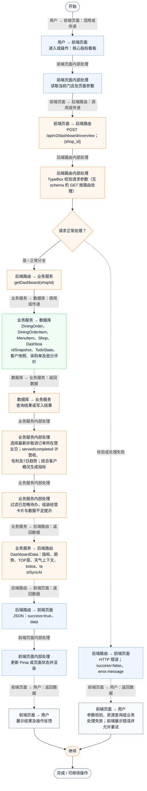
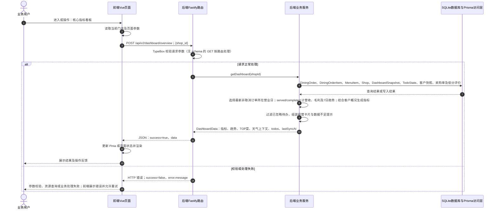

# ① AI经营驾驶舱 / 01 核心指标看板

**实现状态：已实现** · 核对日期：2026-10-27

以下两图依据当前源码；仅对已存在链路作实现描述。尚未实现的范围在边界中说明。

## 业务范围与数据契约

| 项目 | 说明 |
| --- | --- |
| 入口与触发 | PC /dashboard；手机 /dashboard |
| 状态 | 已实现 |
| 接口与关键入参 | POST /api/v2/dashboard/overview；{shop_id} |
| 主要调用 | getDashboard(shopId) |
| 读取或写入数据 | DiningOrder、DiningOrderItem、MenuItem、Shop、DashboardSnapshot、TodoState、客户快照、采购单及低分评价 |
| 核心处理 | 选择最新非取消订单所在营业日；served/completed 计营收、毛利及7日趋势；结合客户概况生成指标 |
| 响应与数据去向 | DashboardData：指标、趋势、TOP菜、天气上下文、todos、lastSyncAt |

对应PRD功能：核心指标看板。

## 业务流程图

## 时序图

## 规则、异常与完成边界

看板默认只有7日趋势；复购趋势以当前值铺成7天，损耗率为0占位。利润主要按菜品当前成本估算，不能等同于含房租人工等完整净利润。数据不足时展示空态。 订单时间筛选通过sqliteTimeMillis兼容ISO文本与毫秒数值；按+08:00营业日划分，查询时归一化，不改写历史记录。最近经营日不一定是今天。

前端准备：读取当前门店及页面参数。

结果处理：更新 Pinia 或页面状态并渲染。

异常处理：参数校验、资源查询或业务处理失败；前端展示错误并允许重试。JSON、SSE和浏览器本地动作按各自协议反馈，失败不会凭空产生成功结果。

访问范围：此旧业务路由没有Agent/RAG同等的统一会话与门店鉴权；PC请求可携Bearer，但不能据此前端行为推断后端已核验。

## 源码与需求依据

- [backend/src/services/merchant-service.ts:396](D:/餐小助/backend/src/services/merchant-service.ts:396)
- [backend/src/routes/v2.ts:495](D:/餐小助/backend/src/routes/v2.ts:495)
- [front-pc/src/views/DashboardView.vue:1](D:/餐小助/front-pc/src/views/DashboardView.vue:1)
- [front-pc/src/views/DailyReportView.vue:1](D:/餐小助/front-pc/src/views/DailyReportView.vue:1)
- [front-phone/src/views/DailyReportView.vue:1](D:/餐小助/front-phone/src/views/DailyReportView.vue:1)
- [backend/src/lib/sqlite-time.ts:3](D:/餐小助/backend/src/lib/sqlite-time.ts:3)
- [front-pc/src/stores/merchant.ts:1](D:/餐小助/front-pc/src/stores/merchant.ts:1)

[返回模块与功能目录](../README.md)
