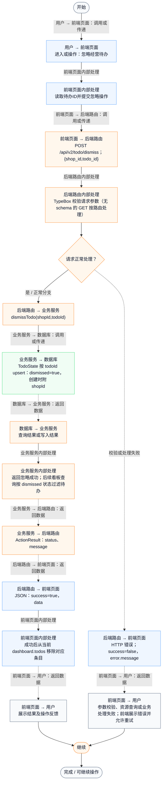
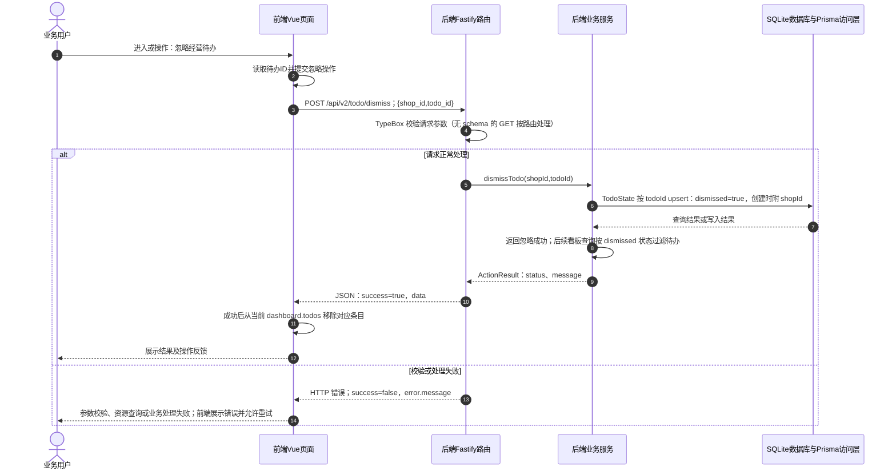

# ① AI经营驾驶舱 / 04 忽略经营待办

**实现状态：已实现** · 核对日期：2026-10-27

以下两图依据当前源码；仅对已存在链路作实现描述。尚未实现的范围在边界中说明。

## 业务范围与数据契约

| 项目 | 说明 |
| --- | --- |
| 入口与触发 | PC 驾驶舱；手机首页 TodoList |
| 状态 | 已实现 |
| 接口与关键入参 | POST /api/v2/todo/dismiss；{shop_id,todo_id} |
| 主要调用 | dismissTodo(shopId,todoId) |
| 读取或写入数据 | TodoState 按 todoId upsert：dismissed=true，创建时附 shopId |
| 核心处理 | 返回忽略成功；后续看板查询按 dismissed 状态过滤待办 |
| 响应与数据去向 | ActionResult：status、message |

## 业务流程图

## 时序图

## 规则、异常与完成边界

只改变待办展示状态，未执行建议对应的采购、发券或订单处理动作。

前端准备：读取待办ID并提交忽略操作。

结果处理：成功后从当前 dashboard.todos 移除对应条目。

异常处理：参数校验、资源查询或业务处理失败；前端展示错误并允许重试。JSON、SSE和浏览器本地动作按各自协议反馈，失败不会凭空产生成功结果。

访问范围：此旧业务路由没有Agent/RAG同等的统一会话与门店鉴权；PC请求可携Bearer，但不能据此前端行为推断后端已核验。

## 源码与需求依据

- [backend/src/services/merchant-service.ts:1981](D:/餐小助/backend/src/services/merchant-service.ts:1981)
- [backend/src/routes/v2.ts:1068](D:/餐小助/backend/src/routes/v2.ts:1068)
- [front-pc/src/views/DashboardView.vue:1](D:/餐小助/front-pc/src/views/DashboardView.vue:1)
- [front-pc/src/views/DailyReportView.vue:1](D:/餐小助/front-pc/src/views/DailyReportView.vue:1)
- [front-phone/src/views/DailyReportView.vue:1](D:/餐小助/front-phone/src/views/DailyReportView.vue:1)
- [front-pc/src/stores/merchant.ts:1](D:/餐小助/front-pc/src/stores/merchant.ts:1)

[返回模块与功能目录](../README.md)
