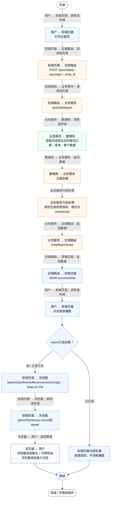
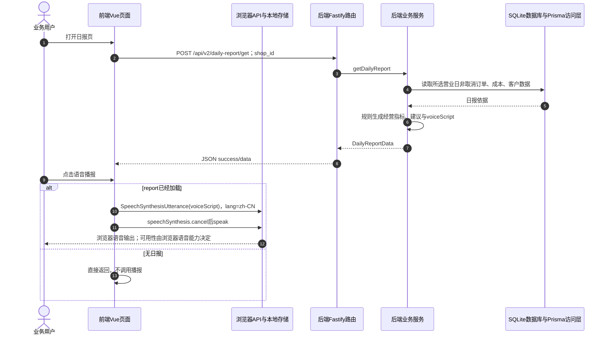

# ① AI经营驾驶舱 / 05 日报语音播报

**实现状态：已实现** · 核对日期：2026-10-27

以下两图依据当前源码；仅对已存在链路作实现描述。尚未实现的范围在边界中说明。

## 业务范围与数据契约

| 项目 | 说明 |
| --- | --- |
| 入口与触发 | PC DailyReportView；手机 DailyReportView |
| 状态 | 已实现 |
| 接口与关键入参 | POST /api/v2/daily-report/get（播报前加载） |
| 主要调用 | getDailyReport |
| 读取或写入数据 | DiningOrder、DiningOrderItem、MenuItem 与客户快照 |
| 核心处理 | 生成 voiceScript 文本 |
| 响应与数据去向 | voiceScript |

## 业务流程图

## 时序图

## 规则、异常与完成边界

浏览器 speechSynthesis 朗读；点击播报不再发后端语音合成请求。不含方言语音识别；可用性取决于浏览器语音能力。

前端准备：读取当前门店及页面参数。

结果处理：点击播报时创建 SpeechSynthesisUtterance(voiceScript)，lang=zh-CN；cancel旧播报后 speak。

异常处理：参数校验、资源查询或业务处理失败；前端展示错误并允许重试。JSON、SSE和浏览器本地动作按各自协议反馈，失败不会凭空产生成功结果。

访问范围：此旧业务路由没有Agent/RAG同等的统一会话与门店鉴权；PC请求可携Bearer，但不能据此前端行为推断后端已核验。

## 源码与需求依据

- [backend/src/services/merchant-service.ts:752](D:/餐小助/backend/src/services/merchant-service.ts:752)
- [backend/src/routes/v2.ts:604](D:/餐小助/backend/src/routes/v2.ts:604)
- [front-pc/src/views/DashboardView.vue:1](D:/餐小助/front-pc/src/views/DashboardView.vue:1)
- [front-pc/src/views/DailyReportView.vue:1](D:/餐小助/front-pc/src/views/DailyReportView.vue:1)
- [front-phone/src/views/DailyReportView.vue:1](D:/餐小助/front-phone/src/views/DailyReportView.vue:1)
- [front-pc/src/stores/merchant.ts:1](D:/餐小助/front-pc/src/stores/merchant.ts:1)

[返回模块与功能目录](../README.md)
