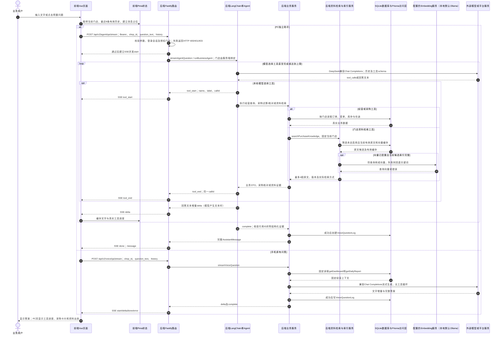

# ① AI经营驾驶舱 / 06 AI连续问答与流式输出

**实现状态：部分实现** · 核对日期：2026-10-27

以下两图依据当前源码；仅对已存在链路作实现描述。尚未实现的范围在边界中说明。

## 业务范围与数据契约

| 项目 | 说明 |
| --- | --- |
| 入口与触发 | PC /assistant 独立工作台；手机 VoiceAssistantSheet 保留原有文字问答 |
| 状态 | 部分实现 |
| 接口与关键入参 | PC POST /api/v2/agent/qa/stream；手机 POST /api/v2/voice/qa/stream；{shop_id,question_text,history?} |
| 主要调用 | PC streamAgentQuestion → runBusinessAgent；手机 streamVoiceQuestion |
| 读取或写入数据 | 当前门店经营订单、菜单成本、库存及有效资料；成功完成后写VoiceQuestionLog |
| 核心处理 | PC由单Agent按问题选择7种工具；手机先查固定看板和日报再请求模型 |
| 响应与数据去向 | PC SSE start/tool_start/tool_end/delta/done/error；done含资料来源、采购试算与核对结果（按实际调用附带） |

对应PRD功能：AI语音数据问答。

## 业务流程图

```mermaid
flowchart TD
  N1(["开始"])
  N2["用户 → 前端页面<br/>输入文字或点击预置问题"]
  N3["前端页面 → Pinia<br/>取得当前门店、最近8条有效历史，建立消息占位"]
  N4{"PC独立助手？"}
  N5["前端页面 → 后端路由<br/>POST /api/v2/agent/qa/stream；Bearer、shop_id、questi<br/>on_text、history"]
  N6["后端路由内部处理<br/>校验参数、登录会话及授权门店；失败返回HTTP 400/401/403"]
  N7["后端路由 → 前端页面<br/>通过后建立SSE并发start"]
  N8["后端路由 → Agent<br/>streamAgentQuestion / runBusinessAgent；门店由服务端绑<br/>定"]
  N9{"模型选择工具直至完成或达到上限"}
  N10["Agent → 外部模型或平台<br/>DeepSeek兼容Chat Completions；历史及工具schema"]
  N11["外部模型或平台 → Agent<br/>tool_calls或回答文本"]
  N12{"本轮模型选择工具？"}
  N13["Agent → 后端路由<br/>tool_start；name、label、callId"]
  N14["后端路由 → 前端页面<br/>SSE tool_start"]
  N15["Agent → 业务服务<br/>执行经营查询、采购试算/核对或资料检索"]
  N16{"经营或采购工具？"}
  N17["业务服务 → 数据库<br/>按门店读取订单、菜单、库存与在途"]
  N18["数据库 → 业务服务<br/>真实业务数据"]
  N19["业务服务 → RAG服务<br/>searchPurchaseKnowledge，固定当前门店"]
  N20["RAG服务 → 数据库<br/>筛选本店启用且当前有效原文和向量缓存"]
  N21["数据库 → RAG服务<br/>原文候选及有效缓存"]
  N22{"向量已配置且当前候选索引完整？"}
  N23["RAG服务 → 向量服务<br/>将查询转成向量，失败则回退关键词"]
  N24["向量服务 → RAG服务<br/>查询向量或错误"]
  N25(["继续"])
  N26["RAG服务 → 业务服务<br/>最多4段原文、版本及实际检索方式"]
  N27(["继续"])
  N28["业务服务 → Agent<br/>业务DTO、采购核对或资料证据"]
  N29["Agent → 后端路由<br/>tool_end；同一callId"]
  N30["后端路由 → 前端页面<br/>SSE tool_end"]
  N31(["继续"])
  N32["Agent → 后端路由<br/>回答文本增量delta（模型产生文本时）"]
  N33["后端路由 → 前端页面<br/>SSE delta"]
  N34["前端页面 → Pinia<br/>缓存文字与真实工具进度"]
  N35["Agent → 业务服务<br/>complete；核验引用ID并附结构化证据"]
  N36["业务服务 → 数据库<br/>成功后创建VoiceQuestionLog"]
  N37["业务服务 → 后端路由<br/>完整AssistantMessage"]
  N38["后端路由 → 前端页面<br/>SSE done；message"]
  N39["前端页面 → 后端路由<br/>POST /api/v2/voice/qa/stream；shop_id、question_text<br/>、history"]
  N40["后端路由 → 业务服务<br/>streamVoiceQuestion"]
  N41["业务服务 → 数据库<br/>固定读取getDashboard和getDailyReport"]
  N42["数据库 → 业务服务<br/>固定经营上下文"]
  N43["业务服务 → 外部模型或平台<br/>兼容Chat Completions流式生成，无工具循环"]
  N44["外部模型或平台 → 业务服务<br/>文字增量与完整答案"]
  N45["业务服务 → 数据库<br/>成功后写VoiceQuestionLog"]
  N46["业务服务 → 后端路由<br/>delta及complete"]
  N47["后端路由 → 前端页面<br/>SSE start/delta/done/error"]
  N48(["继续"])
  N49["前端页面 → 用户<br/>显示答案；PC另显示工具进度、采购卡片和资料出处"]
  N50(["完成 / 可继续操作"])
  N1 -->|"用户 → 前端页面：调用或传递"| N2
  N2 -->|"前端页面 → Pinia：调用或传递"| N3
  N3 --> N4
  N4 -->|"是 / 正常分支"| N5
  N5 -->|"后端路由内部处理"| N6
  N6 -.->|"后端路由 → 前端页面：返回数据"| N7
  N7 -->|"后端路由 → Agent：调用或传递"| N8
  N8 --> N9
  N9 -->|"继续处理"| N10
  N10 -.->|"外部模型或平台 → Agent：返回数据"| N11
  N11 --> N12
  N12 -.->|"是"| N13
  N13 -.->|"后端路由 → 前端页面：返回数据"| N14
  N14 -->|"Agent → 业务服务：调用或传递"| N15
  N15 --> N16
  N16 -->|"是 / 正常分支"| N17
  N17 -.->|"数据库 → 业务服务：返回数据"| N18
  N16 -->|"门店资料检索工具"| N19
  N19 -->|"RAG服务 → 数据库：调用或传递"| N20
  N20 -.->|"数据库 → RAG服务：返回数据"| N21
  N21 --> N22
  N22 -->|"是"| N23
  N23 -.->|"向量服务 → RAG服务：返回数据"| N24
  N24 --> N25
  N22 -->|"否 / 跳过"| N25
  N25 -.->|"RAG服务 → 业务服务：返回数据"| N26
  N18 --> N27
  N26 --> N27
  N27 -.->|"业务服务 → Agent：返回数据"| N28
  N28 -.->|"Agent → 后端路由：返回数据"| N29
  N29 -.->|"后端路由 → 前端页面：返回数据"| N30
  N30 --> N31
  N12 -->|"否 / 跳过"| N31
  N31 -.->|"Agent → 后端路由：返回数据"| N32
  N32 -.->|"后端路由 → 前端页面：返回数据"| N33
  N33 -->|"前端页面 → Pinia：调用或传递"| N34
  N34 -->|"下一次"| N9
  N9 -.->|"循环完成或停止"| N35
  N35 -->|"业务服务 → 数据库：调用或传递"| N36
  N36 -.->|"业务服务 → 后端路由：返回数据"| N37
  N37 -.->|"后端路由 → 前端页面：返回数据"| N38
  N4 -->|"手机原有问答"| N39
  N39 -->|"后端路由 → 业务服务：调用或传递"| N40
  N40 -->|"业务服务 → 数据库：调用或传递"| N41
  N41 -.->|"数据库 → 业务服务：返回数据"| N42
  N42 -->|"业务服务 → 外部模型或平台：调用或传递"| N43
  N43 -.->|"外部模型或平台 → 业务服务：返回数据"| N44
  N44 -->|"业务服务 → 数据库：调用或传递"| N45
  N45 -.->|"业务服务 → 后端路由：返回数据"| N46
  N46 -.->|"后端路由 → 前端页面：返回数据"| N47
  N38 --> N48
  N47 --> N48
  N48 -.->|"前端页面 → 用户：返回数据"| N49
  N49 --> N50
  classDef user fill:#f8fafc,stroke:#64748b,color:#0f172a
  class N1,N49,N50 user
  classDef front fill:#eff6ff,stroke:#60a5fa,color:#0f172a
  class N2,N3,N4,N7,N14,N30,N33,N34,N38,N47,N48 front
  classDef back fill:#fff7ed,stroke:#fb923c,color:#0f172a
  class N5,N6,N8,N9,N11,N12,N13,N15,N16,N18,N19,N21,N22,N24,N25,N26,N27,N28,N29,N31,N32,N35,N37,N39,N40,N42,N44,N46 back
  classDef data fill:#f0fdf4,stroke:#4ade80,color:#0f172a
  class N17,N20,N36,N41,N45 data
  classDef external fill:#faf5ff,stroke:#c084fc,color:#0f172a
  class N10,N23,N43 external
```

## 时序图

## 规则、异常与完成边界

PC已接入LangChain createAgent与DeepSeek兼容Chat Completions，最多8次工具调用、递归上限12、整轮90秒；历史取最近8条并对每条截断4000字符。手机仍是固定经营上下文问答，无Agent工具事件及资料管理。两端均无麦克风ASR输入。PC进入SSE前校验登录和门店，手机旧voice路由没有同等鉴权。成功完整回答后写VoiceQuestionLog，Agent日志provider为langchain-single-agent、confidence为0占位；日志不是可恢复会话或真实置信度。

前端准备：校验问题非空与当前门店，截取历史，建立用户消息和回答占位。

结果处理：PC按callId更新工具步骤，缓冲delta并安全渲染；done合并完整回答、资料和采购结果。

异常处理：参数校验、资源查询或业务处理失败；前端展示错误并允许重试。JSON、SSE和浏览器本地动作按各自协议反馈，失败不会凭空产生成功结果。

PC流中出错时返回SSE error并结束；开始SSE之前的鉴权错误仍是普通HTTP JSON。用户停止与模型超时详见《停止AI回答》《Agent执行限制与异常反馈》。

访问范围：Agent与资料接口校验Bearer会话及assignedShopIds；门店ID不作为模型可修改的工具参数。

## 源码与需求依据

- [backend/src/services/merchant-service.ts:1](D:/餐小助/backend/src/services/merchant-service.ts:1)
- [backend/src/routes/v2.ts:970](D:/餐小助/backend/src/routes/v2.ts:970)
- [front-pc/src/views/DashboardView.vue:1](D:/餐小助/front-pc/src/views/DashboardView.vue:1)
- [front-pc/src/views/DailyReportView.vue:1](D:/餐小助/front-pc/src/views/DailyReportView.vue:1)
- [front-phone/src/views/DailyReportView.vue:1](D:/餐小助/front-phone/src/views/DailyReportView.vue:1)
- [backend/src/services/ai-provider.ts:1](D:/餐小助/backend/src/services/ai-provider.ts:1)
- [backend/src/services/business-agent.ts:67](D:/餐小助/backend/src/services/business-agent.ts:67)
- [front-pc/src/views/AssistantView.vue:68](D:/餐小助/front-pc/src/views/AssistantView.vue:68)
- [front-pc/src/stores/merchant.ts:966](D:/餐小助/front-pc/src/stores/merchant.ts:966)
- [front-pc/src/api/merchant.ts:114](D:/餐小助/front-pc/src/api/merchant.ts:114)
- [front-phone/src/api/merchant.ts:108](D:/餐小助/front-phone/src/api/merchant.ts:108)
- [front-pc/src/stores/merchant.ts:1](D:/餐小助/front-pc/src/stores/merchant.ts:1)

[返回模块与功能目录](../README.md)
