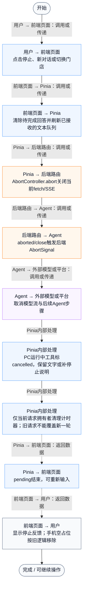
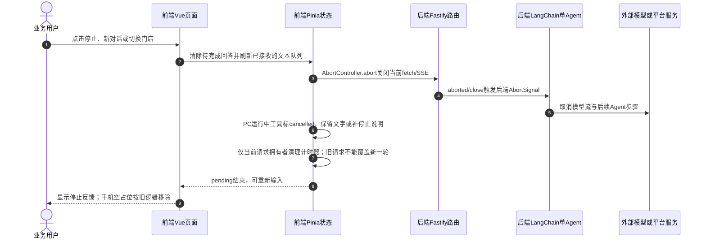

# ① AI经营驾驶舱 / 07 停止AI回答

**实现状态：已实现** · 核对日期：2026-10-27

以下两图依据当前源码；仅对已存在链路作实现描述。尚未实现的范围在边界中说明。

## 业务范围与数据契约

| 项目 | 说明 |
| --- | --- |
| 入口与触发 | PC及手机问答停止按钮 |
| 状态 | 已实现 |
| 接口与关键入参 | 中止PC POST /api/v2/agent/qa/stream 或手机 POST /api/v2/voice/qa/stream；无单独stop接口 |
| 主要调用 | AbortController / streamVoiceQuestion |
| 读取或写入数据 | 当前SSE连接与前端文本队列 |
| 核心处理 | 客户端abort触发后端close/aborted并向模型透传 signal |
| 响应与数据去向 | 已停止状态 |

## 业务流程图

## 时序图

## 规则、异常与完成边界

PC保留已生成文字；空回答变为“本次查询已停止”，运行中工具标为cancelled，清理仅限本轮请求，避免旧请求finally覆盖新请求。手机保留旧取消实现：完全空占位会移除。后端通过连接关闭中止模型循环；已开始的数据库读取、向量请求不保证立即中止，向量请求另有自身超时。已完成的业务只读查询不需要回滚；完成日志与停止有竞态，不能保证绝不写日志。

前端准备：读取当前门店及页面参数。

结果处理：更新 Pinia 或页面状态并渲染。

异常处理：参数校验、资源查询或业务处理失败；前端展示错误并允许重试。JSON、SSE和浏览器本地动作按各自协议反馈，失败不会凭空产生成功结果。

访问范围：Agent与资料接口校验Bearer会话及assignedShopIds；门店ID不作为模型可修改的工具参数。

## 源码与需求依据

- [backend/src/services/merchant-service.ts:1](D:/餐小助/backend/src/services/merchant-service.ts:1)
- [backend/src/routes/v2.ts:970](D:/餐小助/backend/src/routes/v2.ts:970)
- [front-pc/src/views/DashboardView.vue:1](D:/餐小助/front-pc/src/views/DashboardView.vue:1)
- [front-pc/src/views/DailyReportView.vue:1](D:/餐小助/front-pc/src/views/DailyReportView.vue:1)
- [front-phone/src/views/DailyReportView.vue:1](D:/餐小助/front-phone/src/views/DailyReportView.vue:1)
- [front-pc/src/stores/merchant.ts:1](D:/餐小助/front-pc/src/stores/merchant.ts:1)
- [backend/src/services/business-agent.ts:113](D:/餐小助/backend/src/services/business-agent.ts:113)
- [front-phone/src/stores/merchant.ts:365](D:/餐小助/front-phone/src/stores/merchant.ts:365)

[返回模块与功能目录](../README.md)
