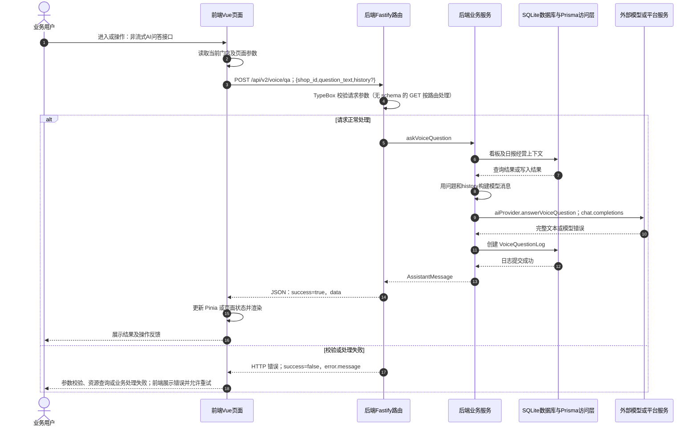

# ① AI经营驾驶舱 / 08 非流式AI问答接口

**实现状态：接口已实现，当前页面未接入** · 核对日期：2026-10-27

以下两图依据当前源码；仅对已存在链路作实现描述。尚未实现的范围在边界中说明。

## 业务范围与数据契约

| 项目 | 说明 |
| --- | --- |
| 入口与触发 | 后端保留旧voice接口；PC非流式Agent接口见单独文档 |
| 状态 | 接口已实现，当前页面未接入 |
| 接口与关键入参 | POST /api/v2/voice/qa；{shop_id,question_text,history?} |
| 主要调用 | askVoiceQuestion |
| 读取或写入数据 | 看板及日报经营上下文 |
| 核心处理 | 用问题和history构建模型消息 |
| 响应与数据去向 | AssistantMessage |

## 业务流程图

```mermaid
flowchart TD
  N1(["开始"])
  N2["用户 → 前端页面<br/>进入或操作：非流式AI问答接口"]
  N3["前端页面内部处理<br/>读取当前门店及页面参数"]
  N4["前端页面 → 后端路由<br/>POST /api/v2/voice/qa；{shop_id,question_text,histor<br/>y?}"]
  N5["后端路由内部处理<br/>TypeBox 校验请求参数（无 schema 的 GET 按路由处理）"]
  N6{"请求正常处理？"}
  N7["后端路由 → 业务服务<br/>askVoiceQuestion"]
  N8["业务服务 → 数据库<br/>看板及日报经营上下文"]
  N9["数据库 → 业务服务<br/>查询结果或写入结果"]
  N10["业务服务内部处理<br/>用问题和history构建模型消息"]
  N11["业务服务 → 外部模型或平台<br/>aiProvider.answerVoiceQuestion；chat.completions"]
  N12["外部模型或平台 → 业务服务<br/>完整文本或模型错误"]
  N13["业务服务 → 数据库<br/>创建 VoiceQuestionLog"]
  N14["数据库 → 业务服务<br/>日志提交成功"]
  N15["业务服务 → 后端路由<br/>AssistantMessage"]
  N16["后端路由 → 前端页面<br/>JSON：success=true，data"]
  N17["前端页面内部处理<br/>更新 Pinia 或页面状态并渲染"]
  N18["前端页面 → 用户<br/>展示结果及操作反馈"]
  N19["后端路由 → 前端页面<br/>HTTP 错误；success=false，error.message"]
  N20["前端页面 → 用户<br/>参数校验、资源查询或业务处理失败；前端展示错误并允许重试"]
  N21(["继续"])
  N22(["完成 / 可继续操作"])
  N1 -->|"用户 → 前端页面：调用或传递"| N2
  N2 -->|"前端页面内部处理"| N3
  N3 -->|"前端页面 → 后端路由：调用或传递"| N4
  N4 -->|"后端路由内部处理"| N5
  N5 --> N6
  N6 -->|"是 / 正常分支"| N7
  N7 -->|"业务服务 → 数据库：调用或传递"| N8
  N8 -.->|"数据库 → 业务服务：返回数据"| N9
  N9 -->|"业务服务内部处理"| N10
  N10 -->|"业务服务 → 外部模型或平台：调用或传递"| N11
  N11 -.->|"外部模型或平台 → 业务服务：返回数据"| N12
  N12 -->|"业务服务 → 数据库：调用或传递"| N13
  N13 -.->|"数据库 → 业务服务：返回数据"| N14
  N14 -.->|"业务服务 → 后端路由：返回数据"| N15
  N15 -.->|"后端路由 → 前端页面：返回数据"| N16
  N16 -->|"前端页面内部处理"| N17
  N17 -.->|"前端页面 → 用户：返回数据"| N18
  N6 -.->|"校验或处理失败"| N19
  N19 -.->|"前端页面 → 用户：返回数据"| N20
  N18 --> N21
  N20 --> N21
  N21 --> N22
  classDef user fill:#f8fafc,stroke:#64748b,color:#0f172a
  class N1,N18,N20,N22 user
  classDef front fill:#eff6ff,stroke:#60a5fa,color:#0f172a
  class N2,N3,N16,N17,N19 front
  classDef back fill:#fff7ed,stroke:#fb923c,color:#0f172a
  class N4,N5,N6,N7,N9,N10,N12,N14,N15,N21 back
  classDef data fill:#f0fdf4,stroke:#4ade80,color:#0f172a
  class N8,N13 data
  classDef external fill:#faf5ff,stroke:#c084fc,color:#0f172a
  class N11 external
```

## 时序图

## 规则、异常与完成边界

本文件仅指旧POST /voice/qa：先读固定看板与日报，再调用配置的模型，错误返回HTTP 503；成功后记录日志。当前PC页面默认使用/agent/qa/stream，手机使用/voice/qa/stream。旧voice接口无Agent工具编排，也没有新增的门店鉴权前置处理。

前端准备：读取当前门店及页面参数。

结果处理：更新 Pinia 或页面状态并渲染。

异常处理：参数校验、资源查询或业务处理失败；前端展示错误并允许重试。JSON、SSE和浏览器本地动作按各自协议反馈，失败不会凭空产生成功结果。

访问范围：此旧业务路由没有Agent/RAG同等的统一会话与门店鉴权；PC请求可携Bearer，但不能据此前端行为推断后端已核验。

## 源码与需求依据

- [backend/src/services/merchant-service.ts:2314](D:/餐小助/backend/src/services/merchant-service.ts:2314)
- [backend/src/routes/v2.ts:812](D:/餐小助/backend/src/routes/v2.ts:812)
- [front-pc/src/views/DashboardView.vue:1](D:/餐小助/front-pc/src/views/DashboardView.vue:1)
- [front-pc/src/views/DailyReportView.vue:1](D:/餐小助/front-pc/src/views/DailyReportView.vue:1)
- [front-phone/src/views/DailyReportView.vue:1](D:/餐小助/front-phone/src/views/DailyReportView.vue:1)
- [backend/src/services/ai-provider.ts:1](D:/餐小助/backend/src/services/ai-provider.ts:1)
- [front-pc/src/stores/merchant.ts:1](D:/餐小助/front-pc/src/stores/merchant.ts:1)

[返回模块与功能目录](../README.md)
