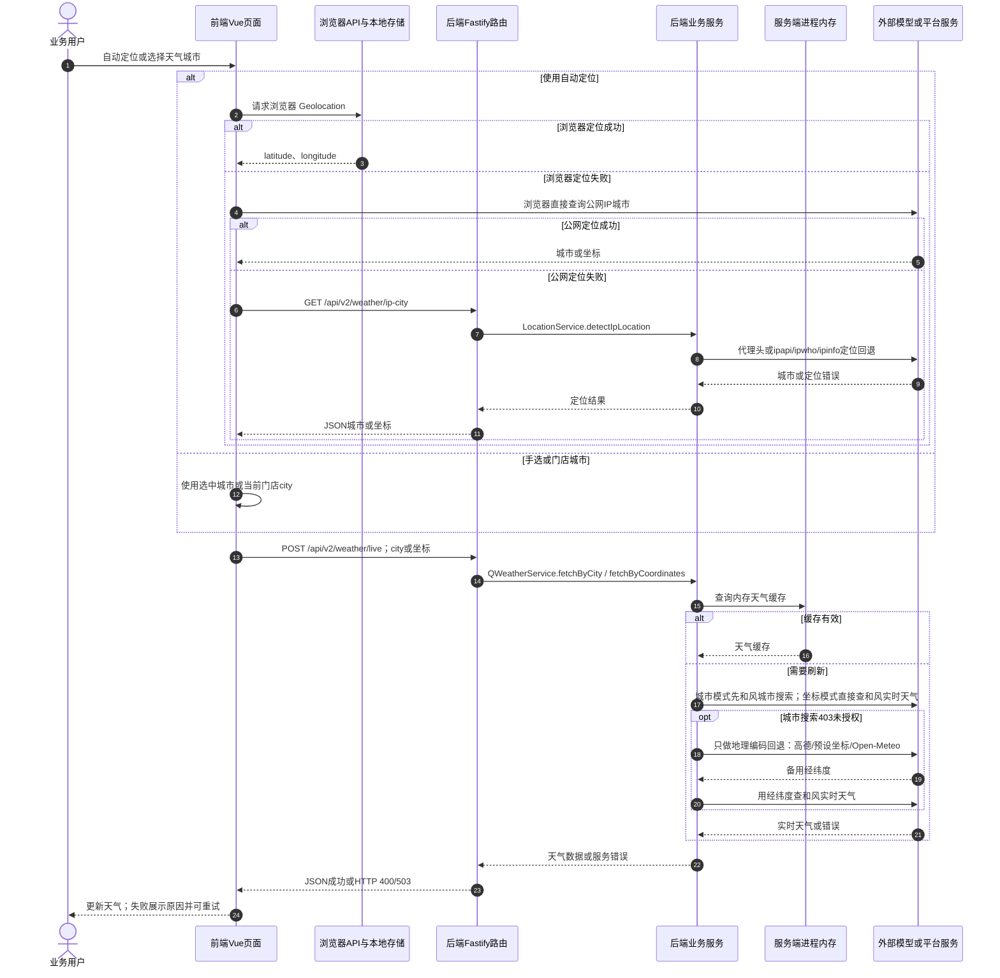

# ① AI经营驾驶舱 / 09 定位城市与实时天气

**实现状态：已实现** · 核对日期：2026-10-27

以下两图依据当前源码；仅对已存在链路作实现描述。尚未实现的范围在边界中说明。

## 业务范围与数据契约

| 项目 | 说明 |
| --- | --- |
| 入口与触发 | PC及手机天气卡片：定位、手选城市、门店城市 |
| 状态 | 已实现 |
| 接口与关键入参 | GET /api/v2/weather/ip-city；POST /api/v2/weather/live |
| 主要调用 | LocationService.detectIpLocation / QWeatherService.fetchByCity 或 fetchByCoordinates |
| 读取或写入数据 | 天气服务内存缓存及定位上下文，不写业务数据库 |
| 核心处理 | 按经纬度或城市查询和风天气并生成天气卡片 |
| 响应与数据去向 | 实时天气、城市标签或错误 |

## 业务流程图

```mermaid
flowchart TD
  N1(["开始"])
  N2["用户 → 前端页面<br/>自动定位或选择天气城市"]
  N3{"使用自动定位？"}
  N4["前端页面 → 浏览器<br/>请求浏览器 Geolocation"]
  N5{"浏览器定位成功？"}
  N6["浏览器 → 前端页面<br/>latitude、longitude"]
  N7["前端页面 → 外部模型或平台<br/>浏览器直接查询公网IP城市"]
  N8{"公网定位成功？"}
  N9["外部模型或平台 → 前端页面<br/>城市或坐标"]
  N10["前端页面 → 后端路由<br/>GET /api/v2/weather/ip-city"]
  N11["后端路由 → 业务服务<br/>LocationService.detectIpLocation"]
  N12["业务服务 → 外部模型或平台<br/>代理头或ipapi/ipwho/ipinfo定位回退"]
  N13["外部模型或平台 → 业务服务<br/>城市或定位错误"]
  N14["业务服务 → 后端路由<br/>定位结果"]
  N15["后端路由 → 前端页面<br/>JSON城市或坐标"]
  N16(["继续"])
  N17(["继续"])
  N18["前端页面内部处理<br/>使用选中城市或当前门店city"]
  N19(["继续"])
  N20["前端页面 → 后端路由<br/>POST /api/v2/weather/live；city或坐标"]
  N21["后端路由 → 业务服务<br/>QWeatherService.fetchByCity / fetchByCoordinates"]
  N22["业务服务 → 服务端内存<br/>查询内存天气缓存"]
  N23{"缓存有效？"}
  N24["服务端内存 → 业务服务<br/>天气缓存"]
  N25["业务服务 → 外部模型或平台<br/>城市模式先和风城市搜索；坐标模式直接查和风实时天气"]
  N26{"城市搜索403未授权？"}
  N27["业务服务 → 外部模型或平台<br/>只做地理编码回退：高德/预设坐标/Open-Meteo"]
  N28["外部模型或平台 → 业务服务<br/>备用经纬度"]
  N29["业务服务 → 外部模型或平台<br/>用经纬度查和风实时天气"]
  N30(["继续"])
  N31["外部模型或平台 → 业务服务<br/>实时天气或错误"]
  N32(["继续"])
  N33["业务服务 → 后端路由<br/>天气数据或服务错误"]
  N34["后端路由 → 前端页面<br/>JSON成功或HTTP 400/503"]
  N35["前端页面 → 用户<br/>更新天气；失败展示原因并可重试"]
  N36(["完成 / 可继续操作"])
  N1 -->|"用户 → 前端页面：调用或传递"| N2
  N2 --> N3
  N3 -->|"是 / 正常分支"| N4
  N4 --> N5
  N5 -.->|"是 / 正常分支"| N6
  N5 -->|"浏览器定位失败"| N7
  N7 --> N8
  N8 -.->|"是 / 正常分支"| N9
  N8 -->|"公网定位失败"| N10
  N10 -->|"后端路由 → 业务服务：调用或传递"| N11
  N11 -->|"业务服务 → 外部模型或平台：调用或传递"| N12
  N12 -.->|"外部模型或平台 → 业务服务：返回数据"| N13
  N13 -.->|"业务服务 → 后端路由：返回数据"| N14
  N14 -.->|"后端路由 → 前端页面：返回数据"| N15
  N9 --> N16
  N15 --> N16
  N6 --> N17
  N16 --> N17
  N3 -->|"手选或门店城市"| N18
  N17 --> N19
  N18 --> N19
  N19 -->|"前端页面 → 后端路由：调用或传递"| N20
  N20 -->|"后端路由 → 业务服务：调用或传递"| N21
  N21 -->|"业务服务 → 服务端内存：调用或传递"| N22
  N22 --> N23
  N23 -.->|"是 / 正常分支"| N24
  N23 -->|"需要刷新"| N25
  N25 --> N26
  N26 -->|"是"| N27
  N27 -.->|"外部模型或平台 → 业务服务：返回数据"| N28
  N28 -->|"业务服务 → 外部模型或平台：调用或传递"| N29
  N29 --> N30
  N26 -->|"否 / 跳过"| N30
  N30 -.->|"外部模型或平台 → 业务服务：返回数据"| N31
  N24 --> N32
  N31 --> N32
  N32 -.->|"业务服务 → 后端路由：返回数据"| N33
  N33 -.->|"后端路由 → 前端页面：返回数据"| N34
  N34 -.->|"前端页面 → 用户：返回数据"| N35
  N35 --> N36
  classDef user fill:#f8fafc,stroke:#64748b,color:#0f172a
  class N1,N35,N36 user
  classDef front fill:#eff6ff,stroke:#60a5fa,color:#0f172a
  class N2,N3,N4,N5,N6,N9,N15,N17,N18,N19,N34 front
  classDef back fill:#fff7ed,stroke:#fb923c,color:#0f172a
  class N10,N11,N13,N14,N20,N21,N22,N23,N24,N28,N31,N32,N33 back
  classDef external fill:#faf5ff,stroke:#c084fc,color:#0f172a
  class N7,N8,N12,N16,N25,N26,N27,N29,N30 external
```

## 时序图

## 规则、异常与完成边界

定位优先浏览器定位，其次浏览器公网IP查询，再回退服务端IP。手选城市和门店城市可直接查天气；失败时可保留当前展示并提示原因。实时天气不代表采购预测已经使用天气因子。 天气缓存为服务端进程内10分钟；城市搜索遇和风403时才尝试高德、预设坐标或Open-Meteo地理编码，实际天气仍取和风实时接口。

前端准备：读取当前门店及页面参数。

结果处理：更新 Pinia 或页面状态并渲染。

异常处理：参数校验、资源查询或业务处理失败；前端展示错误并允许重试。JSON、SSE和浏览器本地动作按各自协议反馈，失败不会凭空产生成功结果。

访问范围：此旧业务路由没有Agent/RAG同等的统一会话与门店鉴权；PC请求可携Bearer，但不能据此前端行为推断后端已核验。

## 源码与需求依据

- [backend/src/services/weather-service.ts:1](D:/餐小助/backend/src/services/weather-service.ts:1)
- [backend/src/routes/v2.ts:399](D:/餐小助/backend/src/routes/v2.ts:399)
- [front-pc/src/views/DashboardView.vue:1](D:/餐小助/front-pc/src/views/DashboardView.vue:1)
- [front-pc/src/views/DailyReportView.vue:1](D:/餐小助/front-pc/src/views/DailyReportView.vue:1)
- [front-phone/src/views/DailyReportView.vue:1](D:/餐小助/front-phone/src/views/DailyReportView.vue:1)
- [front-pc/src/stores/merchant.ts:1](D:/餐小助/front-pc/src/stores/merchant.ts:1)

[返回模块与功能目录](../README.md)
