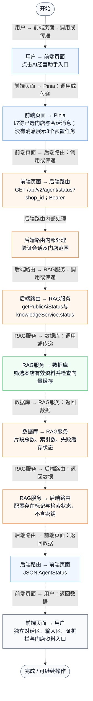
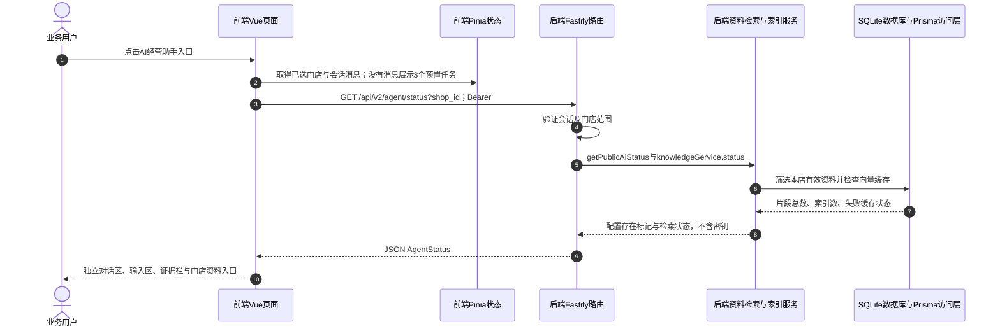

# ① AI经营驾驶舱 / 11 独立AI助手工作台与模型状态

**实现状态：已实现** · 核对日期：2026-10-27

以下两图依据当前源码；仅对已存在链路作实现描述。尚未实现的范围在边界中说明。

## 业务范围与数据契约

| 项目 | 说明 |
| --- | --- |
| 入口与触发 | PC侧栏与悬浮入口 → /assistant |
| 状态 | 已实现 |
| 接口与关键入参 | GET /api/v2/agent/status?shop_id；问答使用POST /api/v2/agent/qa/stream |
| 主要调用 | AssistantView.refreshStatus → getPublicAiStatus / KnowledgeService.status |
| 读取或写入数据 | AuthSession、有效AgentKnowledgeDocument及AgentKnowledgeEmbedding元数据 |
| 核心处理 | 读取模型配置存在状态与本店有效资料/索引状态，组织独立会话和证据栏 |
| 响应与数据去向 | provider、label、model、configured、activeDocuments、retrieval、embedding |

## 业务流程图

## 时序图

## 规则、异常与完成边界

configured只说明密钥配置存在，不代表服务已连通；retrieval=hybrid表示索引状态就绪，单次查询仍可能回退关键词。新页面目前属于PC工程，手机工程仍为原问答抽屉。状态错误单独展示，不伪造已连接。

前端准备：读取当前门店及页面参数。

结果处理：更新 Pinia 或页面状态并渲染。

异常处理：参数校验、资源查询或业务处理失败；前端展示错误并允许重试。JSON、SSE和浏览器本地动作按各自协议反馈，失败不会凭空产生成功结果。

访问范围：Agent与资料接口校验Bearer会话及assignedShopIds；门店ID不作为模型可修改的工具参数。

## 源码与需求依据

- [front-pc/src/views/AssistantView.vue:38](D:/餐小助/front-pc/src/views/AssistantView.vue:38)
- [front-pc/src/components/VoiceAssistant.vue:2](D:/餐小助/front-pc/src/components/VoiceAssistant.vue:2)
- [backend/src/routes/agent-knowledge.ts:24](D:/餐小助/backend/src/routes/agent-knowledge.ts:24)
- [backend/src/config/ai.ts:21](D:/餐小助/backend/src/config/ai.ts:21)
- [backend/src/services/knowledge-service.ts:191](D:/餐小助/backend/src/services/knowledge-service.ts:191)

[返回模块与功能目录](../README.md)
