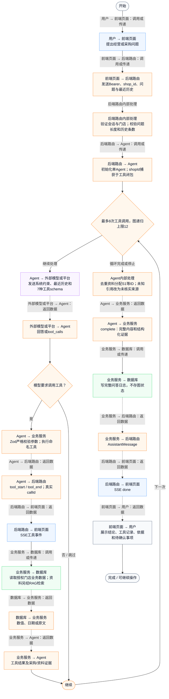
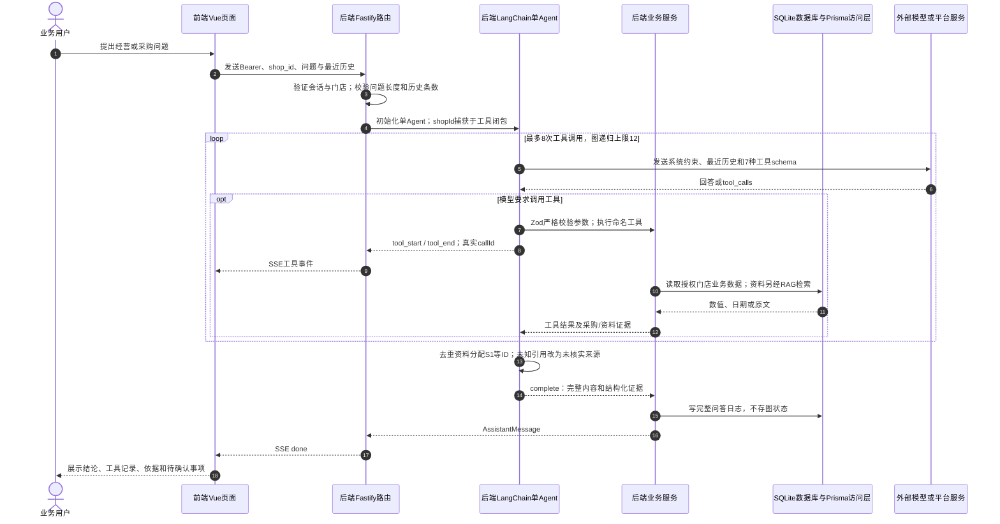

# ① AI经营驾驶舱 / 12 Agent自主工具编排与证据汇总

**实现状态：已实现** · 核对日期：2026-10-27

以下两图依据当前源码；仅对已存在链路作实现描述。尚未实现的范围在边界中说明。

## 业务范围与数据契约

| 项目 | 说明 |
| --- | --- |
| 入口与触发 | PC /assistant 提出经营或采购问题 |
| 状态 | 已实现 |
| 接口与关键入参 | POST /api/v2/agent/qa/stream；{shop_id,question_text,history?} |
| 主要调用 | runBusinessAgent → createAgent → buildBusinessTools |
| 读取或写入数据 | 本店订单、成本、库存、采购资料；完整回答另写VoiceQuestionLog |
| 核心处理 | 模型按问题选择业务工具，程序执行并回传结果，证据充分后生成回答 |
| 响应与数据去向 | 回答、使用工具列表、knowledgeSources、purchasePlan?、purchaseReview? |

## 业务流程图

## 时序图

## 规则、异常与完成边界

工具共7个：get_business_dashboard、get_daily_report、get_dish_sales、get_stock_snapshot、calculate_purchase_plan、search_purchase_knowledge、review_purchase_readiness。由LangChain createAgent提供模型—工具循环，源码没有自定义多Agent、StateGraph节点或checkpointer。门店不是模型可填写的参数。工具操作业务数据为只读，成功完成的问答日志会落库。工具选择来自模型与提示词，不能将提示词要求当作程序必然保证。

前端准备：读取当前门店及页面参数。

结果处理：更新 Pinia 或页面状态并渲染。

异常处理：参数校验、资源查询或业务处理失败；前端展示错误并允许重试。JSON、SSE和浏览器本地动作按各自协议反馈，失败不会凭空产生成功结果。

采购前核对优先review_purchase_readiness；其已包含采购试算及库存，不需要重复计算。仅查经营事实无需强制RAG；规则、报价、截单等问题必须有有效资料依据。

访问范围：Agent与资料接口校验Bearer会话及assignedShopIds；门店ID不作为模型可修改的工具参数。

## 源码与需求依据

- [backend/src/services/business-agent.ts:30](D:/餐小助/backend/src/services/business-agent.ts:30)
- [backend/src/services/business-agent.ts:67](D:/餐小助/backend/src/services/business-agent.ts:67)
- [backend/src/services/merchant-service.ts:2298](D:/餐小助/backend/src/services/merchant-service.ts:2298)
- [backend/src/routes/v2.ts:970](D:/餐小助/backend/src/routes/v2.ts:970)

[返回模块与功能目录](../README.md)
