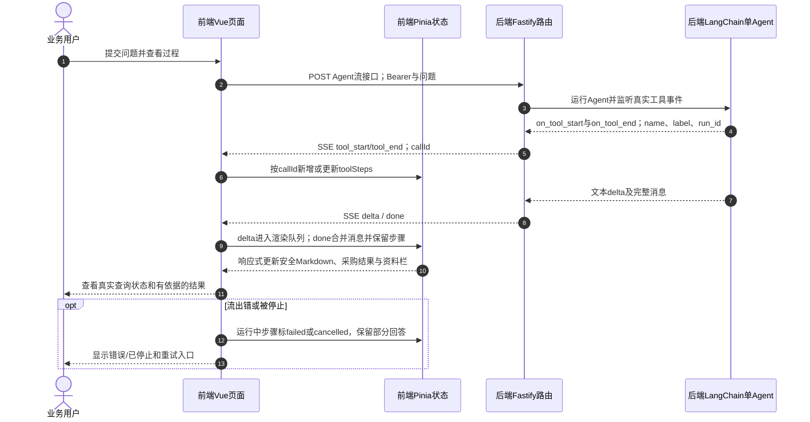

# ① AI经营驾驶舱 / 13 工具执行进度与结构化结果展示

**实现状态：已实现** · 核对日期：2026-10-27

以下两图依据当前源码；仅对已存在链路作实现描述。尚未实现的范围在边界中说明。

## 业务范围与数据契约

| 项目 | 说明 |
| --- | --- |
| 入口与触发 | PC助手回答区与右侧证据栏 |
| 状态 | 已实现 |
| 接口与关键入参 | POST /api/v2/agent/qa/stream；SSE tool_start/tool_end/delta/done/error |
| 主要调用 | api/merchant.streamVoiceQuestion → merchant.askAssistant → AssistantView |
| 读取或写入数据 | 前端AssistantMessage.toolSteps、knowledgeSources、purchasePlan、purchaseReview |
| 核心处理 | 按callId跟踪步骤，安全渲染回答与程序生成的采购卡片 |
| 响应与数据去向 | running/completed/failed/cancelled步骤、Markdown回答、采购表与核对卡片 |

## 业务流程图

```mermaid
flowchart TD
  N1(["开始"])
  N2["用户 → 前端页面<br/>提交问题并查看过程"]
  N3["前端页面 → 后端路由<br/>POST Agent流接口；Bearer与问题"]
  N4["后端路由 → Agent<br/>运行Agent并监听真实工具事件"]
  N5["Agent → 后端路由<br/>on_tool_start与on_tool_end；name、label、run_id"]
  N6["后端路由 → 前端页面<br/>SSE tool_start/tool_end；callId"]
  N7["前端页面 → Pinia<br/>按callId新增或更新toolSteps"]
  N8["Agent → 后端路由<br/>文本delta及完整消息"]
  N9["后端路由 → 前端页面<br/>SSE delta / done"]
  N10["前端页面 → Pinia<br/>delta进入渲染队列；done合并消息并保留步骤"]
  N11["Pinia → 前端页面<br/>响应式更新安全Markdown、采购结果与资料栏"]
  N12["前端页面 → 用户<br/>查看真实查询状态和有依据的结果"]
  N13{"流出错或被停止？"}
  N14["前端页面 → Pinia<br/>运行中步骤标failed或cancelled，保留部分回答"]
  N15["前端页面 → 用户<br/>显示错误/已停止和重试入口"]
  N16(["继续"])
  N17(["完成 / 可继续操作"])
  N1 -->|"用户 → 前端页面：调用或传递"| N2
  N2 -->|"前端页面 → 后端路由：调用或传递"| N3
  N3 -->|"后端路由 → Agent：调用或传递"| N4
  N4 -.->|"Agent → 后端路由：返回数据"| N5
  N5 -.->|"后端路由 → 前端页面：返回数据"| N6
  N6 -->|"前端页面 → Pinia：调用或传递"| N7
  N7 -.->|"Agent → 后端路由：返回数据"| N8
  N8 -.->|"后端路由 → 前端页面：返回数据"| N9
  N9 -->|"前端页面 → Pinia：调用或传递"| N10
  N10 -.->|"Pinia → 前端页面：返回数据"| N11
  N11 -.->|"前端页面 → 用户：返回数据"| N12
  N12 --> N13
  N13 -->|"是"| N14
  N14 -.->|"前端页面 → 用户：返回数据"| N15
  N15 --> N16
  N13 -->|"否 / 跳过"| N16
  N16 --> N17
  classDef user fill:#f8fafc,stroke:#64748b,color:#0f172a
  class N1,N12,N13,N15,N16,N17 user
  classDef front fill:#eff6ff,stroke:#60a5fa,color:#0f172a
  class N2,N6,N7,N9,N10,N11,N14 front
  classDef back fill:#fff7ed,stroke:#fb923c,color:#0f172a
  class N3,N4,N5,N8 back
```

## 时序图

## 规则、异常与完成边界

进度来自真实SSE事件，不是定时伪造。callId可区分同名重复或并发调用。采购表和核对卡片只有本轮工具实际返回时才显示；AssistantMarkdown使用Vue文本插值，不通过v-html执行模型文本。消息只保存在当前Pinia内存，刷新不自动恢复。

前端准备：读取当前门店及页面参数。

结果处理：更新 Pinia 或页面状态并渲染。

异常处理：参数校验、资源查询或业务处理失败；前端展示错误并允许重试。JSON、SSE和浏览器本地动作按各自协议反馈，失败不会凭空产生成功结果。

访问范围：Agent与资料接口校验Bearer会话及assignedShopIds；门店ID不作为模型可修改的工具参数。

## 源码与需求依据

- [front-pc/src/stores/merchant.ts:1008](D:/餐小助/front-pc/src/stores/merchant.ts:1008)
- [front-pc/src/api/merchant.ts:153](D:/餐小助/front-pc/src/api/merchant.ts:153)
- [front-pc/src/views/AssistantView.vue:30](D:/餐小助/front-pc/src/views/AssistantView.vue:30)
- [front-pc/src/components/AssistantMarkdown.vue:1](D:/餐小助/front-pc/src/components/AssistantMarkdown.vue:1)
- [front-pc/src/components/PurchaseReviewCard.vue:1](D:/餐小助/front-pc/src/components/PurchaseReviewCard.vue:1)

[返回模块与功能目录](../README.md)
