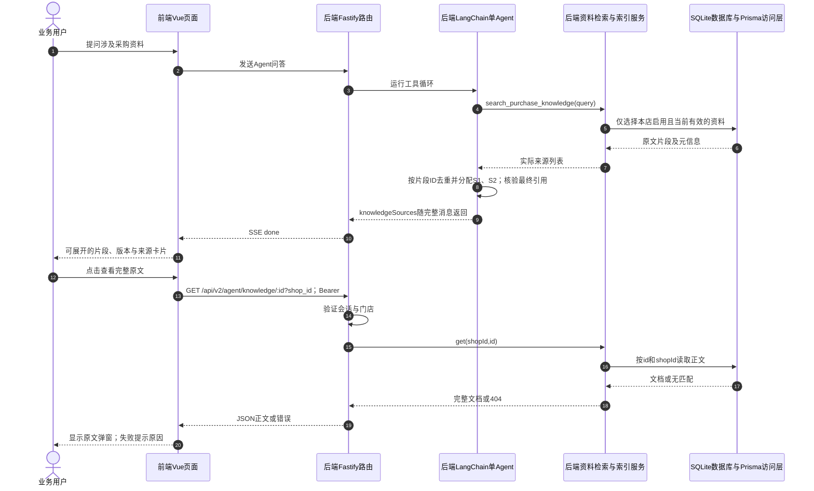

# ① AI经营驾驶舱 / 14 资料引用与完整原文查看

**实现状态：已实现** · 核对日期：2026-10-27

以下两图依据当前源码；仅对已存在链路作实现描述。尚未实现的范围在边界中说明。

## 业务范围与数据契约

| 项目 | 说明 |
| --- | --- |
| 入口与触发 | PC助手引用、资料卡片与原文弹窗 |
| 状态 | 已实现 |
| 接口与关键入参 | GET /api/v2/agent/knowledge/:id?shop_id；问答done提供knowledgeSources |
| 主要调用 | runBusinessAgent证据收集 → AssistantView.openSource → KnowledgeService.get |
| 读取或写入数据 | 检索返回的chunk与AgentKnowledgeDocument.content |
| 核心处理 | 给实际资料分配引用编号，按当前授权门店读取完整原文 |
| 响应与数据去向 | S1等引用、章节、版本、来源、生效起日、原文片段和全文 |

## 业务流程图

```mermaid
flowchart TD
  N1(["开始"])
  N2["用户 → 前端页面<br/>提问涉及采购资料"]
  N3["前端页面 → 后端路由<br/>发送Agent问答"]
  N4["后端路由 → Agent<br/>运行工具循环"]
  N5["Agent → RAG服务<br/>search_purchase_knowledge(query)"]
  N6["RAG服务 → 数据库<br/>仅选择本店启用且当前有效的资料"]
  N7["数据库 → RAG服务<br/>原文片段及元信息"]
  N8["RAG服务 → Agent<br/>实际来源列表"]
  N9["Agent内部处理<br/>按片段ID去重并分配S1、S2；核验最终引用"]
  N10["Agent → 后端路由<br/>knowledgeSources随完整消息返回"]
  N11["后端路由 → 前端页面<br/>SSE done"]
  N12["前端页面 → 用户<br/>可展开的片段、版本与来源卡片"]
  N13["用户 → 前端页面<br/>点击查看完整原文"]
  N14["前端页面 → 后端路由<br/>GET /api/v2/agent/knowledge/:id?shop_id；Bearer"]
  N15["后端路由内部处理<br/>验证会话与门店"]
  N16["后端路由 → RAG服务<br/>get(shopId,id)"]
  N17["RAG服务 → 数据库<br/>按id和shopId读取正文"]
  N18["数据库 → RAG服务<br/>文档或无匹配"]
  N19["RAG服务 → 后端路由<br/>完整文档或404"]
  N20["后端路由 → 前端页面<br/>JSON正文或错误"]
  N21["前端页面 → 用户<br/>显示原文弹窗；失败提示原因"]
  N22(["完成 / 可继续操作"])
  N1 -->|"用户 → 前端页面：调用或传递"| N2
  N2 -->|"前端页面 → 后端路由：调用或传递"| N3
  N3 -->|"后端路由 → Agent：调用或传递"| N4
  N4 -->|"Agent → RAG服务：调用或传递"| N5
  N5 -->|"RAG服务 → 数据库：调用或传递"| N6
  N6 -.->|"数据库 → RAG服务：返回数据"| N7
  N7 -.->|"RAG服务 → Agent：返回数据"| N8
  N8 -->|"Agent内部处理"| N9
  N9 -.->|"Agent → 后端路由：返回数据"| N10
  N10 -.->|"后端路由 → 前端页面：返回数据"| N11
  N11 -.->|"前端页面 → 用户：返回数据"| N12
  N12 -->|"用户 → 前端页面：调用或传递"| N13
  N13 -->|"前端页面 → 后端路由：调用或传递"| N14
  N14 -->|"后端路由内部处理"| N15
  N15 -->|"后端路由 → RAG服务：调用或传递"| N16
  N16 -->|"RAG服务 → 数据库：调用或传递"| N17
  N17 -.->|"数据库 → RAG服务：返回数据"| N18
  N18 -.->|"RAG服务 → 后端路由：返回数据"| N19
  N19 -.->|"后端路由 → 前端页面：返回数据"| N20
  N20 -.->|"前端页面 → 用户：返回数据"| N21
  N21 --> N22
  classDef user fill:#f8fafc,stroke:#64748b,color:#0f172a
  class N1,N12,N21,N22 user
  classDef front fill:#eff6ff,stroke:#60a5fa,color:#0f172a
  class N2,N11,N13,N20 front
  classDef back fill:#fff7ed,stroke:#fb923c,color:#0f172a
  class N3,N4,N5,N7,N8,N9,N10,N14,N15,N16,N18,N19 back
  classDef data fill:#f0fdf4,stroke:#4ade80,color:#0f172a
  class N6,N17 data
```

## 时序图

## 规则、异常与完成边界

引用ID是本轮证据编号，并非全局文档编号。停用/过期阻止新检索，不会回写已经显示的旧答案；全文接口按门店读取文档，不强制仅active。未知[S数字]在最终消息会标记未核实；流式中途文字尚未做最终引用替换。元信息当前返回effectiveFrom，没有返回effectiveUntil，若要核对结束日期可查看全文元信息。

前端准备：读取当前门店及页面参数。

结果处理：更新 Pinia 或页面状态并渲染。

异常处理：参数校验、资源查询或业务处理失败；前端展示错误并允许重试。JSON、SSE和浏览器本地动作按各自协议反馈，失败不会凭空产生成功结果。

访问范围：Agent与资料接口校验Bearer会话及assignedShopIds；门店ID不作为模型可修改的工具参数。

## 源码与需求依据

- [backend/src/services/business-agent.ts:137](D:/餐小助/backend/src/services/business-agent.ts:137)
- [front-pc/src/views/AssistantView.vue:90](D:/餐小助/front-pc/src/views/AssistantView.vue:90)
- [backend/src/routes/agent-knowledge.ts:32](D:/餐小助/backend/src/routes/agent-knowledge.ts:32)
- [backend/src/services/knowledge-service.ts:111](D:/餐小助/backend/src/services/knowledge-service.ts:111)

[返回模块与功能目录](../README.md)
