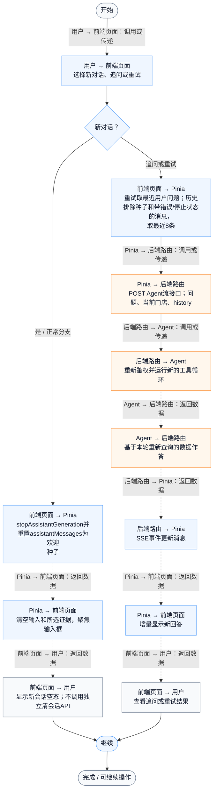
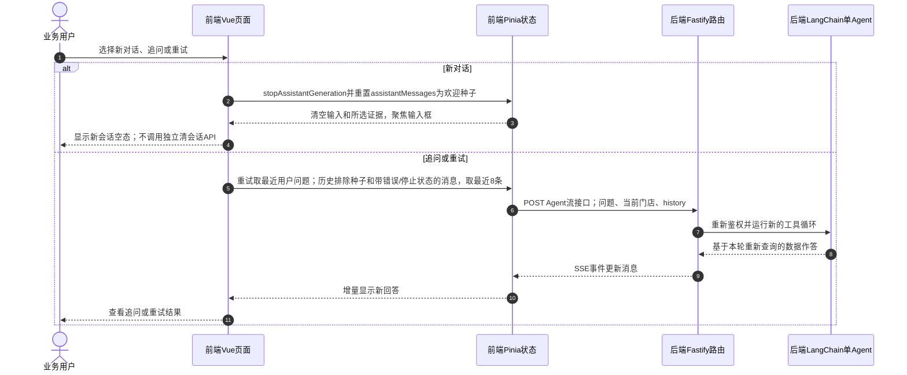

# ① AI经营驾驶舱 / 15 新对话追问与失败重试

**实现状态：已实现** · 核对日期：2026-10-27

以下两图依据当前源码；仅对已存在链路作实现描述。尚未实现的范围在边界中说明。

## 业务范围与数据契约

| 项目 | 说明 |
| --- | --- |
| 入口与触发 | PC /assistant 新对话、追问与重试按钮 |
| 状态 | 已实现 |
| 接口与关键入参 | 新对话为前端操作；重试仍POST /api/v2/agent/qa/stream |
| 主要调用 | resetAssistantConversation / buildAssistantHistory / retry |
| 读取或写入数据 | Pinia当前会话消息；成功问答日志不用于自动恢复 |
| 核心处理 | 新对话中断旧流并清空消息；追问携带有效历史；重试提交最近用户问题 |
| 响应与数据去向 | 当前门店的新会话或新一轮回答 |

## 业务流程图

## 时序图

## 规则、异常与完成边界

没有服务端thread_id、持久会话读取接口或LangGraph检查点。重试会新增一轮消息，不是恢复原模型任务；最近用户问题可能也出现在历史中，当前实现没有专门消除这一重复。旧请求finally只清理自己拥有的运行状态。

前端准备：读取当前门店及页面参数。

结果处理：更新 Pinia 或页面状态并渲染。

异常处理：参数校验、资源查询或业务处理失败；前端展示错误并允许重试。JSON、SSE和浏览器本地动作按各自协议反馈，失败不会凭空产生成功结果。

访问范围：Agent与资料接口校验Bearer会话及assignedShopIds；门店ID不作为模型可修改的工具参数。

## 源码与需求依据

- [front-pc/src/views/AssistantView.vue:98](D:/餐小助/front-pc/src/views/AssistantView.vue:98)
- [front-pc/src/views/AssistantView.vue:79](D:/餐小助/front-pc/src/views/AssistantView.vue:79)
- [front-pc/src/stores/merchant.ts:266](D:/餐小助/front-pc/src/stores/merchant.ts:266)
- [front-pc/src/stores/merchant.ts:261](D:/餐小助/front-pc/src/stores/merchant.ts:261)

[返回模块与功能目录](../README.md)
