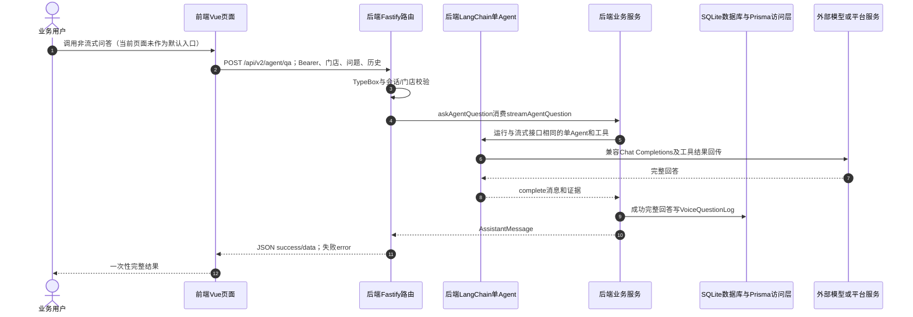

# ① AI经营驾驶舱 / 16 非流式Agent问答接口

**实现状态：接口已实现，当前页面未接入** · 核对日期：2026-10-27

以下两图依据当前源码；仅对已存在链路作实现描述。尚未实现的范围在边界中说明。

## 业务范围与数据契约

| 项目 | 说明 |
| --- | --- |
| 入口与触发 | 后端提供；PC默认仍使用SSE |
| 状态 | 接口已实现，当前页面未接入 |
| 接口与关键入参 | POST /api/v2/agent/qa；{shop_id,question_text,history?} |
| 主要调用 | askAgentQuestion → streamAgentQuestion → runBusinessAgent |
| 读取或写入数据 | 7种工具可查询的当前门店数据；VoiceQuestionLog |
| 核心处理 | 消费同一Agent事件生成器，等待complete后一次返回 |
| 响应与数据去向 | JSON AssistantMessage，失败HTTP 503；鉴权失败401/403 |

## 业务流程图

```mermaid
flowchart TD
  N1(["开始"])
  N2["用户 → 前端页面<br/>调用非流式问答（当前页面未作为默认入口）"]
  N3["前端页面 → 后端路由<br/>POST /api/v2/agent/qa；Bearer、门店、问题、历史"]
  N4["后端路由内部处理<br/>TypeBox与会话/门店校验"]
  N5["后端路由 → 业务服务<br/>askAgentQuestion消费streamAgentQuestion"]
  N6["业务服务 → Agent<br/>运行与流式接口相同的单Agent和工具"]
  N7["Agent → 外部模型或平台<br/>兼容Chat Completions及工具结果回传"]
  N8["外部模型或平台 → Agent<br/>完整回答"]
  N9["Agent → 业务服务<br/>complete消息和证据"]
  N10["业务服务 → 数据库<br/>成功完整回答写VoiceQuestionLog"]
  N11["业务服务 → 后端路由<br/>AssistantMessage"]
  N12["后端路由 → 前端页面<br/>JSON success/data；失败error"]
  N13["前端页面 → 用户<br/>一次性完整结果"]
  N14(["完成 / 可继续操作"])
  N1 -->|"用户 → 前端页面：调用或传递"| N2
  N2 -->|"前端页面 → 后端路由：调用或传递"| N3
  N3 -->|"后端路由内部处理"| N4
  N4 -->|"后端路由 → 业务服务：调用或传递"| N5
  N5 -->|"业务服务 → Agent：调用或传递"| N6
  N6 -->|"Agent → 外部模型或平台：调用或传递"| N7
  N7 -.->|"外部模型或平台 → Agent：返回数据"| N8
  N8 -.->|"Agent → 业务服务：返回数据"| N9
  N9 -->|"业务服务 → 数据库：调用或传递"| N10
  N10 -.->|"业务服务 → 后端路由：返回数据"| N11
  N11 -.->|"后端路由 → 前端页面：返回数据"| N12
  N12 -.->|"前端页面 → 用户：返回数据"| N13
  N13 --> N14
  classDef user fill:#f8fafc,stroke:#64748b,color:#0f172a
  class N1,N13,N14 user
  classDef front fill:#eff6ff,stroke:#60a5fa,color:#0f172a
  class N2,N12 front
  classDef back fill:#fff7ed,stroke:#fb923c,color:#0f172a
  class N3,N4,N5,N6,N8,N9,N11 back
  classDef data fill:#f0fdf4,stroke:#4ade80,color:#0f172a
  class N10 data
  classDef external fill:#faf5ff,stroke:#c084fc,color:#0f172a
  class N7 external
```

## 时序图

## 规则、异常与完成边界

复用同一工具、上限、引用处理及业务只读边界，不是旧/voice/qa固定工作流。等待过程中不会向客户端推送工具状态；非流式路由未绑定客户端断开到AbortSignal，仍有Agent90秒总超时。

前端准备：读取当前门店及页面参数。

结果处理：更新 Pinia 或页面状态并渲染。

异常处理：参数校验、资源查询或业务处理失败；前端展示错误并允许重试。JSON、SSE和浏览器本地动作按各自协议反馈，失败不会凭空产生成功结果。

访问范围：Agent与资料接口校验Bearer会话及assignedShopIds；门店ID不作为模型可修改的工具参数。

## 源码与需求依据

- [backend/src/routes/v2.ts:926](D:/餐小助/backend/src/routes/v2.ts:926)
- [backend/src/services/merchant-service.ts:2307](D:/餐小助/backend/src/services/merchant-service.ts:2307)
- [backend/src/services/business-agent.ts:67](D:/餐小助/backend/src/services/business-agent.ts:67)

[返回模块与功能目录](../README.md)
