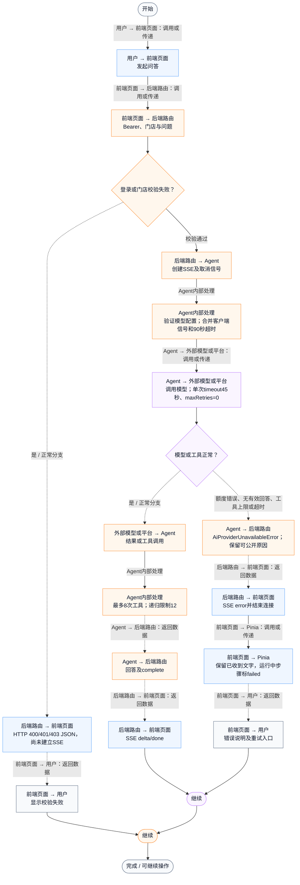
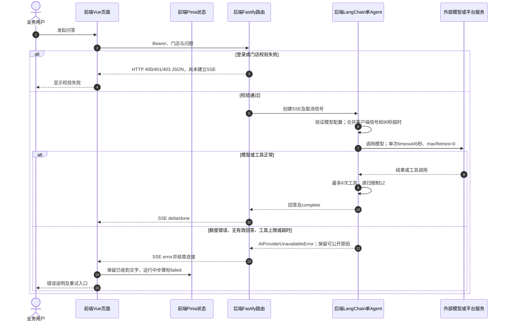

# ① AI经营驾驶舱 / 17 Agent执行限制与异常反馈

**实现状态：已实现** · 核对日期：2026-10-27

以下两图依据当前源码；仅对已存在链路作实现描述。尚未实现的范围在边界中说明。

## 业务范围与数据契约

| 项目 | 说明 |
| --- | --- |
| 入口与触发 | PC助手运行、超时、连接异常和权限失败 |
| 状态 | 已实现 |
| 接口与关键入参 | POST /api/v2/agent/qa/stream；流前HTTP错误、流中SSE error |
| 主要调用 | runBusinessAgent的bounded / combinedSignal；路由getUserFacingAiError |
| 读取或写入数据 | 本轮调用计数、模型状态、客户端断开信号；成功才写问答日志 |
| 核心处理 | 8次工具调用、递归12、模型45秒及整轮90秒；区分401/402/429等模型错误 |
| 响应与数据去向 | 友好错误、失败步骤、保留文字、可重新提问 |

## 业务流程图

## 时序图

## 规则、异常与完成边界

模型401提示密钥无效、402余额不足、429频繁；本地mock未配置会明确报错，不返回假经营答案。8次上限在工具包装和事件监听两处限制；提示词只读之外，实际工具也没有确认采购等写接口。数据库/向量调用不会因模型断开获得统一事务回滚；业务工具结果与日志边界分别说明。

前端准备：读取当前门店及页面参数。

结果处理：更新 Pinia 或页面状态并渲染。

异常处理：参数校验、资源查询或业务处理失败；前端展示错误并允许重试。JSON、SSE和浏览器本地动作按各自协议反馈，失败不会凭空产生成功结果。

访问范围：Agent与资料接口校验Bearer会话及assignedShopIds；门店ID不作为模型可修改的工具参数。

## 源码与需求依据

- [backend/src/services/business-agent.ts:32](D:/餐小助/backend/src/services/business-agent.ts:32)
- [backend/src/services/business-agent.ts:113](D:/餐小助/backend/src/services/business-agent.ts:113)
- [backend/src/routes/v2.ts:78](D:/餐小助/backend/src/routes/v2.ts:78)
- [front-pc/src/stores/merchant.ts:966](D:/餐小助/front-pc/src/stores/merchant.ts:966)

[返回模块与功能目录](../README.md)
