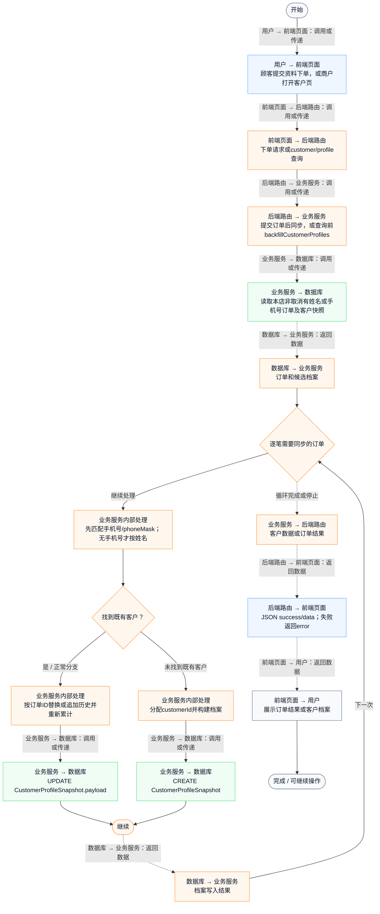
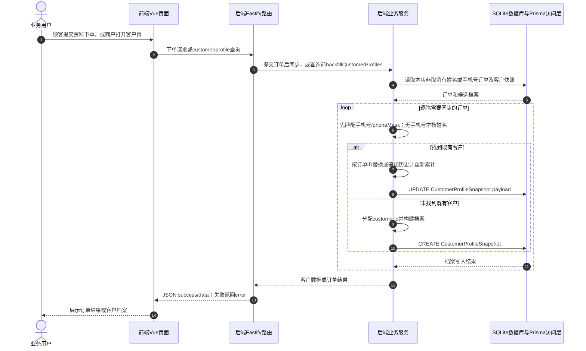

# ② AI客户资产管家 / 01 客户OneID识别与档案沉淀

**实现状态：部分实现** · 核对日期：2026-10-27

以下两图依据当前源码；仅对已存在链路作实现描述。尚未实现的范围在边界中说明。

## 业务范围与数据契约

| 项目 | 说明 |
| --- | --- |
| 入口与触发 | 顾客下单后自动同步；客户查询前自动回填 |
| 状态 | 部分实现 |
| 接口与关键入参 | POST /api/v2/public/dining/:token/orders；POST /api/v2/customer/profile |
| 主要调用 | syncCustomerProfileFromOrder / backfillCustomerProfiles |
| 读取或写入数据 | 同一shopId下 CustomerProfileSnapshot 和非取消 DiningOrder明细 |
| 核心处理 | 手机号或脱敏号匹配；无手机号时按姓名匹配；按订单ID更新历史，重新计算消费与简化分层 |
| 响应与数据去向 | 统一客户档案或订单提交结果 |

对应PRD功能：客户OneID打通。

## 业务流程图

## 时序图

## 规则、异常与完成边界

仅同一门店内匹配，并非全平台或跨店主数据OneID；脱敏号匹配可能重号，未接入顾客UnionID。客户历史最多保存20条；加菜按同一订单ID替换历史项。下单后就同步，不以served/completed为前提。取消订单没有对应删除既有客户历史的回滚链路。

前端准备：读取当前门店及页面参数。

结果处理：更新 Pinia 或页面状态并渲染。

异常处理：参数校验、资源查询或业务处理失败；前端展示错误并允许重试。JSON、SSE和浏览器本地动作按各自协议反馈，失败不会凭空产生成功结果。

访问范围：此旧业务路由没有Agent/RAG同等的统一会话与门店鉴权；PC请求可携Bearer，但不能据此前端行为推断后端已核验。

## 源码与需求依据

- [backend/src/services/dining-service.ts:484](D:/餐小助/backend/src/services/dining-service.ts:484)
- [backend/src/routes/v2.ts:143](D:/餐小助/backend/src/routes/v2.ts:143)
- [front-pc/src/views/CustomersView.vue:1](D:/餐小助/front-pc/src/views/CustomersView.vue:1)
- [front-phone/src/views/CustomersView.vue:1](D:/餐小助/front-phone/src/views/CustomersView.vue:1)
- [front-pc/src/stores/merchant.ts:1](D:/餐小助/front-pc/src/stores/merchant.ts:1)

[返回模块与功能目录](../README.md)
