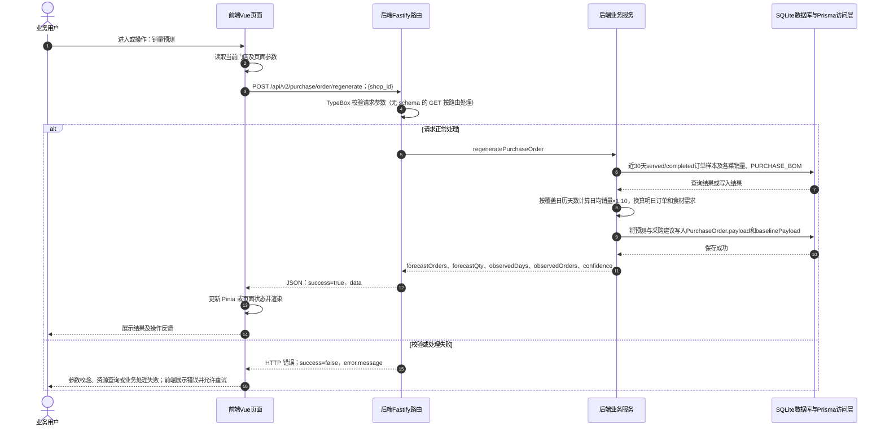

# ④ AI智能采购与库存 / 01 销量预测

**实现状态：部分实现** · 核对日期：2026-10-27

以下两图依据当前源码；仅对已存在链路作实现描述。尚未实现的范围在边界中说明。

## 业务范围与数据契约

| 项目 | 说明 |
| --- | --- |
| 入口与触发 | 采购页预测依据、订单预测和食材预测需求 |
| 状态 | 部分实现 |
| 接口与关键入参 | POST /api/v2/purchase/order/regenerate；{shop_id} |
| 主要调用 | regeneratePurchaseOrder |
| 读取或写入数据 | 近30天served/completed订单样本及各菜销量、PURCHASE_BOM |
| 核心处理 | 按有效样本天数计算日均销量×1.10，换算明日订单和食材需求 |
| 响应与数据去向 | forecastOrders、forecastQty、observedDays、observedOrders、confidence |

对应PRD功能：销量预测。

## 业务流程图

```mermaid
flowchart TD
  N1(["开始"])
  N2["用户 → 前端页面<br/>进入或操作：销量预测"]
  N3["前端页面内部处理<br/>读取当前门店及页面参数"]
  N4["前端页面 → 后端路由<br/>POST /api/v2/purchase/order/regenerate；{shop_id}"]
  N5["后端路由内部处理<br/>TypeBox 校验请求参数（无 schema 的 GET 按路由处理）"]
  N6{"请求正常处理？"}
  N7["后端路由 → 业务服务<br/>regeneratePurchaseOrder"]
  N8["业务服务 → 数据库<br/>近30天served/completed订单样本及各菜销量、PURCHASE_BOM"]
  N9["数据库 → 业务服务<br/>查询结果或写入结果"]
  N10["业务服务内部处理<br/>按覆盖日历天数计算日均销量×1.10，换算明日订单和食材需求"]
  N11["业务服务 → 数据库<br/>将预测与采购建议写入PurchaseOrder.payload和baselinePay<br/>load"]
  N12["数据库 → 业务服务<br/>保存成功"]
  N13["业务服务 → 后端路由<br/>forecastOrders、forecastQty、observedDays、observedOr<br/>ders、confidence"]
  N14["后端路由 → 前端页面<br/>JSON：success=true，data"]
  N15["前端页面内部处理<br/>更新 Pinia 或页面状态并渲染"]
  N16["前端页面 → 用户<br/>展示结果及操作反馈"]
  N17["后端路由 → 前端页面<br/>HTTP 错误；success=false，error.message"]
  N18["前端页面 → 用户<br/>参数校验、资源查询或业务处理失败；前端展示错误并允许重试"]
  N19(["继续"])
  N20(["完成 / 可继续操作"])
  N1 -->|"用户 → 前端页面：调用或传递"| N2
  N2 -->|"前端页面内部处理"| N3
  N3 -->|"前端页面 → 后端路由：调用或传递"| N4
  N4 -->|"后端路由内部处理"| N5
  N5 --> N6
  N6 -->|"是 / 正常分支"| N7
  N7 -->|"业务服务 → 数据库：调用或传递"| N8
  N8 -.->|"数据库 → 业务服务：返回数据"| N9
  N9 -->|"业务服务内部处理"| N10
  N10 -->|"业务服务 → 数据库：调用或传递"| N11
  N11 -.->|"数据库 → 业务服务：返回数据"| N12
  N12 -.->|"业务服务 → 后端路由：返回数据"| N13
  N13 -.->|"后端路由 → 前端页面：返回数据"| N14
  N14 -->|"前端页面内部处理"| N15
  N15 -.->|"前端页面 → 用户：返回数据"| N16
  N6 -.->|"校验或处理失败"| N17
  N17 -.->|"前端页面 → 用户：返回数据"| N18
  N16 --> N19
  N18 --> N19
  N19 --> N20
  classDef user fill:#f8fafc,stroke:#64748b,color:#0f172a
  class N1,N16,N18,N20 user
  classDef front fill:#eff6ff,stroke:#60a5fa,color:#0f172a
  class N2,N3,N14,N15,N17 front
  classDef back fill:#fff7ed,stroke:#fb923c,color:#0f172a
  class N4,N5,N6,N7,N9,N10,N12,N13,N19 back
  classDef data fill:#f0fdf4,stroke:#4ade80,color:#0f172a
  class N8,N11 data
```

## 时序图

## 规则、异常与完成边界

当前预测明天，规则计算，不调用AI模型；未接天气、节假日或活动预测因子，无未来3/7天切换与准确率回测。无BOM匹配或无有效销售时标记insufficient。 历史窗口是从当前营业日向前29天至当前时刻，observedDays按第一笔有效订单至今天的日历天数（含无订单日）计算，最多30天，不是只计算有订单的天数。新增diagnostics包含时间范围、未匹配BOM菜品与被排除状态订单。BOM与库存单位不一致时现存/在途均不抵扣，须人工核实；目录初始化不覆盖既有单位。confidence为规则分数，不是模型准确率。

前端准备：读取当前门店及页面参数。

结果处理：更新 Pinia 或页面状态并渲染。

异常处理：参数校验、资源查询或业务处理失败；前端展示错误并允许重试。JSON、SSE和浏览器本地动作按各自协议反馈，失败不会凭空产生成功结果。

访问范围：此旧业务路由没有Agent/RAG同等的统一会话与门店鉴权；PC请求可携Bearer，但不能据此前端行为推断后端已核验。

## 源码与需求依据

- [backend/src/services/merchant-service.ts:1344](D:/餐小助/backend/src/services/merchant-service.ts:1344)
- [backend/src/routes/v2.ts:674](D:/餐小助/backend/src/routes/v2.ts:674)
- [front-pc/src/views/PurchaseView.vue:1](D:/餐小助/front-pc/src/views/PurchaseView.vue:1)
- [front-phone/src/views/PurchaseView.vue:1](D:/餐小助/front-phone/src/views/PurchaseView.vue:1)
- [front-pc/src/views/InventoryView.vue:1](D:/餐小助/front-pc/src/views/InventoryView.vue:1)
- [front-phone/src/views/InventoryView.vue:1](D:/餐小助/front-phone/src/views/InventoryView.vue:1)
- [backend/src/services/inventory-service.ts:156](D:/餐小助/backend/src/services/inventory-service.ts:156)
- [backend/src/lib/sqlite-time.ts:3](D:/餐小助/backend/src/lib/sqlite-time.ts:3)
- [front-pc/src/stores/merchant.ts:1](D:/餐小助/front-pc/src/stores/merchant.ts:1)

[返回模块与功能目录](../README.md)
