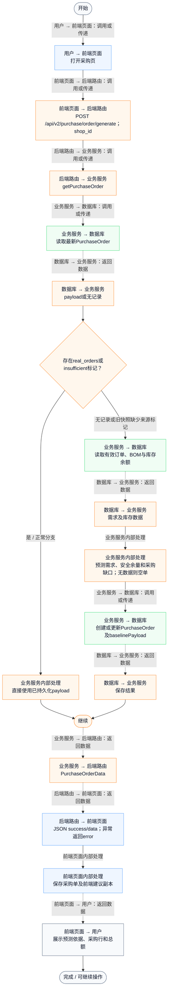
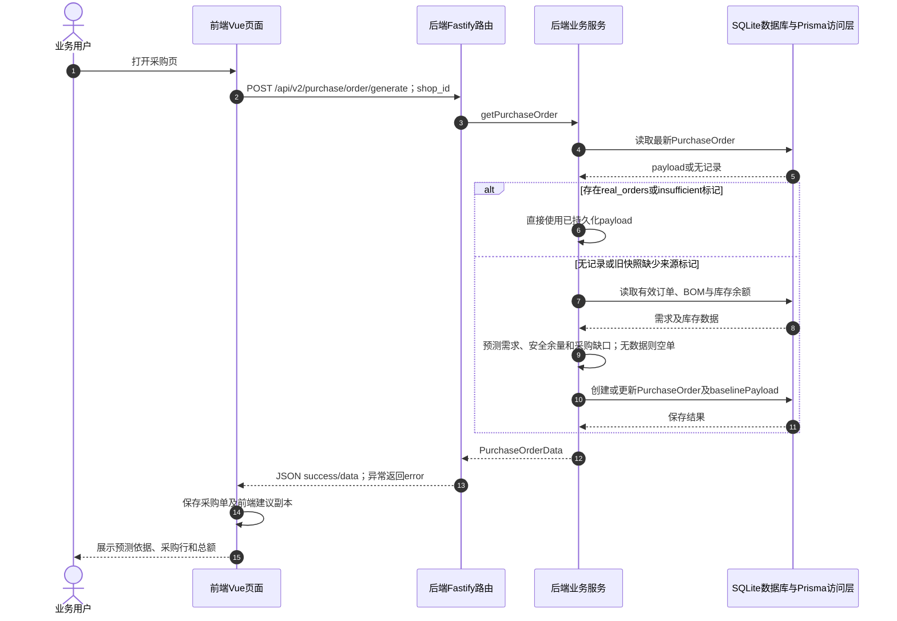

# ④ AI智能采购与库存 / 02 智能采购单读取与自动生成

**实现状态：已实现** · 核对日期：2026-10-27

以下两图依据当前源码；仅对已存在链路作实现描述。尚未实现的范围在边界中说明。

## 业务范围与数据契约

| 项目 | 说明 |
| --- | --- |
| 入口与触发 | PC及手机 /purchase |
| 状态 | 已实现 |
| 接口与关键入参 | POST /api/v2/purchase/order/generate；{shop_id} |
| 主要调用 | getPurchaseOrder → 必要时regeneratePurchaseOrder |
| 读取或写入数据 | 读取最新PurchaseOrder；必要时读取有效订单、BOM、InventoryItem |
| 核心处理 | 仅直接使用dataSource为real_orders或insufficient的采购单；旧快照重新计算需求、安全余量和库存缺口 |
| 响应与数据去向 | PurchaseOrderData |

对应PRD功能：智能采购单。

## 业务流程图

## 时序图

## 规则、异常与完成边界

实际输出CSV而非PDF。库存缺口=max(0,预测消耗+15%安全余量-可用现货-在途)。供应商来自预设BOM档案，不含实时比价。 历史窗口是从当前营业日向前29天至当前时刻，observedDays按第一笔有效订单至今天的日历天数（含无订单日）计算，最多30天，不是只计算有订单的天数。新增diagnostics包含时间范围、未匹配BOM菜品与被排除状态订单。BOM与库存单位不一致时现存/在途均不抵扣，须人工核实；目录初始化不覆盖既有单位。confidence为规则分数，不是模型准确率。 PC无已加载数据时通过ModuleLoadState区分加载和失败，点击重新读取会调用refreshShopContext并发重载8项；已成功模块独立显示。

前端准备：读取当前门店及页面参数。

结果处理：更新 Pinia 或页面状态并渲染。

异常处理：参数校验、资源查询或业务处理失败；前端展示错误并允许重试。JSON、SSE和浏览器本地动作按各自协议反馈，失败不会凭空产生成功结果。

访问范围：此旧业务路由没有Agent/RAG同等的统一会话与门店鉴权；PC请求可携Bearer，但不能据此前端行为推断后端已核验。

## 源码与需求依据

- [backend/src/services/merchant-service.ts:1294](D:/餐小助/backend/src/services/merchant-service.ts:1294)
- [backend/src/routes/v2.ts:662](D:/餐小助/backend/src/routes/v2.ts:662)
- [front-pc/src/views/PurchaseView.vue:1](D:/餐小助/front-pc/src/views/PurchaseView.vue:1)
- [front-phone/src/views/PurchaseView.vue:1](D:/餐小助/front-phone/src/views/PurchaseView.vue:1)
- [front-pc/src/views/InventoryView.vue:1](D:/餐小助/front-pc/src/views/InventoryView.vue:1)
- [front-phone/src/views/InventoryView.vue:1](D:/餐小助/front-phone/src/views/InventoryView.vue:1)
- [backend/src/services/inventory-service.ts:156](D:/餐小助/backend/src/services/inventory-service.ts:156)
- [backend/src/lib/sqlite-time.ts:3](D:/餐小助/backend/src/lib/sqlite-time.ts:3)
- [front-pc/src/components/ModuleLoadState.vue:3](D:/餐小助/front-pc/src/components/ModuleLoadState.vue:3)
- [front-pc/src/stores/merchant.ts:459](D:/餐小助/front-pc/src/stores/merchant.ts:459)
- [front-pc/src/stores/merchant.ts:1](D:/餐小助/front-pc/src/stores/merchant.ts:1)

[返回模块与功能目录](../README.md)
