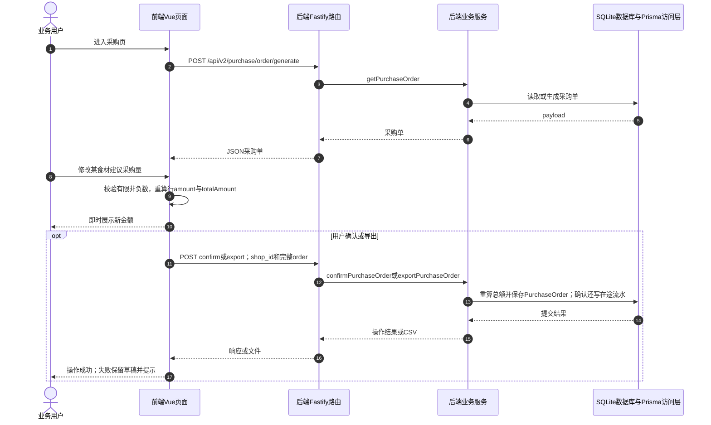

# ④ AI智能采购与库存 / 04 采购数量修改

**实现状态：已实现** · 核对日期：2026-10-27

以下两图依据当前源码；仅对已存在链路作实现描述。尚未实现的范围在边界中说明。

## 业务范围与数据契约

| 项目 | 说明 |
| --- | --- |
| 入口与触发 | PC采购表格；手机采购条目 |
| 状态 | 已实现 |
| 接口与关键入参 | 读取采购单后本地编辑；确认时POST /api/v2/purchase/order/confirm |
| 主要调用 | 前端updatePurchaseQuantity → confirmPurchaseOrder |
| 读取或写入数据 | PurchaseOrder.payload（初始读取及确认时写入） |
| 核心处理 | 本地非负数量校验；行金额=建议数量×单价，合计重新累计 |
| 响应与数据去向 | 本地采购草稿；确认后持久化 |

## 业务流程图

```mermaid
flowchart TD
  N1(["开始"])
  N2["用户 → 前端页面<br/>进入采购页"]
  N3["前端页面 → 后端路由<br/>POST /api/v2/purchase/order/generate"]
  N4["后端路由 → 业务服务<br/>getPurchaseOrder"]
  N5["业务服务 → 数据库<br/>读取或生成采购单"]
  N6["数据库 → 业务服务<br/>payload"]
  N7["业务服务 → 后端路由<br/>采购单"]
  N8["后端路由 → 前端页面<br/>JSON采购单"]
  N9["用户 → 前端页面<br/>修改某食材建议采购量"]
  N10["前端页面内部处理<br/>校验有限非负数，重算行amount与totalAmount"]
  N11["前端页面 → 用户<br/>即时展示新金额"]
  N12{"用户确认或导出？"}
  N13["前端页面 → 后端路由<br/>POST confirm或export；shop_id和完整order"]
  N14["后端路由 → 业务服务<br/>confirmPurchaseOrder或exportPurchaseOrder"]
  N15["业务服务 → 数据库<br/>重算总额并保存PurchaseOrder；确认还写在途流水"]
  N16["数据库 → 业务服务<br/>提交结果"]
  N17["业务服务 → 后端路由<br/>操作结果或CSV"]
  N18["后端路由 → 前端页面<br/>响应或文件"]
  N19["前端页面 → 用户<br/>操作成功；失败保留草稿并提示"]
  N20(["继续"])
  N21(["完成 / 可继续操作"])
  N1 -->|"用户 → 前端页面：调用或传递"| N2
  N2 -->|"前端页面 → 后端路由：调用或传递"| N3
  N3 -->|"后端路由 → 业务服务：调用或传递"| N4
  N4 -->|"业务服务 → 数据库：调用或传递"| N5
  N5 -.->|"数据库 → 业务服务：返回数据"| N6
  N6 -.->|"业务服务 → 后端路由：返回数据"| N7
  N7 -.->|"后端路由 → 前端页面：返回数据"| N8
  N8 -->|"用户 → 前端页面：调用或传递"| N9
  N9 -->|"前端页面内部处理"| N10
  N10 -.->|"前端页面 → 用户：返回数据"| N11
  N11 --> N12
  N12 -->|"是"| N13
  N13 -->|"后端路由 → 业务服务：调用或传递"| N14
  N14 -->|"业务服务 → 数据库：调用或传递"| N15
  N15 -.->|"数据库 → 业务服务：返回数据"| N16
  N16 -.->|"业务服务 → 后端路由：返回数据"| N17
  N17 -.->|"后端路由 → 前端页面：返回数据"| N18
  N18 -.->|"前端页面 → 用户：返回数据"| N19
  N19 --> N20
  N12 -->|"否 / 跳过"| N20
  N20 --> N21
  classDef user fill:#f8fafc,stroke:#64748b,color:#0f172a
  class N1,N11,N12,N19,N20,N21 user
  classDef front fill:#eff6ff,stroke:#60a5fa,color:#0f172a
  class N2,N8,N9,N10,N18 front
  classDef back fill:#fff7ed,stroke:#fb923c,color:#0f172a
  class N3,N4,N6,N7,N13,N14,N16,N17 back
  classDef data fill:#f0fdf4,stroke:#4ade80,color:#0f172a
  class N5,N15 data
```

## 时序图

## 规则、异常与完成边界

没有单独的数量保存接口；修改数量立即重算金额，但只有确认或导出才持久化当前草稿。

前端准备：先完成采购单读取，进入可编辑采购行。

结果处理：显示调整后的金额；确认前仅保存在当前前端状态。

异常处理：参数校验、资源查询或业务处理失败；前端展示错误并允许重试。JSON、SSE和浏览器本地动作按各自协议反馈，失败不会凭空产生成功结果。

访问范围：此旧业务路由没有Agent/RAG同等的统一会话与门店鉴权；PC请求可携Bearer，但不能据此前端行为推断后端已核验。

## 源码与需求依据

- [backend/src/services/merchant-service.ts:1](D:/餐小助/backend/src/services/merchant-service.ts:1)
- [backend/src/routes/v2.ts:687](D:/餐小助/backend/src/routes/v2.ts:687)
- [front-pc/src/views/PurchaseView.vue:1](D:/餐小助/front-pc/src/views/PurchaseView.vue:1)
- [front-phone/src/views/PurchaseView.vue:1](D:/餐小助/front-phone/src/views/PurchaseView.vue:1)
- [front-pc/src/views/InventoryView.vue:1](D:/餐小助/front-pc/src/views/InventoryView.vue:1)
- [front-phone/src/views/InventoryView.vue:1](D:/餐小助/front-phone/src/views/InventoryView.vue:1)
- [front-pc/src/stores/merchant.ts:1](D:/餐小助/front-pc/src/stores/merchant.ts:1)

[返回模块与功能目录](../README.md)
