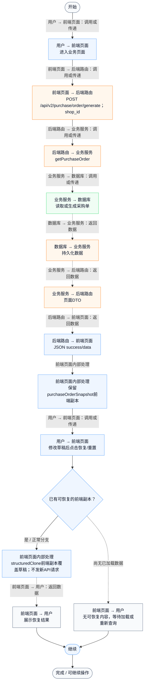
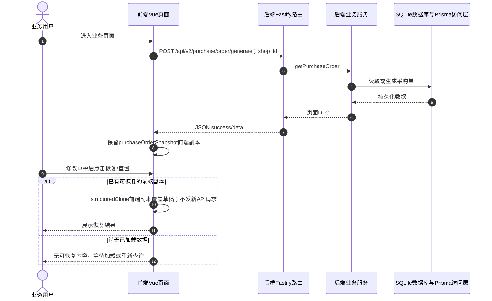

# ④ AI智能采购与库存 / 06 恢复采购初始建议

**实现状态：已实现** · 核对日期：2026-10-27

以下两图依据当前源码；仅对已存在链路作实现描述。尚未实现的范围在边界中说明。

## 业务范围与数据契约

| 项目 | 说明 |
| --- | --- |
| 入口与触发 | PC及手机采购页恢复建议按钮 |
| 状态 | 已实现 |
| 接口与关键入参 | 采购单加载接口；恢复动作不发新请求 |
| 主要调用 | 前端resetPurchaseOrder |
| 读取或写入数据 | 读取时PurchaseOrder.payload；恢复使用前端副本 |
| 核心处理 | structuredClone初次加载或最近生成的前端快照 |
| 响应与数据去向 | 恢复后的本地采购草稿 |

## 业务流程图

## 时序图

## 规则、异常与完成边界

恢复使用前端副本；不是调用后端baselinePayload回滚，不撤销已经确认的在途库存流水，也不执行数据库撤销事务。

前端准备：读取当前门店及页面参数。

结果处理：点击恢复时用前端purchaseOrderSnapshot覆盖草稿并提示。

异常处理：参数校验、资源查询或业务处理失败；前端展示错误并允许重试。JSON、SSE和浏览器本地动作按各自协议反馈，失败不会凭空产生成功结果。

访问范围：此旧业务路由没有Agent/RAG同等的统一会话与门店鉴权；PC请求可携Bearer，但不能据此前端行为推断后端已核验。

## 源码与需求依据

- [backend/src/services/merchant-service.ts:1](D:/餐小助/backend/src/services/merchant-service.ts:1)
- [backend/src/routes/v2.ts:115](D:/餐小助/backend/src/routes/v2.ts:115)
- [front-pc/src/views/PurchaseView.vue:1](D:/餐小助/front-pc/src/views/PurchaseView.vue:1)
- [front-phone/src/views/PurchaseView.vue:1](D:/餐小助/front-phone/src/views/PurchaseView.vue:1)
- [front-pc/src/views/InventoryView.vue:1](D:/餐小助/front-pc/src/views/InventoryView.vue:1)
- [front-phone/src/views/InventoryView.vue:1](D:/餐小助/front-phone/src/views/InventoryView.vue:1)
- [front-pc/src/stores/merchant.ts:1](D:/餐小助/front-pc/src/stores/merchant.ts:1)

[返回模块与功能目录](../README.md)
