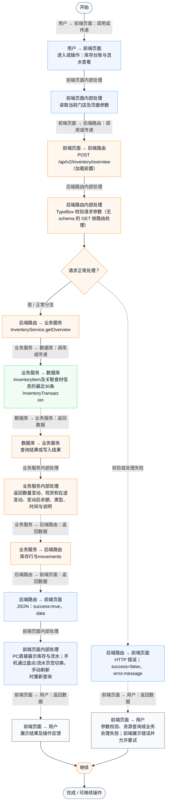
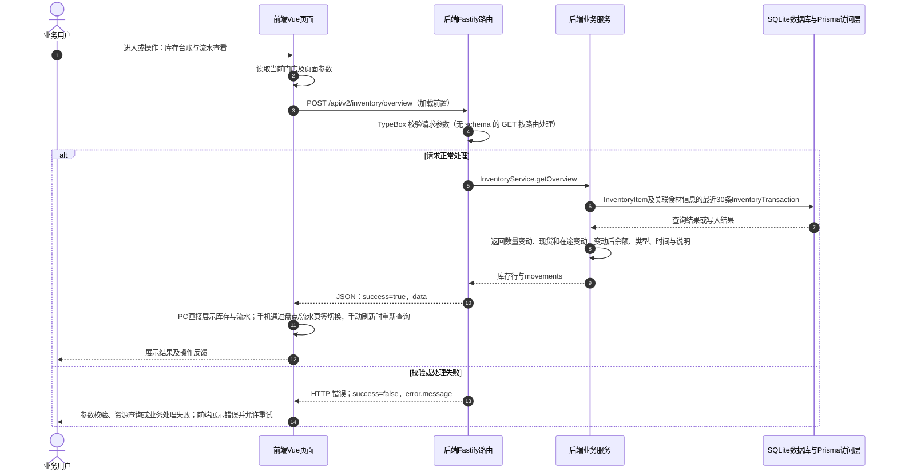

# ④ AI智能采购与库存 / 10 库存台账与流水查看

**实现状态：已实现** · 核对日期：2026-10-27

以下两图依据当前源码；仅对已存在链路作实现描述。尚未实现的范围在边界中说明。

## 业务范围与数据契约

| 项目 | 说明 |
| --- | --- |
| 入口与触发 | PC及手机库存列表及出入库流水 |
| 状态 | 已实现 |
| 接口与关键入参 | POST /api/v2/inventory/overview（加载前置） |
| 主要调用 | InventoryService.getOverview |
| 读取或写入数据 | InventoryItem及关联食材信息的最近30条InventoryTransaction |
| 核心处理 | 返回数量变动、现货和在途变动、变动后余额、类型、时间与说明 |
| 响应与数据去向 | 库存行与movements |

## 业务流程图

## 时序图

## 规则、异常与完成边界

当前页面没有库存关键词或流水类型搜索控件；后端只返回最近30条流水，没有完整历史分页检索。

前端准备：读取当前门店及页面参数。

结果处理：PC直接展示库存与流水；手机通过盘点/流水页签切换，手动刷新时重新查询。

异常处理：参数校验、资源查询或业务处理失败；前端展示错误并允许重试。JSON、SSE和浏览器本地动作按各自协议反馈，失败不会凭空产生成功结果。

访问范围：此旧业务路由没有Agent/RAG同等的统一会话与门店鉴权；PC请求可携Bearer，但不能据此前端行为推断后端已核验。

## 源码与需求依据

- [backend/src/services/inventory-service.ts:211](D:/餐小助/backend/src/services/inventory-service.ts:211)
- [backend/src/routes/v2.ts:1140](D:/餐小助/backend/src/routes/v2.ts:1140)
- [front-pc/src/views/PurchaseView.vue:1](D:/餐小助/front-pc/src/views/PurchaseView.vue:1)
- [front-phone/src/views/PurchaseView.vue:1](D:/餐小助/front-phone/src/views/PurchaseView.vue:1)
- [front-pc/src/views/InventoryView.vue:1](D:/餐小助/front-pc/src/views/InventoryView.vue:1)
- [front-phone/src/views/InventoryView.vue:1](D:/餐小助/front-phone/src/views/InventoryView.vue:1)
- [front-pc/src/stores/merchant.ts:1](D:/餐小助/front-pc/src/stores/merchant.ts:1)

[返回模块与功能目录](../README.md)
