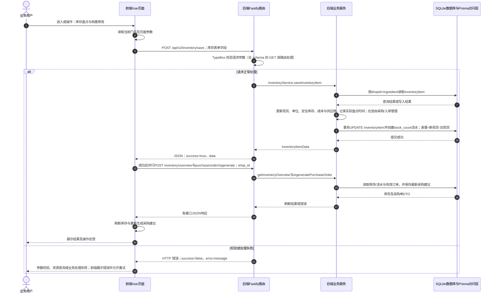

# ④ AI智能采购与库存 / 12 库存盘点与档案修改

**实现状态：已实现** · 核对日期：2026-10-27

以下两图依据当前源码；仅对已存在链路作实现描述。尚未实现的范围在边界中说明。

## 业务范围与数据契约

| 项目 | 说明 |
| --- | --- |
| 入口与触发 | 库存页编辑食材表单 |
| 状态 | 已实现 |
| 接口与关键入参 | POST /api/v2/inventory/save；库存表单字段 |
| 主要调用 | InventoryService.saveInventoryItem |
| 读取或写入数据 | 按shopId+ingredient读取InventoryItem |
| 核心处理 | 更新现货、单位、安全库存、成本与供应商，记录实际盘点时间；在途由采购/入库管理 |
| 响应与数据去向 | InventoryItemData |

## 业务流程图

```mermaid
flowchart TD
  N1(["开始"])
  N2["用户 → 前端页面<br/>进入或操作：库存盘点与档案修改"]
  N3["前端页面内部处理<br/>读取当前门店及页面参数"]
  N4["前端页面 → 后端路由<br/>POST /api/v2/inventory/save；库存表单字段"]
  N5["后端路由内部处理<br/>TypeBox 校验请求参数（无 schema 的 GET 按路由处理）"]
  N6{"请求正常处理？"}
  N7["后端路由 → 业务服务<br/>InventoryService.saveInventoryItem"]
  N8["业务服务 → 数据库<br/>按shopId+ingredient读取InventoryItem"]
  N9["数据库 → 业务服务<br/>查询结果或写入结果"]
  N10["业务服务内部处理<br/>更新现货、单位、安全库存、成本与供应商，记录实际盘点时间；<br/>在途由采购/入库管理"]
  N11["业务服务 → 数据库<br/>事务UPDATE InventoryItem并创建stock_count流水；差量=新<br/>现货-旧现货"]
  N12["数据库 → 业务服务<br/>提交成功"]
  N13["业务服务 → 后端路由<br/>InventoryItemData"]
  N14["后端路由 → 前端页面<br/>JSON：success=true，data"]
  N15["前端页面 → 后端路由<br/>成功后并行POST inventory/overview与purchase/order/reg<br/>enerate；shop_id"]
  N16["后端路由 → 业务服务<br/>getInventoryOverview与regeneratePurchaseOrder"]
  N17["业务服务 → 数据库<br/>读取库存/流水与有效订单，并保存最新采购建议"]
  N18["数据库 → 业务服务<br/>库存及采购单DTO"]
  N19["业务服务 → 后端路由<br/>刷新结果或错误"]
  N20["后端路由 → 前端页面<br/>各接口JSON响应"]
  N21["前端页面内部处理<br/>刷新库存与重新生成采购建议"]
  N22["前端页面 → 用户<br/>展示结果及操作反馈"]
  N23["后端路由 → 前端页面<br/>HTTP 错误；success=false，error.message"]
  N24["前端页面 → 用户<br/>参数校验、资源查询或业务处理失败；前端展示错误并允许重试"]
  N25(["继续"])
  N26(["完成 / 可继续操作"])
  N1 -->|"用户 → 前端页面：调用或传递"| N2
  N2 -->|"前端页面内部处理"| N3
  N3 -->|"前端页面 → 后端路由：调用或传递"| N4
  N4 -->|"后端路由内部处理"| N5
  N5 --> N6
  N6 -->|"是 / 正常分支"| N7
  N7 -->|"业务服务 → 数据库：调用或传递"| N8
  N8 -.->|"数据库 → 业务服务：返回数据"| N9
  N9 -->|"业务服务内部处理"| N10
  N10 -->|"业务服务 → 数据库：调用或传递"| N11
  N11 -.->|"数据库 → 业务服务：返回数据"| N12
  N12 -.->|"业务服务 → 后端路由：返回数据"| N13
  N13 -.->|"后端路由 → 前端页面：返回数据"| N14
  N14 -->|"前端页面 → 后端路由：调用或传递"| N15
  N15 -->|"后端路由 → 业务服务：调用或传递"| N16
  N16 -->|"业务服务 → 数据库：调用或传递"| N17
  N17 -.->|"数据库 → 业务服务：返回数据"| N18
  N18 -.->|"业务服务 → 后端路由：返回数据"| N19
  N19 -.->|"后端路由 → 前端页面：返回数据"| N20
  N20 -->|"前端页面内部处理"| N21
  N21 -.->|"前端页面 → 用户：返回数据"| N22
  N6 -.->|"校验或处理失败"| N23
  N23 -.->|"前端页面 → 用户：返回数据"| N24
  N22 --> N25
  N24 --> N25
  N25 --> N26
  classDef user fill:#f8fafc,stroke:#64748b,color:#0f172a
  class N1,N22,N24,N26 user
  classDef front fill:#eff6ff,stroke:#60a5fa,color:#0f172a
  class N2,N3,N14,N20,N21,N23 front
  classDef back fill:#fff7ed,stroke:#fb923c,color:#0f172a
  class N4,N5,N6,N7,N9,N10,N12,N13,N15,N16,N18,N19,N25 back
  classDef data fill:#f0fdf4,stroke:#4ade80,color:#0f172a
  class N8,N11,N17 data
```

## 时序图

## 规则、异常与完成边界

盘点是把现货设置为实际值，而非在旧值上累加；不会覆盖已有在途库存。按食材名称识别，不提供独立删除食材接口。 库存主写入成功而后续刷新/采购重算失败时，界面可能报错，但已提交库存不会因此回滚。

前端准备：读取当前门店及页面参数。

结果处理：刷新库存与重新生成采购建议。

异常处理：参数校验、资源查询或业务处理失败；前端展示错误并允许重试。JSON、SSE和浏览器本地动作按各自协议反馈，失败不会凭空产生成功结果。

访问范围：此旧业务路由没有Agent/RAG同等的统一会话与门店鉴权；PC请求可携Bearer，但不能据此前端行为推断后端已核验。

## 源码与需求依据

- [backend/src/services/inventory-service.ts:268](D:/餐小助/backend/src/services/inventory-service.ts:268)
- [backend/src/routes/v2.ts:1153](D:/餐小助/backend/src/routes/v2.ts:1153)
- [front-pc/src/views/PurchaseView.vue:1](D:/餐小助/front-pc/src/views/PurchaseView.vue:1)
- [front-phone/src/views/PurchaseView.vue:1](D:/餐小助/front-phone/src/views/PurchaseView.vue:1)
- [front-pc/src/views/InventoryView.vue:1](D:/餐小助/front-pc/src/views/InventoryView.vue:1)
- [front-phone/src/views/InventoryView.vue:1](D:/餐小助/front-phone/src/views/InventoryView.vue:1)
- [front-pc/src/stores/merchant.ts:1](D:/餐小助/front-pc/src/stores/merchant.ts:1)

[返回模块与功能目录](../README.md)
