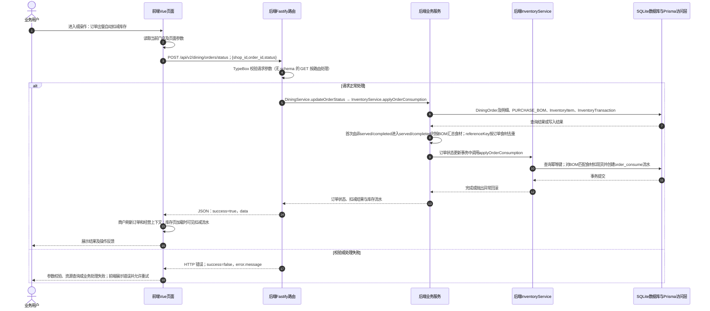

# ④ AI智能采购与库存 / 14 订单出餐自动扣减库存

**实现状态：已实现** · 核对日期：2026-10-27

以下两图依据当前源码；仅对已存在链路作实现描述。尚未实现的范围在边界中说明。

## 业务范围与数据契约

| 项目 | 说明 |
| --- | --- |
| 入口与触发 | 商户订单状态更新触发，库存页查看结果 |
| 状态 | 已实现 |
| 接口与关键入参 | POST /api/v2/dining/orders/status；{shop_id,order_id,status} |
| 主要调用 | DiningService.updateOrderStatus → InventoryService.applyOrderConsumption |
| 读取或写入数据 | DiningOrder及明细、PURCHASE_BOM、InventoryItem、InventoryTransaction |
| 核心处理 | 首次由非served/completed进入served/completed时按BOM汇总食材；referenceKey按订单食材去重 |
| 响应与数据去向 | 订单状态、扣减结果与库存流水 |

## 业务流程图

```mermaid
flowchart TD
  N1(["开始"])
  N2["用户 → 前端页面<br/>进入或操作：订单出餐自动扣减库存"]
  N3["前端页面内部处理<br/>读取当前门店及页面参数"]
  N4["前端页面 → 后端路由<br/>POST /api/v2/dining/orders/status；{shop_id,order_id<br/>,status}"]
  N5["后端路由内部处理<br/>TypeBox 校验请求参数（无 schema 的 GET 按路由处理）"]
  N6{"请求正常处理？"}
  N7["后端路由 → 业务服务<br/>DiningService.updateOrderStatus → InventoryService.<br/>applyOrderConsumption"]
  N8["业务服务 → 数据库<br/>DiningOrder及明细、PURCHASE_BOM、InventoryItem、Inven<br/>toryTransaction"]
  N9["数据库 → 业务服务<br/>查询结果或写入结果"]
  N10["业务服务内部处理<br/>首次由非served/completed进入served/completed时按BOM汇<br/>总食材；referenceKey按订单食材去重"]
  N11["业务服务 → 库存服务<br/>订单状态更新事务中调用applyOrderConsumption"]
  N12["库存服务 → 数据库<br/>查询幂等键；对BOM匹配食材扣现货并创建order_consume流水"]
  N13["数据库 → 库存服务<br/>事务提交"]
  N14["库存服务 → 业务服务<br/>完成或抛出异常回滚"]
  N15["业务服务 → 后端路由<br/>订单状态、扣减结果与库存流水"]
  N16["后端路由 → 前端页面<br/>JSON：success=true，data"]
  N17["前端页面内部处理<br/>商户刷新订单和经营上下文；库存页加载时可见扣减流水"]
  N18["前端页面 → 用户<br/>展示结果及操作反馈"]
  N19["后端路由 → 前端页面<br/>HTTP 错误；success=false，error.message"]
  N20["前端页面 → 用户<br/>参数校验、资源查询或业务处理失败；前端展示错误并允许重试"]
  N21(["继续"])
  N22(["完成 / 可继续操作"])
  N1 -->|"用户 → 前端页面：调用或传递"| N2
  N2 -->|"前端页面内部处理"| N3
  N3 -->|"前端页面 → 后端路由：调用或传递"| N4
  N4 -->|"后端路由内部处理"| N5
  N5 --> N6
  N6 -->|"是 / 正常分支"| N7
  N7 -->|"业务服务 → 数据库：调用或传递"| N8
  N8 -.->|"数据库 → 业务服务：返回数据"| N9
  N9 -->|"业务服务内部处理"| N10
  N10 -->|"业务服务 → 库存服务：调用或传递"| N11
  N11 -->|"库存服务 → 数据库：调用或传递"| N12
  N12 -.->|"数据库 → 库存服务：返回数据"| N13
  N13 -.->|"库存服务 → 业务服务：返回数据"| N14
  N14 -.->|"业务服务 → 后端路由：返回数据"| N15
  N15 -.->|"后端路由 → 前端页面：返回数据"| N16
  N16 -->|"前端页面内部处理"| N17
  N17 -.->|"前端页面 → 用户：返回数据"| N18
  N6 -.->|"校验或处理失败"| N19
  N19 -.->|"前端页面 → 用户：返回数据"| N20
  N18 --> N21
  N20 --> N21
  N21 --> N22
  classDef user fill:#f8fafc,stroke:#64748b,color:#0f172a
  class N1,N18,N20,N22 user
  classDef front fill:#eff6ff,stroke:#60a5fa,color:#0f172a
  class N2,N3,N16,N17,N19 front
  classDef back fill:#fff7ed,stroke:#fb923c,color:#0f172a
  class N4,N5,N6,N7,N9,N10,N11,N13,N14,N15,N21 back
  classDef data fill:#f0fdf4,stroke:#4ade80,color:#0f172a
  class N8,N12 data
```

## 时序图

## 规则、异常与完成边界

BOM匹配的未盘点食材也会从默认现货0扣减；库存允许负数以保留真实消耗。served→completed不二次扣减；加菜后已扣减的同订单食材没有完整差量补扣机制，取消也没有自动反冲库存流程。

前端准备：读取当前门店及页面参数。

结果处理：商户刷新订单和经营上下文；库存页加载时可见扣减流水。

异常处理：参数校验、资源查询或业务处理失败；前端展示错误并允许重试。JSON、SSE和浏览器本地动作按各自协议反馈，失败不会凭空产生成功结果。

访问范围：此旧业务路由没有Agent/RAG同等的统一会话与门店鉴权；PC请求可携Bearer，但不能据此前端行为推断后端已核验。

## 源码与需求依据

- [backend/src/services/inventory-service.ts:1](D:/餐小助/backend/src/services/inventory-service.ts:1)
- [backend/src/routes/v2.ts:574](D:/餐小助/backend/src/routes/v2.ts:574)
- [front-pc/src/views/PurchaseView.vue:1](D:/餐小助/front-pc/src/views/PurchaseView.vue:1)
- [front-phone/src/views/PurchaseView.vue:1](D:/餐小助/front-phone/src/views/PurchaseView.vue:1)
- [front-pc/src/views/InventoryView.vue:1](D:/餐小助/front-pc/src/views/InventoryView.vue:1)
- [front-phone/src/views/InventoryView.vue:1](D:/餐小助/front-phone/src/views/InventoryView.vue:1)
- [front-pc/src/stores/merchant.ts:1](D:/餐小助/front-pc/src/stores/merchant.ts:1)

[返回模块与功能目录](../README.md)
