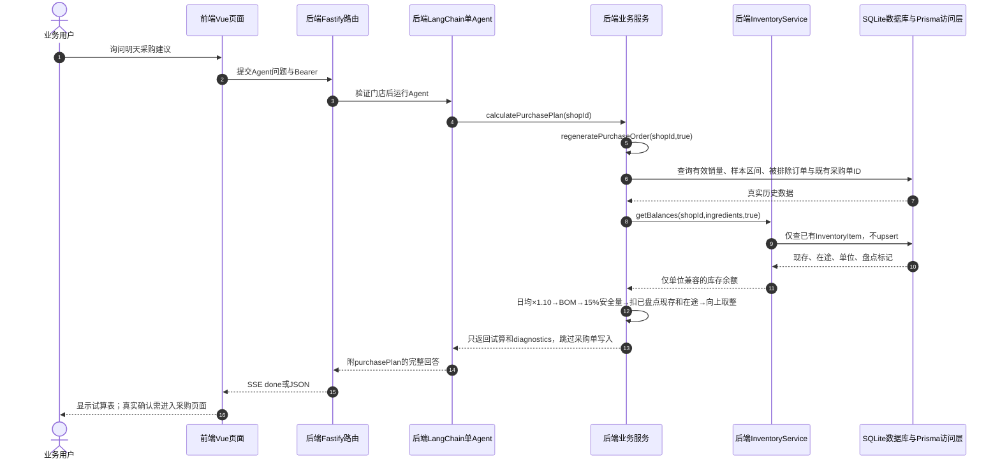

# ④ AI智能采购与库存 / 18 Agent只读采购试算

**实现状态：已实现** · 核对日期：2026-10-27

以下两图依据当前源码；仅对已存在链路作实现描述。尚未实现的范围在边界中说明。

## 业务范围与数据契约

| 项目 | 说明 |
| --- | --- |
| 入口与触发 | 助手模型调用calculate_purchase_plan；采购核对亦复用 |
| 状态 | 已实现 |
| 接口与关键入参 | POST /api/v2/agent/qa/stream 或 /api/v2/agent/qa；内部工具calculate_purchase_plan |
| 主要调用 | calculatePurchasePlan → regeneratePurchaseOrder(shopId,true) |
| 读取或写入数据 | 近30天有效订单与明细、代码BOM、现有库存和在途；仅读取最新采购单ID |
| 核心处理 | 复用采购唯一算法，readOnly跳过目录初始化与PurchaseOrder持久化 |
| 响应与数据去向 | PurchaseOrderData附预测依据、数据诊断与逐行库存扣减 |

## 业务流程图

```mermaid
flowchart TD
  N1(["开始"])
  N2["用户 → 前端页面<br/>询问明天采购建议"]
  N3["前端页面 → 后端路由<br/>提交Agent问题与Bearer"]
  N4["后端路由 → Agent<br/>验证门店后运行Agent"]
  N5["Agent → 业务服务<br/>calculatePurchasePlan(shopId)"]
  N6["业务服务内部处理<br/>regeneratePurchaseOrder(shopId,true)"]
  N7["业务服务 → 数据库<br/>查询有效销量、样本区间、被排除订单与既有采购单ID"]
  N8["数据库 → 业务服务<br/>真实历史数据"]
  N9["业务服务 → 库存服务<br/>getBalances(shopId,ingredients,true)"]
  N10["库存服务 → 数据库<br/>仅查已有InventoryItem，不upsert"]
  N11["数据库 → 库存服务<br/>现存、在途、单位、盘点标记"]
  N12["库存服务 → 业务服务<br/>仅单位兼容的库存余额"]
  N13["业务服务内部处理<br/>日均×1.10→BOM→15%安全量→扣已盘点现存和在途→向上取整"]
  N14["业务服务 → Agent<br/>只返回试算和diagnostics，跳过采购单写入"]
  N15["Agent → 后端路由<br/>附purchasePlan的完整回答"]
  N16["后端路由 → 前端页面<br/>SSE done或JSON"]
  N17["前端页面 → 用户<br/>显示试算表；真实确认需进入采购页面"]
  N18(["完成 / 可继续操作"])
  N1 -->|"用户 → 前端页面：调用或传递"| N2
  N2 -->|"前端页面 → 后端路由：调用或传递"| N3
  N3 -->|"后端路由 → Agent：调用或传递"| N4
  N4 -->|"Agent → 业务服务：调用或传递"| N5
  N5 -->|"业务服务内部处理"| N6
  N6 -->|"业务服务 → 数据库：调用或传递"| N7
  N7 -.->|"数据库 → 业务服务：返回数据"| N8
  N8 -->|"业务服务 → 库存服务：调用或传递"| N9
  N9 -->|"库存服务 → 数据库：调用或传递"| N10
  N10 -.->|"数据库 → 库存服务：返回数据"| N11
  N11 -.->|"库存服务 → 业务服务：返回数据"| N12
  N12 -->|"业务服务内部处理"| N13
  N13 -.->|"业务服务 → Agent：返回数据"| N14
  N14 -.->|"Agent → 后端路由：返回数据"| N15
  N15 -.->|"后端路由 → 前端页面：返回数据"| N16
  N16 -.->|"前端页面 → 用户：返回数据"| N17
  N17 --> N18
  classDef user fill:#f8fafc,stroke:#64748b,color:#0f172a
  class N1,N17,N18 user
  classDef front fill:#eff6ff,stroke:#60a5fa,color:#0f172a
  class N2,N16 front
  classDef back fill:#fff7ed,stroke:#fb923c,color:#0f172a
  class N3,N4,N5,N6,N8,N9,N11,N12,N13,N14,N15 back
  classDef data fill:#f0fdf4,stroke:#4ade80,color:#0f172a
  class N7,N10 data
```

## 时序图

## 规则、异常与完成边界

计算口径与采购重算完全复用。个单位向上取整，其他单位向上到0.1；未盘点现存暂按0，不代表真实零库存；单位不一致时该食材库存和在途不抵扣。没有有效销量或无法匹配BOM时不能声称无需补货。业务只读不代表完全不落库：整轮回答成功仍由外层写问答日志。

前端准备：读取当前门店及页面参数。

结果处理：更新 Pinia 或页面状态并渲染。

异常处理：参数校验、资源查询或业务处理失败；前端展示错误并允许重试。JSON、SSE和浏览器本地动作按各自协议反馈，失败不会凭空产生成功结果。

访问范围：Agent与资料接口校验Bearer会话及assignedShopIds；门店ID不作为模型可修改的工具参数。

## 源码与需求依据

- [backend/src/services/merchant-service.ts:1314](D:/餐小助/backend/src/services/merchant-service.ts:1314)
- [backend/src/services/merchant-service.ts:1344](D:/餐小助/backend/src/services/merchant-service.ts:1344)
- [backend/src/services/inventory-service.ts:156](D:/餐小助/backend/src/services/inventory-service.ts:156)
- [backend/src/services/business-agent.ts:23](D:/餐小助/backend/src/services/business-agent.ts:23)

[返回模块与功能目录](../README.md)
