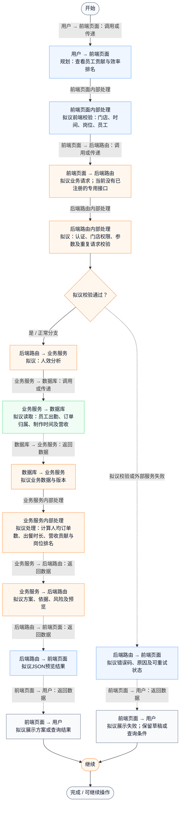
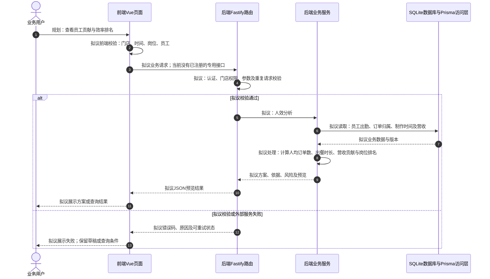

# ⑥ AI员工与排班 / 02 人效分析

**实现状态：仅规划** · 核对日期：2026-10-27

本文件两张图均为**规划设计**；专用接口、数据模型或页面未形成完整链路，图中拟议步骤不表示已经实现。

## 业务范围与数据契约

| 项目 | 说明 |
| --- | --- |
| 入口与触发 | PRD 规划；当前无完整前端入口 |
| 状态 | 仅规划 |
| 接口与关键入参 | 规划接口，路径未定义 |
| 主要调用 | 规划服务 |
| 读取或写入数据 | 员工出勤、订单归属、制作时间及营收 |
| 核心处理 | 计算人均订单数、出餐时长、营收贡献与岗位排名 |
| 响应与数据去向 | 规划方案或执行结果 |

对应PRD功能：人效分析。

## 业务流程图

## 时序图

## 规则、异常与完成边界

当前DiningOrder没有完整员工责任归属和制作过程事件，员工配置字段不足以算人效。

## 源码与需求依据

- [docs/餐小助_完整PRD_V2.0.md:197](D:/餐小助/docs/餐小助_完整PRD_V2.0.md:197)
- [backend/src/routes/v2.ts:115](D:/餐小助/backend/src/routes/v2.ts:115)
- [backend/prisma/schema.prisma:11](D:/餐小助/backend/prisma/schema.prisma:11)

[返回模块与功能目录](../README.md)
