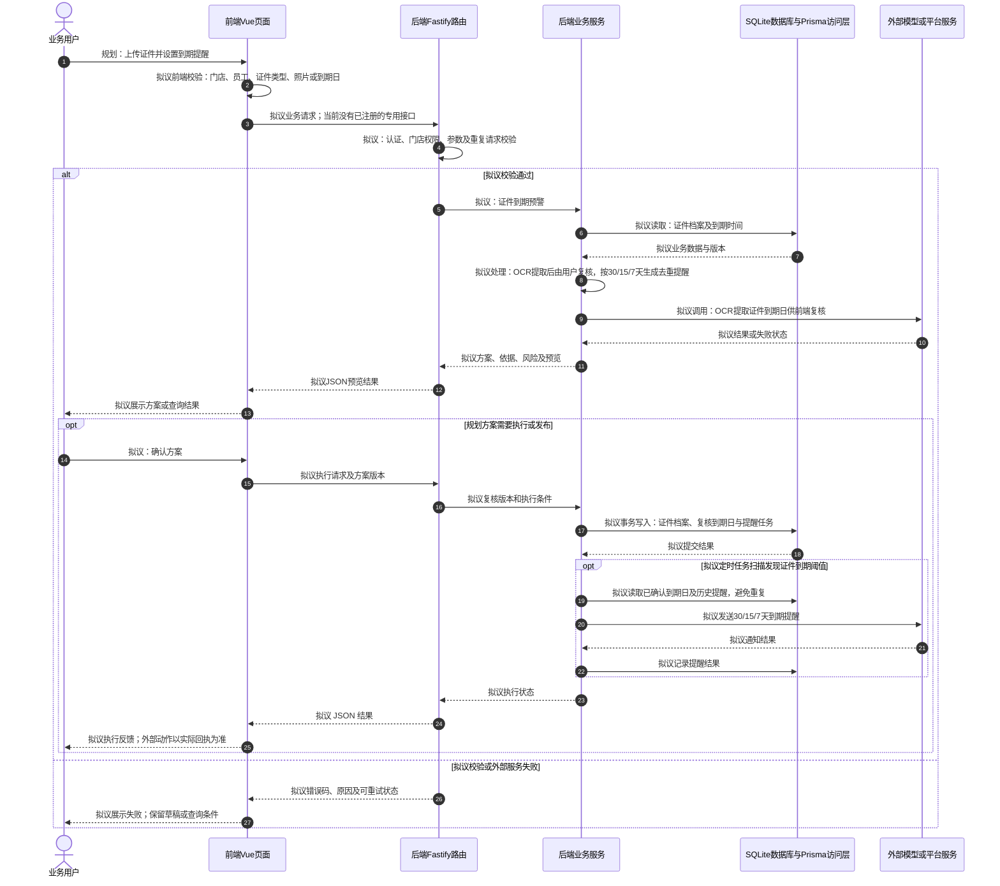

# ⑥ AI员工与排班 / 03 证件到期预警

**实现状态：仅规划** · 核对日期：2026-10-27

本文件两张图均为**规划设计**；专用接口、数据模型或页面未形成完整链路，图中拟议步骤不表示已经实现。

## 业务范围与数据契约

| 项目 | 说明 |
| --- | --- |
| 入口与触发 | PRD 规划；当前无完整前端入口 |
| 状态 | 仅规划 |
| 接口与关键入参 | 规划接口，路径未定义 |
| 主要调用 | 规划服务 |
| 读取或写入数据 | 证件档案及到期时间 |
| 核心处理 | OCR提取后由用户复核，按30/15/7天生成去重提醒 |
| 响应与数据去向 | 规划方案或执行结果 |

对应PRD功能：证件到期预警。

## 业务流程图

```mermaid
flowchart TD
  N1(["开始"])
  N2["用户 → 前端页面<br/>规划：上传证件并设置到期提醒"]
  N3["前端页面内部处理<br/>拟议前端校验：门店、员工、证件类型、照片或到期日"]
  N4["前端页面 → 后端路由<br/>拟议业务请求；当前没有已注册的专用接口"]
  N5["后端路由内部处理<br/>拟议：认证、门店权限、参数及重复请求校验"]
  N6{"拟议校验通过？"}
  N7["后端路由 → 业务服务<br/>拟议：证件到期预警"]
  N8["业务服务 → 数据库<br/>拟议读取：证件档案及到期时间"]
  N9["数据库 → 业务服务<br/>拟议业务数据与版本"]
  N10["业务服务内部处理<br/>拟议处理：OCR提取后由用户复核，按30/15/7天生成去重提醒"]
  N11["业务服务 → 外部模型或平台<br/>拟议调用：OCR提取证件到期日供前端复核"]
  N12["外部模型或平台 → 业务服务<br/>拟议结果或失败状态"]
  N13["业务服务 → 后端路由<br/>拟议方案、依据、风险及预览"]
  N14["后端路由 → 前端页面<br/>拟议JSON预览结果"]
  N15["前端页面 → 用户<br/>拟议展示方案或查询结果"]
  N16{"规划方案需要执行或发布？"}
  N17["用户 → 前端页面<br/>拟议：确认方案"]
  N18["前端页面 → 后端路由<br/>拟议执行请求及方案版本"]
  N19["后端路由 → 业务服务<br/>拟议复核版本和执行条件"]
  N20["业务服务 → 数据库<br/>拟议事务写入：证件档案、复核到期日与提醒任务"]
  N21["数据库 → 业务服务<br/>拟议提交结果"]
  N22{"拟议定时任务扫描发现证件到期阈值？"}
  N23["业务服务 → 数据库<br/>拟议读取已确认到期日及历史提醒，避免重复"]
  N24["业务服务 → 外部模型或平台<br/>拟议发送30/15/7天到期提醒"]
  N25["外部模型或平台 → 业务服务<br/>拟议通知结果"]
  N26["业务服务 → 数据库<br/>拟议记录提醒结果"]
  N27(["继续"])
  N28["业务服务 → 后端路由<br/>拟议执行状态"]
  N29["后端路由 → 前端页面<br/>拟议 JSON 结果"]
  N30["前端页面 → 用户<br/>拟议执行反馈；外部动作以实际回执为准"]
  N31(["继续"])
  N32["后端路由 → 前端页面<br/>拟议错误码、原因及可重试状态"]
  N33["前端页面 → 用户<br/>拟议展示失败；保留草稿或查询条件"]
  N34(["继续"])
  N35(["完成 / 可继续操作"])
  N1 -->|"用户 → 前端页面：调用或传递"| N2
  N2 -->|"前端页面内部处理"| N3
  N3 -->|"前端页面 → 后端路由：调用或传递"| N4
  N4 -->|"后端路由内部处理"| N5
  N5 --> N6
  N6 -->|"是 / 正常分支"| N7
  N7 -->|"业务服务 → 数据库：调用或传递"| N8
  N8 -.->|"数据库 → 业务服务：返回数据"| N9
  N9 -->|"业务服务内部处理"| N10
  N10 -->|"业务服务 → 外部模型或平台：调用或传递"| N11
  N11 -.->|"外部模型或平台 → 业务服务：返回数据"| N12
  N12 -.->|"业务服务 → 后端路由：返回数据"| N13
  N13 -.->|"后端路由 → 前端页面：返回数据"| N14
  N14 -.->|"前端页面 → 用户：返回数据"| N15
  N15 --> N16
  N16 -->|"是"| N17
  N17 -->|"前端页面 → 后端路由：调用或传递"| N18
  N18 -->|"后端路由 → 业务服务：调用或传递"| N19
  N19 -->|"业务服务 → 数据库：调用或传递"| N20
  N20 -.->|"数据库 → 业务服务：返回数据"| N21
  N21 --> N22
  N22 -->|"是"| N23
  N23 -->|"业务服务 → 外部模型或平台：调用或传递"| N24
  N24 -.->|"外部模型或平台 → 业务服务：返回数据"| N25
  N25 -->|"业务服务 → 数据库：调用或传递"| N26
  N26 --> N27
  N22 -->|"否 / 跳过"| N27
  N27 -.->|"业务服务 → 后端路由：返回数据"| N28
  N28 -.->|"后端路由 → 前端页面：返回数据"| N29
  N29 -.->|"前端页面 → 用户：返回数据"| N30
  N30 --> N31
  N16 -->|"否 / 跳过"| N31
  N6 -.->|"拟议校验或外部服务失败"| N32
  N32 -.->|"前端页面 → 用户：返回数据"| N33
  N31 --> N34
  N33 --> N34
  N34 --> N35
  classDef user fill:#f8fafc,stroke:#64748b,color:#0f172a
  class N1,N15,N16,N30,N31,N33,N35 user
  classDef front fill:#eff6ff,stroke:#60a5fa,color:#0f172a
  class N2,N3,N14,N17,N29,N32 front
  classDef back fill:#fff7ed,stroke:#fb923c,color:#0f172a
  class N4,N5,N6,N7,N9,N10,N12,N13,N18,N19,N21,N22,N25,N27,N28,N34 back
  classDef data fill:#f0fdf4,stroke:#4ade80,color:#0f172a
  class N8,N20,N23,N26 data
  classDef external fill:#faf5ff,stroke:#c084fc,color:#0f172a
  class N11,N24 external
```

## 时序图

## 规则、异常与完成边界

照片存储、OCR、定时扫描和触达均为建议设计，当前未实现。

## 源码与需求依据

- [docs/餐小助_完整PRD_V2.0.md:198](D:/餐小助/docs/餐小助_完整PRD_V2.0.md:198)
- [backend/src/routes/v2.ts:115](D:/餐小助/backend/src/routes/v2.ts:115)
- [backend/prisma/schema.prisma:11](D:/餐小助/backend/prisma/schema.prisma:11)

[返回模块与功能目录](../README.md)
