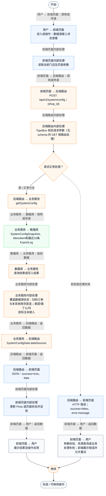
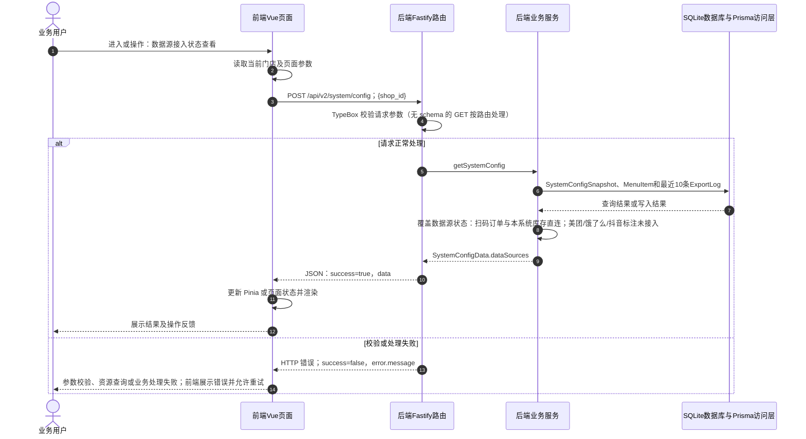

# ⑧ 系统管理与数据接入 / 01 数据源接入状态查看

**实现状态：部分实现** · 核对日期：2026-10-27

以下两图依据当前源码；仅对已存在链路作实现描述。尚未实现的范围在边界中说明。

## 业务范围与数据契约

| 项目 | 说明 |
| --- | --- |
| 入口与触发 | PC及手机 /settings 数据源区域 |
| 状态 | 部分实现 |
| 接口与关键入参 | POST /api/v2/system/config；{shop_id} |
| 主要调用 | getSystemConfig |
| 读取或写入数据 | SystemConfigSnapshot、MenuItem和最近10条ExportLog |
| 核心处理 | 覆盖数据源状态：扫码订单与本系统库存直连；美团/饿了么/抖音标注未接入 |
| 响应与数据去向 | SystemConfigData.dataSources |

对应PRD功能：多平台数据接入配置。

## 业务流程图

## 时序图

## 规则、异常与完成边界

当前数据源状态为后端明确组装的能力说明；配置页面无真正平台授权链路，不能把目录记录视为已接入。

前端准备：读取当前门店及页面参数。

结果处理：更新 Pinia 或页面状态并渲染。

异常处理：参数校验、资源查询或业务处理失败；前端展示错误并允许重试。JSON、SSE和浏览器本地动作按各自协议反馈，失败不会凭空产生成功结果。

访问范围：此旧业务路由没有Agent/RAG同等的统一会话与门店鉴权；PC请求可携Bearer，但不能据此前端行为推断后端已核验。

## 源码与需求依据

- [backend/src/services/merchant-service.ts:1828](D:/餐小助/backend/src/services/merchant-service.ts:1828)
- [backend/src/routes/v2.ts:786](D:/餐小助/backend/src/routes/v2.ts:786)
- [front-pc/src/views/SettingsView.vue:1](D:/餐小助/front-pc/src/views/SettingsView.vue:1)
- [front-phone/src/views/SettingsView.vue:1](D:/餐小助/front-phone/src/views/SettingsView.vue:1)
- [front-pc/src/stores/merchant.ts:1](D:/餐小助/front-pc/src/stores/merchant.ts:1)

[返回模块与功能目录](../README.md)
