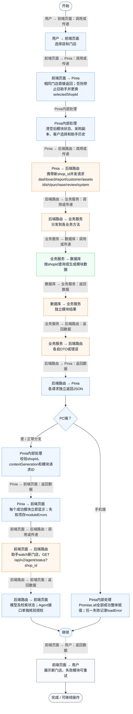
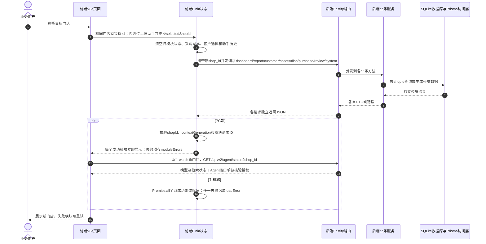

# ⑧ 系统管理与数据接入 / 04 多店切换与上下文刷新

**实现状态：已实现** · 核对日期：2026-10-27

以下两图依据当前源码；仅对已存在链路作实现描述。尚未实现的范围在边界中说明。

## 业务范围与数据契约

| 项目 | 说明 |
| --- | --- |
| 入口与触发 | PC顶栏；手机门店选择 |
| 状态 | 已实现 |
| 接口与关键入参 | GET /api/v2/shop/list；各门店业务查询接口 |
| 主要调用 | 前端setSelectedShop → refreshShopContext |
| 读取或写入数据 | Shop及每个模块对应的本店订单、客户、采购、评价、配置 |
| 核心处理 | 按selectedShopId重新加载模块，停止旧AI回答并重置会话上下文 |
| 响应与数据去向 | 新门店上下文 |

对应PRD功能：多店切换。

## 业务流程图

## 时序图

## 规则、异常与完成边界

PC用Promise.all并发8个带独立try/catch的load任务，各模块返回即发布；不是等待全部完成后统一赋值，也不是当前实现直接调用allSettled。contextGeneration与门店ID避免旧响应覆盖新店，菜品/评价另有请求ID。手机仍Promise.all加载7项，任一失败整体报错。PC助手停止旧流、清空消息和原文弹窗，重新查询新店模型/RAG状态；当前不提供跨门店对话恢复。

前端准备：读取当前门店及页面参数。

结果处理：更新 Pinia 或页面状态并渲染。

异常处理：参数校验、资源查询或业务处理失败；前端展示错误并允许重试。JSON、SSE和浏览器本地动作按各自协议反馈，失败不会凭空产生成功结果。

访问范围：此旧业务路由没有Agent/RAG同等的统一会话与门店鉴权；PC请求可携Bearer，但不能据此前端行为推断后端已核验。

## 源码与需求依据

- [backend/src/services/merchant-service.ts:1](D:/餐小助/backend/src/services/merchant-service.ts:1)
- [backend/src/routes/v2.ts:445](D:/餐小助/backend/src/routes/v2.ts:445)
- [front-pc/src/views/SettingsView.vue:1](D:/餐小助/front-pc/src/views/SettingsView.vue:1)
- [front-phone/src/views/SettingsView.vue:1](D:/餐小助/front-phone/src/views/SettingsView.vue:1)
- [front-pc/src/stores/merchant.ts:459](D:/餐小助/front-pc/src/stores/merchant.ts:459)
- [front-pc/src/views/AssistantView.vue:38](D:/餐小助/front-pc/src/views/AssistantView.vue:38)
- [front-phone/src/stores/merchant.ts:424](D:/餐小助/front-phone/src/stores/merchant.ts:424)
- [front-pc/src/stores/merchant.ts:1](D:/餐小助/front-pc/src/stores/merchant.ts:1)

[返回模块与功能目录](../README.md)
