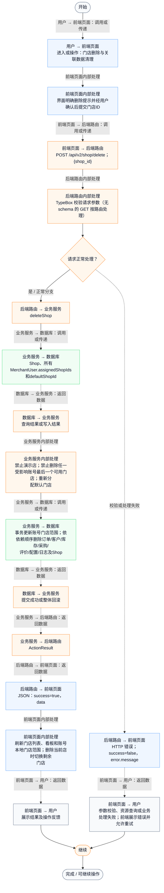
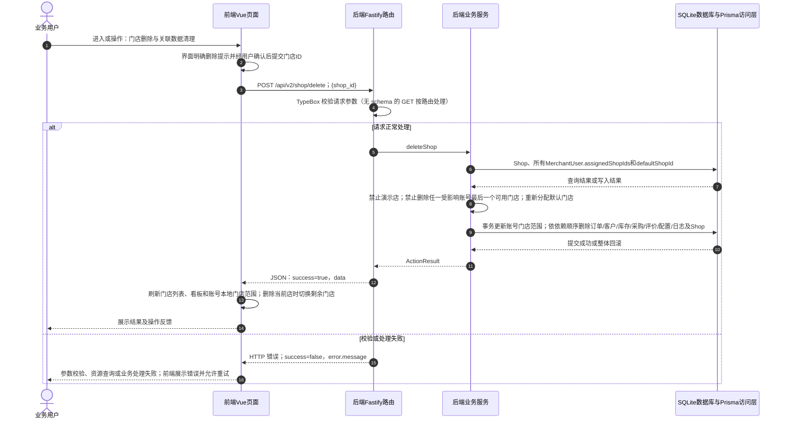

# ⑧ 系统管理与数据接入 / 06 门店删除与关联数据清理

**实现状态：已实现** · 核对日期：2026-10-27

以下两图依据当前源码；仅对已存在链路作实现描述。尚未实现的范围在边界中说明。

## 业务范围与数据契约

| 项目 | 说明 |
| --- | --- |
| 入口与触发 | PC多店看板删除门店按钮 |
| 状态 | 已实现 |
| 接口与关键入参 | POST /api/v2/shop/delete；{shop_id} |
| 主要调用 | deleteShop |
| 读取或写入数据 | Shop、所有MerchantUser.assignedShopIds和defaultShopId |
| 核心处理 | 禁止演示店；禁止删除任一受影响账号最后一个可用门店；重新分配默认门店 |
| 响应与数据去向 | ActionResult |

## 业务流程图

## 时序图

## 规则、异常与完成边界

删除真实业务数据而非软删除；接口已实现。本次分析文档生成不调用该删除接口。

前端准备：界面明确删除提示并经用户确认后提交门店ID。

结果处理：刷新门店列表、看板和账号本地门店范围；删除当前店时切换剩余门店。

异常处理：参数校验、资源查询或业务处理失败；前端展示错误并允许重试。JSON、SSE和浏览器本地动作按各自协议反馈，失败不会凭空产生成功结果。

访问范围：此旧业务路由没有Agent/RAG同等的统一会话与门店鉴权；PC请求可携Bearer，但不能据此前端行为推断后端已核验。

## 源码与需求依据

- [backend/src/services/merchant-service.ts:315](D:/餐小助/backend/src/services/merchant-service.ts:315)
- [backend/src/routes/v2.ts:472](D:/餐小助/backend/src/routes/v2.ts:472)
- [front-pc/src/views/SettingsView.vue:1](D:/餐小助/front-pc/src/views/SettingsView.vue:1)
- [front-phone/src/views/SettingsView.vue:1](D:/餐小助/front-phone/src/views/SettingsView.vue:1)
- [front-pc/src/stores/merchant.ts:1](D:/餐小助/front-pc/src/stores/merchant.ts:1)

[返回模块与功能目录](../README.md)
