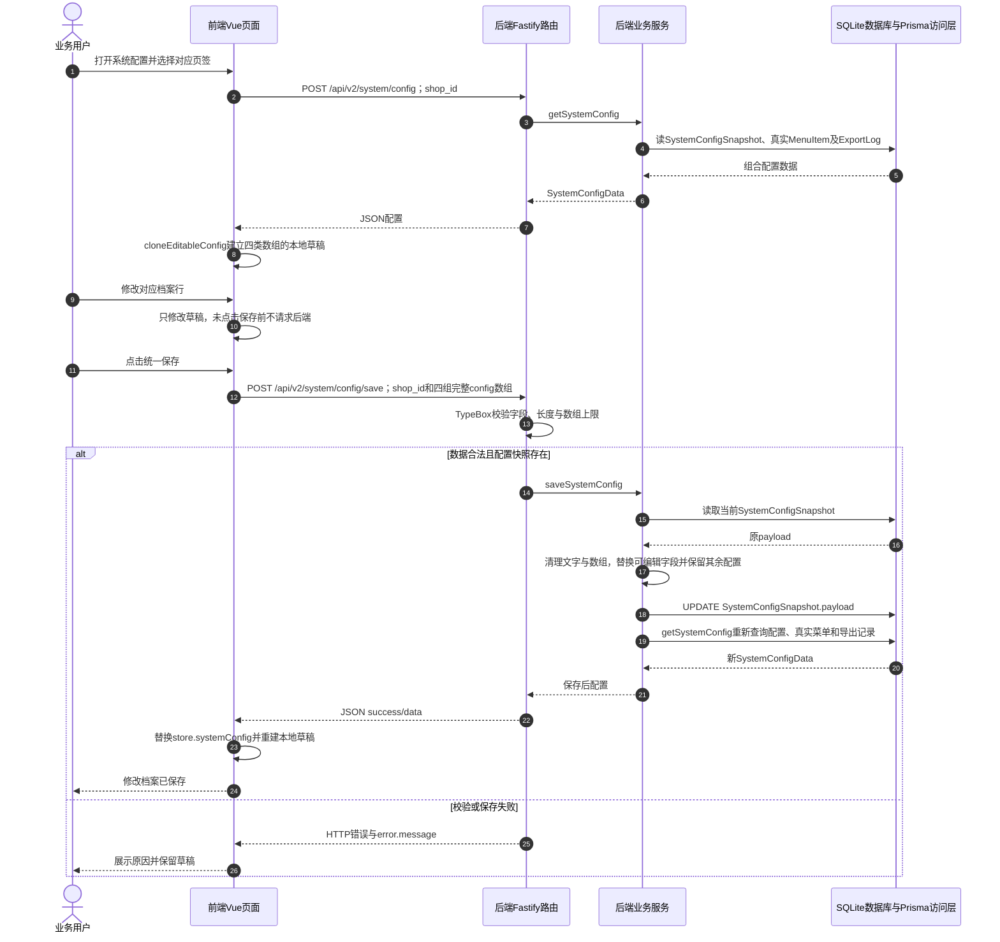

# ⑧ 系统管理与数据接入 / 15 修改知识条目档案

**实现状态：部分实现** · 核对日期：2026-10-27

以下两图依据当前源码；仅对已存在链路作实现描述。尚未实现的范围在边界中说明。

## 业务范围与数据契约

| 项目 | 说明 |
| --- | --- |
| 入口与触发 | PC /settings 对应页签；手机只读展示 |
| 状态 | 部分实现 |
| 接口与关键入参 | POST /api/v2/system/config；POST /api/v2/system/config/save；{shop_id,config} |
| 主要调用 | getSystemConfig → saveSystemConfig |
| 读取或写入数据 | 读取SystemConfigSnapshot；整体更新payload中knowledgeBase数组 |
| 核心处理 | 前端修改草稿行；服务清理文本并限制knowledgeBase最多80项；保存后重新读取组合配置 |
| 响应与数据去向 | 更新后SystemConfigData |

## 业务流程图

```mermaid
flowchart TD
  N1(["开始"])
  N2["用户 → 前端页面<br/>打开系统配置并选择对应页签"]
  N3["前端页面 → 后端路由<br/>POST /api/v2/system/config；shop_id"]
  N4["后端路由 → 业务服务<br/>getSystemConfig"]
  N5["业务服务 → 数据库<br/>读SystemConfigSnapshot、真实MenuItem及ExportLog"]
  N6["数据库 → 业务服务<br/>组合配置数据"]
  N7["业务服务 → 后端路由<br/>SystemConfigData"]
  N8["后端路由 → 前端页面<br/>JSON配置"]
  N9["前端页面内部处理<br/>cloneEditableConfig建立四类数组的本地草稿"]
  N10["用户 → 前端页面<br/>修改对应档案行"]
  N11["前端页面内部处理<br/>只修改草稿，未点击保存前不请求后端"]
  N12["用户 → 前端页面<br/>点击统一保存"]
  N13["前端页面 → 后端路由<br/>POST /api/v2/system/config/save；shop_id和四组完整con<br/>fig数组"]
  N14["后端路由内部处理<br/>TypeBox校验字段、长度与数组上限"]
  N15{"数据合法且配置快照存在？"}
  N16["后端路由 → 业务服务<br/>saveSystemConfig"]
  N17["业务服务 → 数据库<br/>读取当前SystemConfigSnapshot"]
  N18["数据库 → 业务服务<br/>原payload"]
  N19["业务服务内部处理<br/>清理文字与数组，替换可编辑字段并保留其余配置"]
  N20["业务服务 → 数据库<br/>UPDATE SystemConfigSnapshot.payload"]
  N21["业务服务 → 数据库<br/>getSystemConfig重新查询配置、真实菜单和导出记录"]
  N22["数据库 → 业务服务<br/>新SystemConfigData"]
  N23["业务服务 → 后端路由<br/>保存后配置"]
  N24["后端路由 → 前端页面<br/>JSON success/data"]
  N25["前端页面内部处理<br/>替换store.systemConfig并重建本地草稿"]
  N26["前端页面 → 用户<br/>修改档案已保存"]
  N27["后端路由 → 前端页面<br/>HTTP错误与error.message"]
  N28["前端页面 → 用户<br/>展示原因并保留草稿"]
  N29(["继续"])
  N30(["完成 / 可继续操作"])
  N1 -->|"用户 → 前端页面：调用或传递"| N2
  N2 -->|"前端页面 → 后端路由：调用或传递"| N3
  N3 -->|"后端路由 → 业务服务：调用或传递"| N4
  N4 -->|"业务服务 → 数据库：调用或传递"| N5
  N5 -.->|"数据库 → 业务服务：返回数据"| N6
  N6 -.->|"业务服务 → 后端路由：返回数据"| N7
  N7 -.->|"后端路由 → 前端页面：返回数据"| N8
  N8 -->|"前端页面内部处理"| N9
  N9 -->|"用户 → 前端页面：调用或传递"| N10
  N10 -->|"前端页面内部处理"| N11
  N11 -->|"用户 → 前端页面：调用或传递"| N12
  N12 -->|"前端页面 → 后端路由：调用或传递"| N13
  N13 -->|"后端路由内部处理"| N14
  N14 --> N15
  N15 -->|"是 / 正常分支"| N16
  N16 -->|"业务服务 → 数据库：调用或传递"| N17
  N17 -.->|"数据库 → 业务服务：返回数据"| N18
  N18 -->|"业务服务内部处理"| N19
  N19 -->|"业务服务 → 数据库：调用或传递"| N20
  N20 -->|"业务服务 → 数据库：调用或传递"| N21
  N21 -.->|"数据库 → 业务服务：返回数据"| N22
  N22 -.->|"业务服务 → 后端路由：返回数据"| N23
  N23 -.->|"后端路由 → 前端页面：返回数据"| N24
  N24 -->|"前端页面内部处理"| N25
  N25 -.->|"前端页面 → 用户：返回数据"| N26
  N15 -.->|"校验或保存失败"| N27
  N27 -.->|"前端页面 → 用户：返回数据"| N28
  N26 --> N29
  N28 --> N29
  N29 --> N30
  classDef user fill:#f8fafc,stroke:#64748b,color:#0f172a
  class N1,N26,N28,N30 user
  classDef front fill:#eff6ff,stroke:#60a5fa,color:#0f172a
  class N2,N8,N9,N10,N11,N12,N24,N25,N27 front
  classDef back fill:#fff7ed,stroke:#fb923c,color:#0f172a
  class N3,N4,N6,N7,N13,N14,N15,N16,N18,N19,N22,N23,N29 back
  classDef data fill:#f0fdf4,stroke:#4ade80,color:#0f172a
  class N5,N17,N20,N21 data
```

## 时序图

## 规则、异常与完成边界

本文件仅描述系统配置knowledgeBase数组的目录元信息维护（title/type/updatedAt），不存正文、不参与检索。独立的AgentKnowledgeDocument资料库现已实现正文导入、版本有效期、停用/启用、向量索引与混合检索；见本模块新增RAG功能文档。两者是不同存储及界面，修改这里不会自动修改助手资料。config仍须同时提交employees、suppliers、knowledgeBase、permissions四组数组。

前端准备：加载配置后克隆可编辑草稿；修改对象字段：id、title、type、updatedAt。

结果处理：点击统一保存后替换store.systemConfig并重建草稿；失败保留草稿。

异常处理：参数校验、资源查询或业务处理失败；前端展示错误并允许重试。JSON、SSE和浏览器本地动作按各自协议反馈，失败不会凭空产生成功结果。

访问范围：此旧业务路由没有Agent/RAG同等的统一会话与门店鉴权；PC请求可携Bearer，但不能据此前端行为推断后端已核验。

## 源码与需求依据

- [backend/src/services/merchant-service.ts:1828](D:/餐小助/backend/src/services/merchant-service.ts:1828)
- [backend/src/routes/v2.ts:786](D:/餐小助/backend/src/routes/v2.ts:786)
- [front-pc/src/views/SettingsView.vue:1](D:/餐小助/front-pc/src/views/SettingsView.vue:1)
- [front-phone/src/views/SettingsView.vue:1](D:/餐小助/front-phone/src/views/SettingsView.vue:1)
- [front-pc/src/stores/merchant.ts:1](D:/餐小助/front-pc/src/stores/merchant.ts:1)

[返回模块与功能目录](../README.md)
