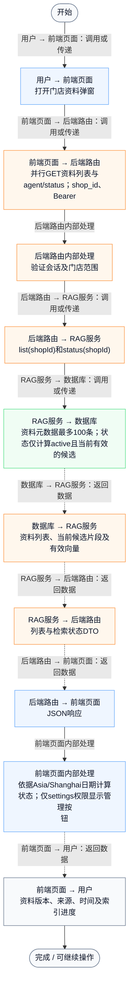
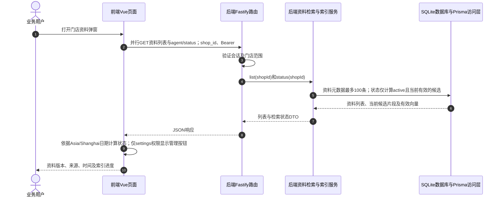

# ⑧ 系统管理与数据接入 / 26 RAG资料列表与有效状态

**实现状态：已实现** · 核对日期：2026-10-27

以下两图依据当前源码；仅对已存在链路作实现描述。尚未实现的范围在边界中说明。

## 业务范围与数据契约

| 项目 | 说明 |
| --- | --- |
| 入口与触发 | PC /assistant → 门店资料 |
| 状态 | 已实现 |
| 接口与关键入参 | GET /api/v2/agent/knowledge?shop_id；GET /api/v2/agent/status?shop_id |
| 主要调用 | KnowledgeManager.load → KnowledgeService.list / status |
| 读取或写入数据 | AgentKnowledgeDocument元数据、AgentKnowledgeEmbedding有效缓存 |
| 核心处理 | 列出本店资料，以启停状态及上海日期区分使用中、待生效、已过期、已停用 |
| 响应与数据去向 | 最多100条文档元数据；有效资料数和索引状态 |

## 业务流程图

## 时序图

## 规则、异常与完成边界

active资料数量上限50，包含尚未生效或已过期但未停用的active行；activeDocuments只计算当前生效资料，因此两者数量可能不同。列表可含停用版本，文档正文不随列表返回。列表最多100条且无分页入口。仅查看无需settings权限，仍须登录并属于该门店。

前端准备：读取当前门店及页面参数。

结果处理：更新 Pinia 或页面状态并渲染。

异常处理：参数校验、资源查询或业务处理失败；前端展示错误并允许重试。JSON、SSE和浏览器本地动作按各自协议反馈，失败不会凭空产生成功结果。

访问范围：此功能读取需有效Bearer会话及当前门店授权；导入、启停和索引写入另需settings权限。

## 源码与需求依据

- [front-pc/src/components/KnowledgeManager.vue:30](D:/餐小助/front-pc/src/components/KnowledgeManager.vue:30)
- [front-pc/src/components/KnowledgeManager.vue:98](D:/餐小助/front-pc/src/components/KnowledgeManager.vue:98)
- [backend/src/routes/agent-knowledge.ts:27](D:/餐小助/backend/src/routes/agent-knowledge.ts:27)
- [backend/src/services/knowledge-service.ts:105](D:/餐小助/backend/src/services/knowledge-service.ts:105)
- [backend/src/services/knowledge-vector-index.ts:60](D:/餐小助/backend/src/services/knowledge-vector-index.ts:60)

[返回模块与功能目录](../README.md)
