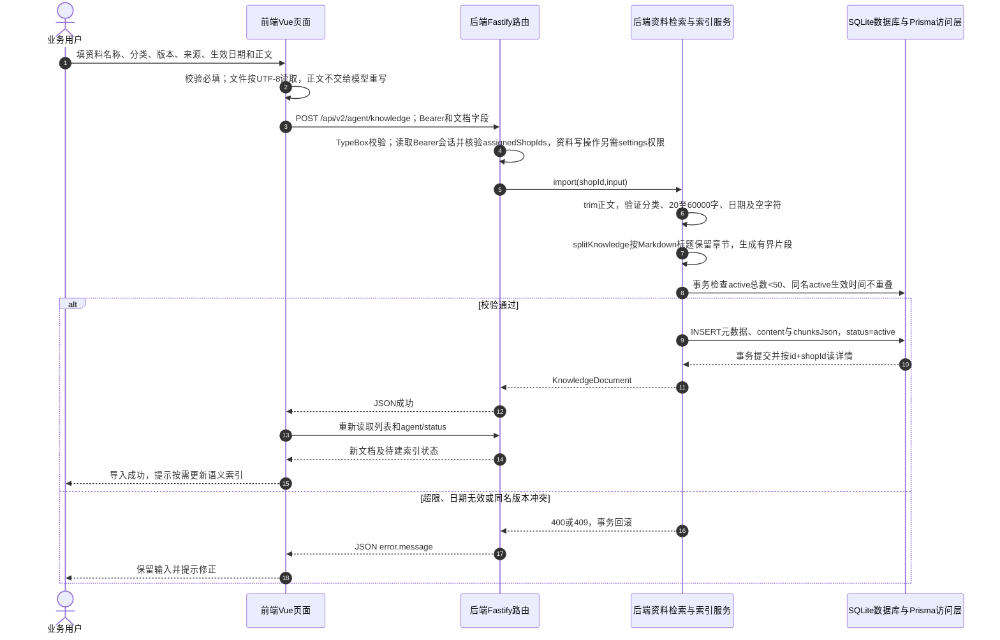

# ⑧ 系统管理与数据接入 / 27 RAG单份资料导入与分段

**实现状态：已实现** · 核对日期：2026-10-27

以下两图依据当前源码；仅对已存在链路作实现描述。尚未实现的范围在边界中说明。

## 业务范围与数据契约

| 项目 | 说明 |
| --- | --- |
| 入口与触发 | PC门店资料→导入新资料；粘贴正文或单文件 |
| 状态 | 已实现 |
| 接口与关键入参 | POST /api/v2/agent/knowledge；{shop_id,title,category,version,sourceName,effectiveFrom,effectiveUntil?,content} |
| 主要调用 | KnowledgeService.import → splitKnowledge → checkActivation |
| 读取或写入数据 | AgentKnowledgeDocument：元数据、完整content、chunksJson |
| 核心处理 | 校验真实日期/正文长度/版本重叠与启用上限，保留章节分段并事务保存 |
| 响应与数据去向 | 新文档详情、chunkCount；有效后立即参与关键词检索 |

## 业务流程图

```mermaid
flowchart TD
  N1(["开始"])
  N2["用户 → 前端页面<br/>填资料名称、分类、版本、来源、生效日期和正文"]
  N3["前端页面内部处理<br/>校验必填；文件按UTF-8读取，正文不交给模型重写"]
  N4["前端页面 → 后端路由<br/>POST /api/v2/agent/knowledge；Bearer和文档字段"]
  N5["后端路由内部处理<br/>TypeBox校验；读取Bearer会话并核验assignedShopIds，资料<br/>写操作另需settings权限"]
  N6["后端路由 → RAG服务<br/>import(shopId,input)"]
  N7["RAG服务内部处理<br/>trim正文，验证分类、20至60000字、日期及空字符"]
  N8["RAG服务内部处理<br/>splitKnowledge按Markdown标题保留章节，生成有界片段"]
  N9["RAG服务 → 数据库<br/>事务检查active总数&lt;50、同名active生效时间不重叠"]
  N10{"校验通过？"}
  N11["RAG服务 → 数据库<br/>INSERT元数据、content与chunksJson，status=active"]
  N12["数据库 → RAG服务<br/>事务提交并按id+shopId读详情"]
  N13["RAG服务 → 后端路由<br/>KnowledgeDocument"]
  N14["后端路由 → 前端页面<br/>JSON成功"]
  N15["前端页面 → 后端路由<br/>重新读取列表和agent/status"]
  N16["后端路由 → 前端页面<br/>新文档及待建索引状态"]
  N17["前端页面 → 用户<br/>导入成功，提示按需更新语义索引"]
  N18["RAG服务 → 后端路由<br/>400或409，事务回滚"]
  N19["后端路由 → 前端页面<br/>JSON error.message"]
  N20["前端页面 → 用户<br/>保留输入并提示修正"]
  N21(["继续"])
  N22(["完成 / 可继续操作"])
  N1 -->|"用户 → 前端页面：调用或传递"| N2
  N2 -->|"前端页面内部处理"| N3
  N3 -->|"前端页面 → 后端路由：调用或传递"| N4
  N4 -->|"后端路由内部处理"| N5
  N5 -->|"后端路由 → RAG服务：调用或传递"| N6
  N6 -->|"RAG服务内部处理"| N7
  N7 -->|"RAG服务内部处理"| N8
  N8 -->|"RAG服务 → 数据库：调用或传递"| N9
  N9 --> N10
  N10 -->|"是 / 正常分支"| N11
  N11 -.->|"数据库 → RAG服务：返回数据"| N12
  N12 -.->|"RAG服务 → 后端路由：返回数据"| N13
  N13 -.->|"后端路由 → 前端页面：返回数据"| N14
  N14 -->|"前端页面 → 后端路由：调用或传递"| N15
  N15 -.->|"后端路由 → 前端页面：返回数据"| N16
  N16 -.->|"前端页面 → 用户：返回数据"| N17
  N10 -.->|"超限、日期无效或同名版本冲突"| N18
  N18 -.->|"后端路由 → 前端页面：返回数据"| N19
  N19 -.->|"前端页面 → 用户：返回数据"| N20
  N17 --> N21
  N20 --> N21
  N21 --> N22
  classDef user fill:#f8fafc,stroke:#64748b,color:#0f172a
  class N1,N17,N20,N22 user
  classDef front fill:#eff6ff,stroke:#60a5fa,color:#0f172a
  class N2,N3,N14,N16,N19 front
  classDef back fill:#fff7ed,stroke:#fb923c,color:#0f172a
  class N4,N5,N6,N7,N8,N12,N13,N15,N18 back
  classDef data fill:#f0fdf4,stroke:#4ade80,color:#0f172a
  class N9,N10,N11,N21 data
```

## 时序图

## 规则、异常与完成边界

分类仅采购规范、供应商说明、异常处理。标题≤100字、版本≤40、来源≤120，正文20至60000字。一般按约1000字符聚合，超长行900切片并100重叠；不是所有片段统一长度或统一重叠。正文和片段持久化在SQLite，无PDF/OCR或网页抓取。导入不自动建向量索引，不会把资料起订量写入采购算法。

前端准备：读取当前门店及页面参数。

结果处理：更新 Pinia 或页面状态并渲染。

异常处理：参数校验、资源查询或业务处理失败；前端展示错误并允许重试。JSON、SSE和浏览器本地动作按各自协议反馈，失败不会凭空产生成功结果。

访问范围：此功能读取需有效Bearer会话及当前门店授权；导入、启停和索引写入另需settings权限。

## 源码与需求依据

- [front-pc/src/components/KnowledgeManager.vue:59](D:/餐小助/front-pc/src/components/KnowledgeManager.vue:59)
- [backend/src/routes/agent-knowledge.ts:27](D:/餐小助/backend/src/routes/agent-knowledge.ts:27)
- [backend/src/services/knowledge-service.ts:130](D:/餐小助/backend/src/services/knowledge-service.ts:130)
- [backend/src/services/knowledge-service.ts:50](D:/餐小助/backend/src/services/knowledge-service.ts:50)

[返回模块与功能目录](../README.md)
