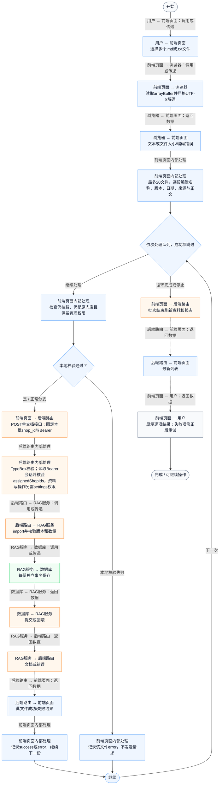
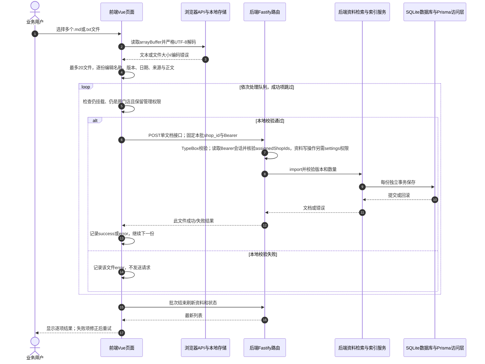

# ⑧ 系统管理与数据接入 / 28 RAG多文件批量导入与部分重试

**实现状态：已实现** · 核对日期：2026-10-27

以下两图依据当前源码；仅对已存在链路作实现描述。尚未实现的范围在边界中说明。

## 业务范围与数据契约

| 项目 | 说明 |
| --- | --- |
| 入口与触发 | PC门店资料→多选Markdown或TXT |
| 状态 | 已实现 |
| 接口与关键入参 | 逐份POST /api/v2/agent/knowledge；没有独立batch路由 |
| 主要调用 | readKnowledgeFiles → importKnowledgeQueue → importKnowledgeDocument |
| 读取或写入数据 | 浏览器本地文件队列与各自独立AgentKnowledgeDocument |
| 核心处理 | 每批≤20份、每份≤200000字节；逐份校验、逐份提交、成功项跳过重试 |
| 响应与数据去向 | 每文件pending/importing/success/error状态及总成功/失败数量 |

## 业务流程图

## 时序图

## 规则、异常与完成边界

批量不是单个原子事务，部分成功不会回滚；成功项在本地队列重试时不重复提交。切换门店或卸载会停止后续提交，已发出的当前请求可能仍成功，不承诺全撤销。文件默认从表单继承分类/版本/日期，每份文件可独立修改。文件大小按200000字节限制，正文另受20至60000字和NUL校验。

前端准备：读取当前门店及页面参数。

结果处理：更新 Pinia 或页面状态并渲染。

异常处理：参数校验、资源查询或业务处理失败；前端展示错误并允许重试。JSON、SSE和浏览器本地动作按各自协议反馈，失败不会凭空产生成功结果。

访问范围：此功能读取需有效Bearer会话及当前门店授权；导入、启停和索引写入另需settings权限。

## 源码与需求依据

- [front-pc/src/utils/knowledge-import.ts:13](D:/餐小助/front-pc/src/utils/knowledge-import.ts:13)
- [front-pc/src/utils/knowledge-import.ts:46](D:/餐小助/front-pc/src/utils/knowledge-import.ts:46)
- [front-pc/src/components/KnowledgeManager.vue:71](D:/餐小助/front-pc/src/components/KnowledgeManager.vue:71)
- [backend/src/services/knowledge-service.ts:130](D:/餐小助/backend/src/services/knowledge-service.ts:130)

[返回模块与功能目录](../README.md)
