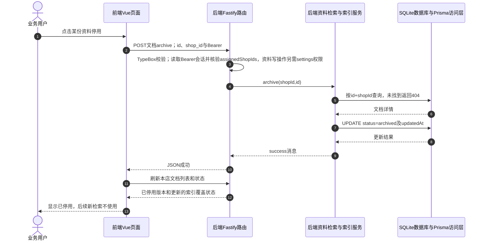

# ⑧ 系统管理与数据接入 / 29 RAG资料停用

**实现状态：已实现** · 核对日期：2026-10-27

以下两图依据当前源码；仅对已存在链路作实现描述。尚未实现的范围在边界中说明。

## 业务范围与数据契约

| 项目 | 说明 |
| --- | --- |
| 入口与触发 | PC门店资料列表→停用 |
| 状态 | 已实现 |
| 接口与关键入参 | POST /api/v2/agent/knowledge/:id/archive；{shop_id} |
| 主要调用 | KnowledgeService.archive |
| 读取或写入数据 | AgentKnowledgeDocument.status与updatedAt；保留正文及向量缓存 |
| 核心处理 | 核验所属门店，软停用为archived，后续检索候选排除 |
| 响应与数据去向 | 操作结果与刷新后的已停用状态 |

## 业务流程图

```mermaid
flowchart TD
  N1(["开始"])
  N2["用户 → 前端页面<br/>点击某份资料停用"]
  N3["前端页面 → 后端路由<br/>POST文档archive；id、shop_id与Bearer"]
  N4["后端路由内部处理<br/>TypeBox校验；读取Bearer会话并核验assignedShopIds，资料<br/>写操作另需settings权限"]
  N5["后端路由 → RAG服务<br/>archive(shopId,id)"]
  N6["RAG服务 → 数据库<br/>按id+shopId查询，未找到返回404"]
  N7["数据库 → RAG服务<br/>文档详情"]
  N8["RAG服务 → 数据库<br/>UPDATE status=archived及updatedAt"]
  N9["数据库 → RAG服务<br/>更新结果"]
  N10["RAG服务 → 后端路由<br/>success消息"]
  N11["后端路由 → 前端页面<br/>JSON成功"]
  N12["前端页面 → 后端路由<br/>刷新本店文档列表和状态"]
  N13["后端路由 → 前端页面<br/>已停用版本和更新的索引覆盖状态"]
  N14["前端页面 → 用户<br/>显示已停用，后续新检索不使用"]
  N15(["完成 / 可继续操作"])
  N1 -->|"用户 → 前端页面：调用或传递"| N2
  N2 -->|"前端页面 → 后端路由：调用或传递"| N3
  N3 -->|"后端路由内部处理"| N4
  N4 -->|"后端路由 → RAG服务：调用或传递"| N5
  N5 -->|"RAG服务 → 数据库：调用或传递"| N6
  N6 -.->|"数据库 → RAG服务：返回数据"| N7
  N7 -->|"RAG服务 → 数据库：调用或传递"| N8
  N8 -.->|"数据库 → RAG服务：返回数据"| N9
  N9 -.->|"RAG服务 → 后端路由：返回数据"| N10
  N10 -.->|"后端路由 → 前端页面：返回数据"| N11
  N11 -->|"前端页面 → 后端路由：调用或传递"| N12
  N12 -.->|"后端路由 → 前端页面：返回数据"| N13
  N13 -.->|"前端页面 → 用户：返回数据"| N14
  N14 --> N15
  classDef user fill:#f8fafc,stroke:#64748b,color:#0f172a
  class N1,N14,N15 user
  classDef front fill:#eff6ff,stroke:#60a5fa,color:#0f172a
  class N2,N11,N13 front
  classDef back fill:#fff7ed,stroke:#fb923c,color:#0f172a
  class N3,N4,N5,N7,N9,N10,N12 back
  classDef data fill:#f0fdf4,stroke:#4ade80,color:#0f172a
  class N6,N8 data
```

## 时序图

## 规则、异常与完成边界

软停用不删除正文或向量，也不会撤回已返回的历史答案。下次检索按active+有效期筛选，因此保留的向量不会使停用版本重新命中。没有独立永久删除文档接口。

前端准备：读取当前门店及页面参数。

结果处理：更新 Pinia 或页面状态并渲染。

异常处理：参数校验、资源查询或业务处理失败；前端展示错误并允许重试。JSON、SSE和浏览器本地动作按各自协议反馈，失败不会凭空产生成功结果。

访问范围：此功能读取需有效Bearer会话及当前门店授权；导入、启停和索引写入另需settings权限。

## 源码与需求依据

- [front-pc/src/components/KnowledgeManager.vue:83](D:/餐小助/front-pc/src/components/KnowledgeManager.vue:83)
- [backend/src/routes/agent-knowledge.ts:45](D:/餐小助/backend/src/routes/agent-knowledge.ts:45)
- [backend/src/services/knowledge-service.ts:160](D:/餐小助/backend/src/services/knowledge-service.ts:160)
- [backend/src/services/knowledge-service.ts:182](D:/餐小助/backend/src/services/knowledge-service.ts:182)

[返回模块与功能目录](../README.md)
