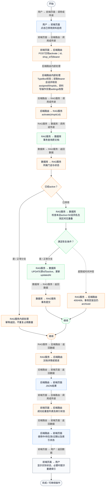
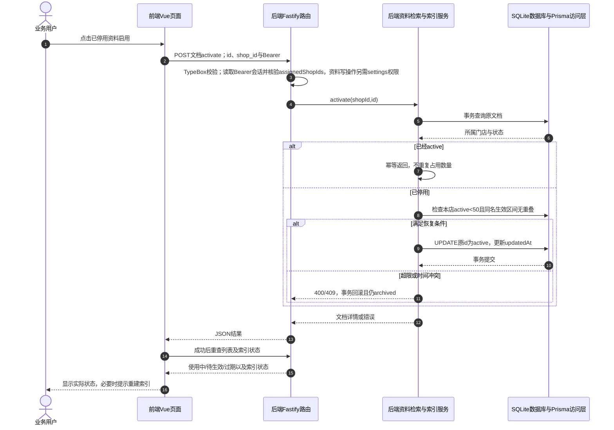

# ⑧ 系统管理与数据接入 / 30 RAG资料重新启用与版本冲突校验

**实现状态：已实现** · 核对日期：2026-10-27

以下两图依据当前源码；仅对已存在链路作实现描述。尚未实现的范围在边界中说明。

## 业务范围与数据契约

| 项目 | 说明 |
| --- | --- |
| 入口与触发 | PC门店资料列表→已停用版本启用 |
| 状态 | 已实现 |
| 接口与关键入参 | POST /api/v2/agent/knowledge/:id/activate；{shop_id} |
| 主要调用 | KnowledgeService.activate → checkActivation |
| 读取或写入数据 | 原AgentKnowledgeDocument；不创建副本，兼容有效的原向量缓存 |
| 核心处理 | 事务核验文档门店、active数量和同名有效期重叠；已active直接返回 |
| 响应与数据去向 | 原文档恢复active；是否可检索仍由当前日期决定 |

## 业务流程图

## 时序图

## 规则、异常与完成边界

同名区间首尾日期均包含；旧版effectiveUntil为空表示长期，可能与新版重叠。启用不修改内容和版本、不延长有效期、不复制文档。重新启用后符合fingerprint与textHash的向量可复用；未来或已过期资料即使active也不参与当前检索。

前端准备：读取当前门店及页面参数。

结果处理：更新 Pinia 或页面状态并渲染。

异常处理：参数校验、资源查询或业务处理失败；前端展示错误并允许重试。JSON、SSE和浏览器本地动作按各自协议反馈，失败不会凭空产生成功结果。

访问范围：此功能读取需有效Bearer会话及当前门店授权；导入、启停和索引写入另需settings权限。

## 源码与需求依据

- [backend/src/services/knowledge-service.ts:167](D:/餐小助/backend/src/services/knowledge-service.ts:167)
- [backend/src/services/knowledge-service.ts:119](D:/餐小助/backend/src/services/knowledge-service.ts:119)
- [backend/src/routes/agent-knowledge.ts:48](D:/餐小助/backend/src/routes/agent-knowledge.ts:48)
- [backend/src/services/knowledge-vector-index.ts:36](D:/餐小助/backend/src/services/knowledge-vector-index.ts:36)
- [front-pc/src/components/KnowledgeManager.vue:83](D:/餐小助/front-pc/src/components/KnowledgeManager.vue:83)

[返回模块与功能目录](../README.md)
