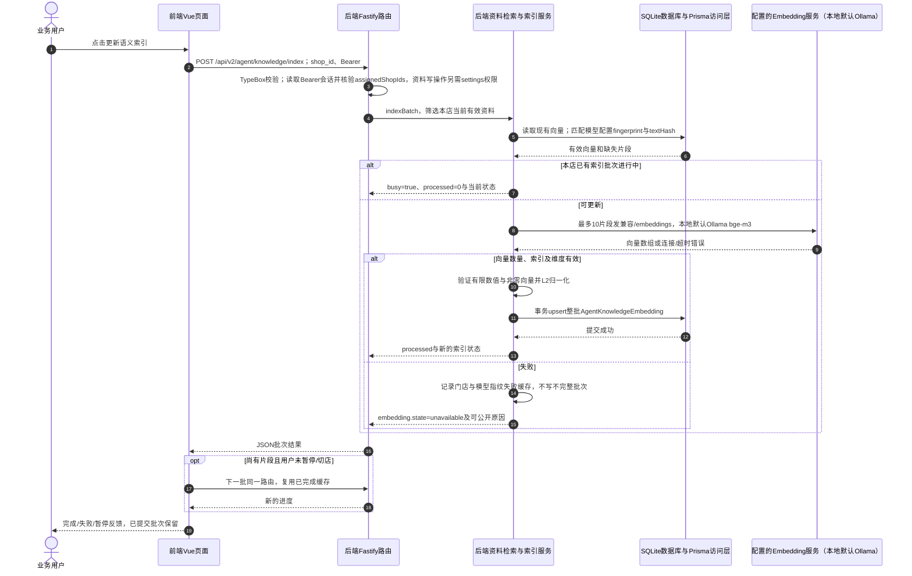

# ⑧ 系统管理与数据接入 / 31 RAG语义索引更新暂停与续建

**实现状态：已实现** · 核对日期：2026-10-27

以下两图依据当前源码；仅对已存在链路作实现描述。尚未实现的范围在边界中说明。

## 业务范围与数据契约

| 项目 | 说明 |
| --- | --- |
| 入口与触发 | PC门店资料→更新语义索引/完成本批后暂停 |
| 状态 | 已实现 |
| 接口与关键入参 | POST /api/v2/agent/knowledge/index；{shop_id} |
| 主要调用 | KnowledgeManager.updateIndex → indexBatch → indexKnowledgeBatch → embedTexts |
| 读取或写入数据 | 有效AgentKnowledgeDocument片段与AgentKnowledgeEmbedding缓存 |
| 核心处理 | 每次最多10片段，按模型指纹和文本哈希去重；验证向量后整批事务写入 |
| 响应与数据去向 | processed、busy及embedding状态与已索引/总片段数 |

## 业务流程图

```mermaid
flowchart TD
  N1(["开始"])
  N2["用户 → 前端页面<br/>点击更新语义索引"]
  N3["前端页面 → 后端路由<br/>POST /api/v2/agent/knowledge/index；shop_id、Bearer"]
  N4["后端路由内部处理<br/>TypeBox校验；读取Bearer会话并核验assignedShopIds，资料<br/>写操作另需settings权限"]
  N5["后端路由 → RAG服务<br/>indexBatch，筛选本店当前有效资料"]
  N6["RAG服务 → 数据库<br/>读取现有向量；匹配模型配置fingerprint与textHash"]
  N7["数据库 → RAG服务<br/>有效向量和缺失片段"]
  N8{"本店已有索引批次进行中？"}
  N9["RAG服务 → 后端路由<br/>busy=true、processed=0与当前状态"]
  N10["RAG服务 → 向量服务<br/>最多10片段发兼容/embeddings，本地默认Ollama bge-m3"]
  N11["向量服务 → RAG服务<br/>向量数组或连接/超时错误"]
  N12{"向量数量、索引及维度有效？"}
  N13["RAG服务内部处理<br/>验证有限数值与非零向量并L2归一化"]
  N14["RAG服务 → 数据库<br/>事务upsert整批AgentKnowledgeEmbedding"]
  N15["数据库 → RAG服务<br/>提交成功"]
  N16["RAG服务 → 后端路由<br/>processed与新的索引状态"]
  N17["RAG服务内部处理<br/>记录门店与模型指纹失败缓存，不写不完整批次"]
  N18["RAG服务 → 后端路由<br/>embedding.state=unavailable及可公开原因"]
  N19(["继续"])
  N20(["继续"])
  N21["后端路由 → 前端页面<br/>JSON批次结果"]
  N22{"尚有片段且用户未暂停/切店？"}
  N23["前端页面 → 后端路由<br/>下一批同一路由，复用已完成缓存"]
  N24["后端路由 → 前端页面<br/>新的进度"]
  N25(["继续"])
  N26["前端页面 → 用户<br/>完成/失败/暂停反馈，已提交批次保留"]
  N27(["完成 / 可继续操作"])
  N1 -->|"用户 → 前端页面：调用或传递"| N2
  N2 -->|"前端页面 → 后端路由：调用或传递"| N3
  N3 -->|"后端路由内部处理"| N4
  N4 -->|"后端路由 → RAG服务：调用或传递"| N5
  N5 -->|"RAG服务 → 数据库：调用或传递"| N6
  N6 -.->|"数据库 → RAG服务：返回数据"| N7
  N7 --> N8
  N8 -.->|"是 / 正常分支"| N9
  N8 -->|"可更新"| N10
  N10 -.->|"向量服务 → RAG服务：返回数据"| N11
  N11 --> N12
  N12 -->|"是 / 正常分支"| N13
  N13 -->|"RAG服务 → 数据库：调用或传递"| N14
  N14 -.->|"数据库 → RAG服务：返回数据"| N15
  N15 -.->|"RAG服务 → 后端路由：返回数据"| N16
  N12 -->|"失败"| N17
  N17 -.->|"RAG服务 → 后端路由：返回数据"| N18
  N16 --> N19
  N18 --> N19
  N9 --> N20
  N19 --> N20
  N20 -.->|"后端路由 → 前端页面：返回数据"| N21
  N21 --> N22
  N22 -->|"是"| N23
  N23 -.->|"后端路由 → 前端页面：返回数据"| N24
  N24 --> N25
  N22 -->|"否 / 跳过"| N25
  N25 -.->|"前端页面 → 用户：返回数据"| N26
  N26 --> N27
  classDef user fill:#f8fafc,stroke:#64748b,color:#0f172a
  class N1,N26,N27 user
  classDef front fill:#eff6ff,stroke:#60a5fa,color:#0f172a
  class N2,N21,N22,N24,N25 front
  classDef back fill:#fff7ed,stroke:#fb923c,color:#0f172a
  class N3,N4,N5,N7,N8,N9,N11,N12,N13,N15,N16,N17,N18,N19,N20,N23 back
  classDef data fill:#f0fdf4,stroke:#4ade80,color:#0f172a
  class N6,N14 data
  classDef external fill:#faf5ff,stroke:#c084fc,color:#0f172a
  class N10 external
```

## 时序图

## 规则、异常与完成边界

暂停是完成当前批次后停止后续请求，不会立即撤回当前向量调用。切店停止后续循环；每店索引锁是进程内Set，不是分布式锁。向量存SQLite的JSON列，不是外部向量数据库。模型/维度/地址/提供方变化生成新fingerprint；正文变化由textHash识别。本地30秒、远程12秒超时。状态接口不主动探测模型连通性。

前端准备：读取当前门店及页面参数。

结果处理：更新 Pinia 或页面状态并渲染。

异常处理：参数校验、资源查询或业务处理失败；前端展示错误并允许重试。JSON、SSE和浏览器本地动作按各自协议反馈，失败不会凭空产生成功结果。

访问范围：此功能读取需有效Bearer会话及当前门店授权；导入、启停和索引写入另需settings权限。

## 源码与需求依据

- [front-pc/src/components/KnowledgeManager.vue:104](D:/餐小助/front-pc/src/components/KnowledgeManager.vue:104)
- [backend/src/routes/agent-knowledge.ts:27](D:/餐小助/backend/src/routes/agent-knowledge.ts:27)
- [backend/src/services/knowledge-vector-index.ts:82](D:/餐小助/backend/src/services/knowledge-vector-index.ts:82)
- [backend/src/services/embedding-service.ts:47](D:/餐小助/backend/src/services/embedding-service.ts:47)
- [backend/src/services/embedding-service.ts:31](D:/餐小助/backend/src/services/embedding-service.ts:31)

[返回模块与功能目录](../README.md)
