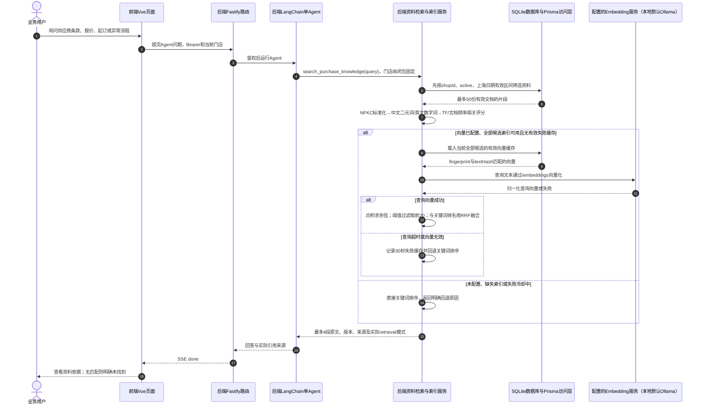

# ⑧ 系统管理与数据接入 / 32 RAG混合检索排序与关键词回退

**实现状态：已实现** · 核对日期：2026-10-27

以下两图依据当前源码；仅对已存在链路作实现描述。尚未实现的范围在边界中说明。

## 业务范围与数据契约

| 项目 | 说明 |
| --- | --- |
| 入口与触发 | Agent工具search_purchase_knowledge；无独立公开search接口 |
| 状态 | 已实现 |
| 接口与关键入参 | POST /api/v2/agent/qa/stream；内部KnowledgeService.search(shopId,query) |
| 主要调用 | activeCandidates → keyword评分 + semanticRanks → fuseRanks |
| 读取或写入数据 | 本店active且当前有效资料、对应模型指纹与文本哈希匹配的缓存向量 |
| 核心处理 | 中文二元词/英文数字词频评分与余弦相似度融合，最多返回4段原文 |
| 响应与数据去向 | sources、message、retrieval=hybrid或keyword |

## 业务流程图

```mermaid
flowchart TD
  N1(["开始"])
  N2["用户 → 前端页面<br/>询问供应商条款、报价、起订或异常流程"]
  N3["前端页面 → 后端路由<br/>提交Agent问题，Bearer和当前门店"]
  N4["后端路由 → Agent<br/>鉴权后运行Agent"]
  N5["Agent → RAG服务<br/>search_purchase_knowledge(query)，门店由闭包固定"]
  N6["RAG服务 → 数据库<br/>先按shopId、active、上海日期有效区间筛选资料"]
  N7["数据库 → RAG服务<br/>最多50份有效文档的片段"]
  N8["RAG服务内部处理<br/>NFKC标准化→中文二元词/英文数字词→TF/文档频率相关评分"]
  N9{"向量已配置、全部候选索引可用且无有效失败缓存？"}
  N10["RAG服务 → 数据库<br/>载入当前全部候选的有效向量缓存"]
  N11["数据库 → RAG服务<br/>fingerprint与textHash匹配的向量"]
  N12["RAG服务 → 向量服务<br/>查询文本通过/embeddings向量化"]
  N13["向量服务 → RAG服务<br/>归一化查询向量或失败"]
  N14{"查询向量成功？"}
  N15["RAG服务内部处理<br/>点积求余弦；阈值过滤取前20；与关键词排名用RRF融合"]
  N16["RAG服务内部处理<br/>记录30秒失败缓存并回退关键词排序"]
  N17(["继续"])
  N18["RAG服务内部处理<br/>直接关键词排序，返回明确回退原因"]
  N19(["继续"])
  N20["RAG服务 → Agent<br/>最多4段原文、版本、来源及实际retrieval模式"]
  N21["Agent → 后端路由<br/>回答与实际引用来源"]
  N22["后端路由 → 前端页面<br/>SSE done"]
  N23["前端页面 → 用户<br/>查看资料依据；无匹配则明确未找到"]
  N24(["完成 / 可继续操作"])
  N1 -->|"用户 → 前端页面：调用或传递"| N2
  N2 -->|"前端页面 → 后端路由：调用或传递"| N3
  N3 -->|"后端路由 → Agent：调用或传递"| N4
  N4 -->|"Agent → RAG服务：调用或传递"| N5
  N5 -->|"RAG服务 → 数据库：调用或传递"| N6
  N6 -.->|"数据库 → RAG服务：返回数据"| N7
  N7 -->|"RAG服务内部处理"| N8
  N8 --> N9
  N9 -->|"是 / 正常分支"| N10
  N10 -.->|"数据库 → RAG服务：返回数据"| N11
  N11 -->|"RAG服务 → 向量服务：调用或传递"| N12
  N12 -.->|"向量服务 → RAG服务：返回数据"| N13
  N13 --> N14
  N14 -->|"是 / 正常分支"| N15
  N14 -->|"查询超时或向量无效"| N16
  N15 --> N17
  N16 --> N17
  N9 -->|"未配置、缺失索引或失败冷却中"| N18
  N17 --> N19
  N18 --> N19
  N19 -.->|"RAG服务 → Agent：返回数据"| N20
  N20 -.->|"Agent → 后端路由：返回数据"| N21
  N21 -.->|"后端路由 → 前端页面：返回数据"| N22
  N22 -.->|"前端页面 → 用户：返回数据"| N23
  N23 --> N24
  classDef user fill:#f8fafc,stroke:#64748b,color:#0f172a
  class N1,N23,N24 user
  classDef front fill:#eff6ff,stroke:#60a5fa,color:#0f172a
  class N2,N22 front
  classDef back fill:#fff7ed,stroke:#fb923c,color:#0f172a
  class N3,N4,N5,N7,N8,N9,N11,N13,N14,N15,N16,N17,N18,N19,N20,N21 back
  classDef data fill:#f0fdf4,stroke:#4ade80,color:#0f172a
  class N6,N10 data
  classDef external fill:#faf5ff,stroke:#c084fc,color:#0f172a
  class N12 external
```

## 时序图

## 规则、异常与完成边界

向量归一化后以点积求余弦，默认阈值0.35；语义及关键词各最多20名参与RRF，融合公式为各列表1/(60+名次)之和，最后返回4段。关键词评分是TF/文档频率加权实现，不能直接称为完整BM25。所有当前有效候选均有匹配缓存才启用语义分支；未配置、未建完、接口故障等会明确回退。没有独立reranker、查询改写或检索命中后的事实验证器。召回相近材料不表示已证明用户当前订单事实。

前端准备：读取当前门店及页面参数。

结果处理：更新 Pinia 或页面状态并渲染。

异常处理：参数校验、资源查询或业务处理失败；前端展示错误并允许重试。JSON、SSE和浏览器本地动作按各自协议反馈，失败不会凭空产生成功结果。

访问范围：此功能读取需有效Bearer会话及当前门店授权；导入、启停和索引写入另需settings权限。

## 源码与需求依据

- [backend/src/services/knowledge-service.ts:200](D:/餐小助/backend/src/services/knowledge-service.ts:200)
- [backend/src/services/knowledge-service.ts:182](D:/餐小助/backend/src/services/knowledge-service.ts:182)
- [backend/src/services/knowledge-vector-index.ts:110](D:/餐小助/backend/src/services/knowledge-vector-index.ts:110)
- [backend/src/services/knowledge-vector-index.ts:134](D:/餐小助/backend/src/services/knowledge-vector-index.ts:134)
- [backend/src/services/embedding-service.ts:37](D:/餐小助/backend/src/services/embedding-service.ts:37)

[返回模块与功能目录](../README.md)
