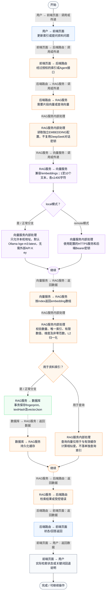
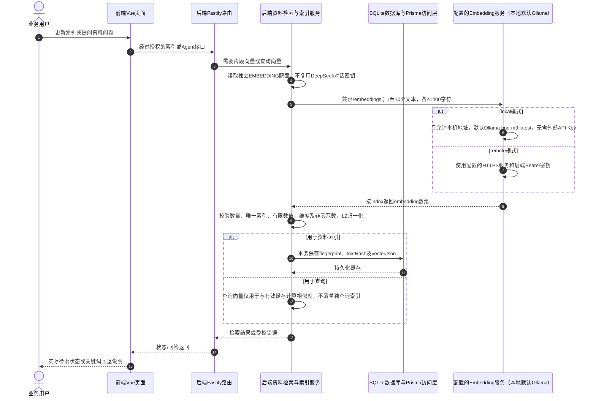

# ⑧ 系统管理与数据接入 / 33 本地向量模型调用与缓存校验

**实现状态：已实现** · 核对日期：2026-10-27

以下两图依据当前源码；仅对已存在链路作实现描述。尚未实现的范围在边界中说明。

## 业务范围与数据契约

| 项目 | 说明 |
| --- | --- |
| 入口与触发 | RAG索引建立及查询向量化；不是对话模型调用 |
| 状态 | 已实现 |
| 接口与关键入参 | 后端→配置的/embeddings；本地默认http://127.0.0.1:11434/v1/embeddings |
| 主要调用 | getEmbeddingConfig / embedTexts / normalizeVector / loadVectors |
| 读取或写入数据 | EMBEDDING配置（不输出密钥）及AgentKnowledgeEmbedding |
| 核心处理 | 区分本机/远程配置，限制地址和请求批量，验证返回索引与维度，缓存可复用向量 |
| 响应与数据去向 | 1024维（默认）归一化向量，错误时上层回退关键词 |

## 业务流程图

## 时序图

## 规则、异常与完成边界

对话模型和向量模型分开配置，DeepSeek负责问答与工具选择，Ollama bge-m3负责Embedding；默认维度1024可配置，不是DeepSeek生成向量。local模式仅允许localhost/127.0.0.1/[::1]，remote可用HTTPS或本机测试地址，禁止URL中账号密码/查询/hash和重定向。模型指纹包含提供方、地址、模型与维度；本任务不下载模型、不修改本机模型服务。

前端准备：读取当前门店及页面参数。

结果处理：更新 Pinia 或页面状态并渲染。

异常处理：参数校验、资源查询或业务处理失败；前端展示错误并允许重试。JSON、SSE和浏览器本地动作按各自协议反馈，失败不会凭空产生成功结果。

访问范围：此功能读取需有效Bearer会话及当前门店授权；导入、启停和索引写入另需settings权限。

## 源码与需求依据

- [backend/src/services/embedding-service.ts:17](D:/餐小助/backend/src/services/embedding-service.ts:17)
- [backend/src/services/embedding-service.ts:47](D:/餐小助/backend/src/services/embedding-service.ts:47)
- [backend/src/services/knowledge-vector-index.ts:36](D:/餐小助/backend/src/services/knowledge-vector-index.ts:36)
- [backend/src/services/knowledge-vector-index.ts:60](D:/餐小助/backend/src/services/knowledge-vector-index.ts:60)
- [docs/本地向量检索.md:20](D:/餐小助/docs/本地向量检索.md:20)

[返回模块与功能目录](../README.md)
