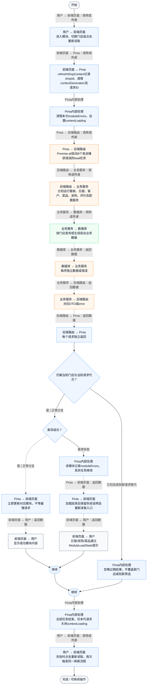
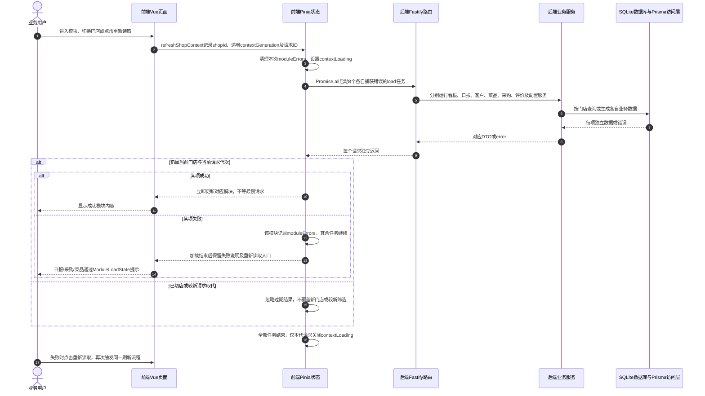

# ⑧ 系统管理与数据接入 / 34 PC模块独立加载与失败重试

**实现状态：已实现** · 核对日期：2026-10-27

以下两图依据当前源码；仅对已存在链路作实现描述。尚未实现的范围在边界中说明。

## 业务范围与数据契约

| 项目 | 说明 |
| --- | --- |
| 入口与触发 | PC日报、采购、菜品等页面加载空态与重新读取按钮 |
| 状态 | 已实现 |
| 接口与关键入参 | POST /api/v2/dashboard/overview、/api/v2/daily-report/get、/api/v2/customer/profile、/api/v2/customer/assets/overview、/api/v2/dish/quadrant、/api/v2/purchase/order/generate、/api/v2/review/aggregate、/api/v2/system/config |
| 主要调用 | refreshShopContext → 每项独立load；页面ModuleLoadState触发重试 |
| 读取或写入数据 | Pinia模块状态、moduleErrors、contextGeneration与各模块业务数据 |
| 核心处理 | 8个请求并发、每项独立捕获错误和发布结果；重试重新加载门店上下文 |
| 响应与数据去向 | 成功模块可见，失败模块提示原因且可重新读取 |

## 业务流程图

## 时序图

## 规则、异常与完成边界

页面重新读取通常调用refreshShopContext，当前会重新加载8项，并非只请求失败的单项。页面有本地数据时可能继续保留旧结果；无数据时显示加载/失败空态。评价页和库存页还各有独立请求序号及重试逻辑。不是全局自动重试、离线缓存或RouteErrorBoundary自动恢复；后者组件存在不代表被当前AppShell使用。

前端准备：读取当前门店及页面参数。

结果处理：更新 Pinia 或页面状态并渲染。

异常处理：参数校验、资源查询或业务处理失败；前端展示错误并允许重试。JSON、SSE和浏览器本地动作按各自协议反馈，失败不会凭空产生成功结果。

访问范围：此旧业务路由没有Agent/RAG同等的统一会话与门店鉴权；PC请求可携Bearer，但不能据此前端行为推断后端已核验。

## 源码与需求依据

- [front-pc/src/stores/merchant.ts:459](D:/餐小助/front-pc/src/stores/merchant.ts:459)
- [front-pc/src/components/ModuleLoadState.vue:3](D:/餐小助/front-pc/src/components/ModuleLoadState.vue:3)
- [front-pc/src/views/DailyReportView.vue:2](D:/餐小助/front-pc/src/views/DailyReportView.vue:2)
- [front-pc/src/views/PurchaseView.vue:2](D:/餐小助/front-pc/src/views/PurchaseView.vue:2)
- [front-pc/src/views/DishesView.vue:2](D:/餐小助/front-pc/src/views/DishesView.vue:2)

[返回模块与功能目录](../README.md)
