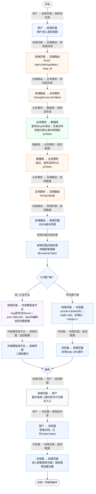
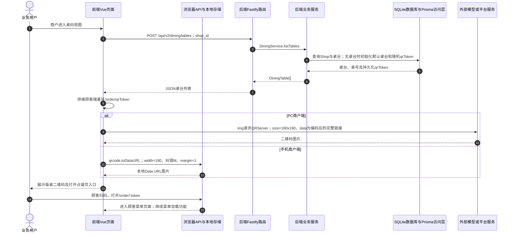

# ⑨ 扫码点餐与堂食订单 / 01 桌台列表与二维码入口

**实现状态：已实现** · 核对日期：2026-10-27

以下两图依据当前源码；仅对已存在链路作实现描述。尚未实现的范围在边界中说明。

## 业务范围与数据契约

| 项目 | 说明 |
| --- | --- |
| 入口与触发 | PC及手机 /dining 桌码视图 |
| 状态 | 已实现 |
| 接口与关键入参 | POST /api/v2/dining/tables；{shop_id} |
| 主要调用 | listTables → ensureShopDiningDefaults |
| 读取或写入数据 | Shop、DiningTable；缺少桌台时按默认A01/A02/A03/B01/B02初始化 |
| 核心处理 | 返回桌号、座位、qrToken、status，前端拼公网手机端/order/token链接 |
| 响应与数据去向 | DiningTable[]与二维码入口 |

## 业务流程图

## 时序图

## 规则、异常与完成边界

每桌qrToken由Node crypto.randomBytes(18).toString(base64url)生成并持久化，数据库有唯一约束。链接为顾客端基址/order/qrToken；VITE_CUSTOMER_ORDER_BASE_URL可覆盖基址，localhost默认5174，部署同源默认/phone前缀。PC调用QRServer在线接口生成180×180二维码；手机商户端用qrcode.toDataURL在浏览器本地生成。二维码包含链接，门店桌号由后端Token关联查询；刷新页面不重新生成Token。不是微信小程序码，也不是一次性顾客身份令牌。

前端准备：读取当前门店及页面参数。

结果处理：PC构建远程二维码img URL；手机QRCode.toDataURL本地绘制；展示或打开顾客点餐链接。

异常处理：参数校验、资源查询或业务处理失败；前端展示错误并允许重试。JSON、SSE和浏览器本地动作按各自协议反馈，失败不会凭空产生成功结果。

访问范围：此旧业务路由没有Agent/RAG同等的统一会话与门店鉴权；PC请求可携Bearer，但不能据此前端行为推断后端已核验。

## 源码与需求依据

- [backend/src/services/dining-service.ts:658](D:/餐小助/backend/src/services/dining-service.ts:658)
- [backend/src/routes/v2.ts:507](D:/餐小助/backend/src/routes/v2.ts:507)
- [front-pc/src/views/DiningOrdersView.vue:1](D:/餐小助/front-pc/src/views/DiningOrdersView.vue:1)
- [front-phone/src/views/DiningOrdersView.vue:1](D:/餐小助/front-phone/src/views/DiningOrdersView.vue:1)
- [front-phone/src/views/DiningOrdersView.vue:153](D:/餐小助/front-phone/src/views/DiningOrdersView.vue:153)
- [front-pc/src/views/DiningOrdersView.vue:82](D:/餐小助/front-pc/src/views/DiningOrdersView.vue:82)
- [backend/src/services/dining-service.ts:101](D:/餐小助/backend/src/services/dining-service.ts:101)

[返回模块与功能目录](../README.md)
