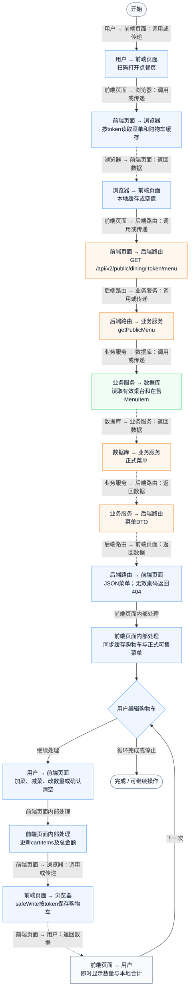
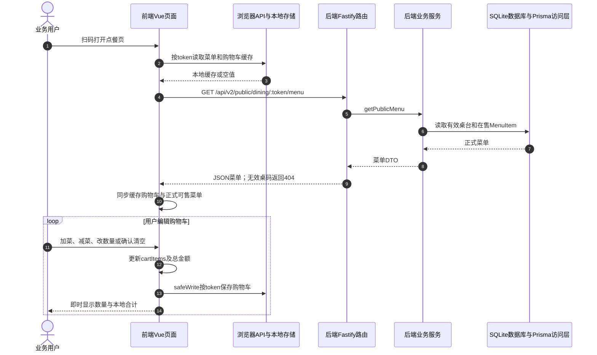

# ⑨ 扫码点餐与堂食订单 / 04 购物车编辑与本地恢复

**实现状态：已实现** · 核对日期：2026-10-27

以下两图依据当前源码；仅对已存在链路作实现描述。尚未实现的范围在边界中说明。

## 业务范围与数据契约

| 项目 | 说明 |
| --- | --- |
| 入口与触发 | 手机顾客点餐页加减数量、清空购物车 |
| 状态 | 已实现 |
| 接口与关键入参 | 菜单加载接口为前置；购物车编辑不发后端请求 |
| 主要调用 | 前端cartItems / safeRead / safeWrite |
| 读取或写入数据 | DiningTable对应菜单；浏览器按token隔离的localStorage购物车缓存 |
| 核心处理 | 基于当前菜单加减数量和本地合计，刷新菜单时同步可售项；清空有二次点击确认 |
| 响应与数据去向 | 本地购物车与金额 |

## 业务流程图

## 时序图

## 规则、异常与完成边界

购物车是浏览器本地状态，没有服务端购物车表或保存API。浏览器存储失败被容错处理。

前端准备：读取当前门店及页面参数。

结果处理：watch深度保存购物车缓存，刷新页面恢复；下单成功清空购物车。

异常处理：参数校验、资源查询或业务处理失败；前端展示错误并允许重试。JSON、SSE和浏览器本地动作按各自协议反馈，失败不会凭空产生成功结果。

访问范围：顾客端凭有效桌台Token限定门店与桌台，不使用商户登录令牌。

## 源码与需求依据

- [backend/src/services/dining-service.ts:1](D:/餐小助/backend/src/services/dining-service.ts:1)
- [backend/src/routes/v2.ts:115](D:/餐小助/backend/src/routes/v2.ts:115)
- [front-pc/src/views/DiningOrdersView.vue:1](D:/餐小助/front-pc/src/views/DiningOrdersView.vue:1)
- [front-phone/src/views/DiningOrdersView.vue:1](D:/餐小助/front-phone/src/views/DiningOrdersView.vue:1)
- [front-phone/src/views/CustomerOrderView.vue:1](D:/餐小助/front-phone/src/views/CustomerOrderView.vue:1)

[返回模块与功能目录](../README.md)
